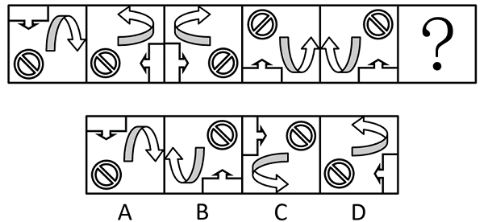
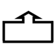
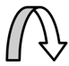
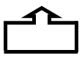
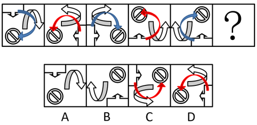

# 图形推理-位置规律（旋转+翻转交替循环）

考点：[[20-考点/判断推理/图形推理/图形推理-位置规律（旋转+翻转交替循环）|图形推理 / 图形推理-位置规律（旋转+翻转交替循环）]]

**问法模型**：五幅图元素组成相同求问号处图形 → 优先考虑位置规律，用'时针法定方向+变换循环归纳'两步锁定答案

## 推理链
1. 第1步：题干五图与选项均由相同三元素构成（弧形弯箭头、禁止符号圆、带小箭头的拐角块），元素组成相同，优先考虑位置规律而非样式规律。
2. 第2步：时针法——按'禁止圆→拐角块→弯箭头'的顺序连接三元素画时针，图1、图3、图5呈顺时针，图2、图4呈逆时针，顺逆交替出现，故？处应为逆时针，排除A、B两项。
3. 第3步：追踪弯箭头的长底边：图1→图3、图3→图5中长底边沿逆时针方向平移1条边，图2→图4中沿顺时针方向平移1条边，即平移方向按奇偶段交替，故图5→？应沿顺时针方向平移1条边。
4. 第4步：逐项对照：C项三元素时针方向为逆时针且长底边位置符合顺时针平移1条边；D项虽时针方向为逆时针但底边位置不符，排除D、锁定C。
5. 第5步：交叉验证（解法二/三）：图1→图2为'左右翻转+顺时针旋转'，图2→图3仅'左右翻转'，图3→图4为'左右翻转+顺时针旋转'，图4→图5仅'左右翻转'，奇数步含旋转、偶数步仅翻转，对图5再施加'左右翻转+顺时针旋转'同样唯一得到C。

**最快解法**：⚡ 变换循环法：发现变换按'翻转+旋转'与'仅翻转'逐项交替（奇数步含旋转、偶数步仅翻转），直接对图5施加'左右翻转+顺时针旋转'一步锁定C；若不确定，先用时针法定顺逆时针排除A、B，再比对长底边平移方向。

## 易错点
- ⚠ 只盯单一元素的旋转角度，忽略'翻转'参与变换，误以为图形无规律而乱选
- ⚠ 跳过时针法整体定向这一步，未先排除A、B就直接比对细节，速度慢且易错
- ⚠ 忽略弯箭头长底边平移方向奇偶交替（逆时针段与顺时针段轮换），在C、D之间误选D

## 母题抽象
> 🧩 当一组图形'元素组成相同但每幅姿态不同'时，用'时针法（三元素相对位置定顺逆时针）+变换循环（旋转/翻转按奇偶步交替）'：先排除时针方向不符的选项，再以某一特征边或箭头的平移/旋转验证唯一答案。

**同类特征**：元素组成相同、每幅含固定三小元素（弯箭头/禁止圆/拐角块）、图形整体姿态逐幅变化、顺逆时针交替出现、翻转与旋转按奇偶步循环

## 相关题
- [[10-真题/判断推理/图形推理/2172768 位置规律（旋转-翻转）|2172768]]（海南 2021，相关度1）
- [[10-真题/判断推理/图形推理/10204458 位置规律-平移（特征交点沿内圈循环平移）|10204458]]（甘肃 2024，相关度1）
- [[10-真题/判断推理/图形推理/10297399 位置规律—平移（多黑块分组循环平移）|10297399]]（四川 2025，相关度1）
- [[10-真题/判断推理/图形推理/11226892 位置规律-九宫格小元素沿固定循环链移动|11226892]]（上海 2025，相关度1）
- [[10-真题/判断推理/图形推理/11226904 位置规律-时针方向（旋转-翻转之外的方向判定）|11226904]]（上海 2025，相关度1）

---

### 题干

从所给四个选项中，选择最合适的一个填入问号处，使之呈现一定的规律性：

### 选项
- A. A
- B. B
- C. C　✅
- D. D

### 官方解析

解法一：

元素组成相同，优先考虑位置规律。根据三个图形的相对位置，可利用时针法，从至再到画时针，如下图所示，依次是顺时针、逆时针交替出现，因此？处应该是逆时针，排除A、B两项。继续观察发现，题干中的的长底边，在图1至图3、以及图3至图5中，依次沿逆时针方向平移1条边，而图2至图4中其底边沿顺时针方向平移1条边，故图4至？处也应沿顺时针方向平移1条边，只有C项符合规律。

故正确答案为C。

解法二：

元素组成相同，优先考虑位置规律。观察发现，图1经过左右翻转并顺时针旋转后得到图2，图2经过左右翻转后得到图3，图3经过左右翻转并顺时针旋转后得到图4，图4经过左右翻转后得到图5，故？处图形应为图5经过左右翻转并顺时针旋转后得到，只有C项符合规律。

故正确答案为C。

解法三：

元素组成相同，优先考虑位置规律。观察发现，图1经过顺时针旋转并上下翻转后得到图2，图2经过左右翻转后得到图3，图3经过顺时针旋转并上下翻转后得到图4，图4经过左右翻转后得到图5，故？处图形应为图5经过顺时针旋转并上下翻转后得到，只有C项符合规律。

故正确答案为C。

### 给定材料
（无）
