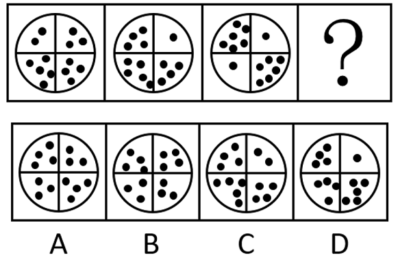

# 数量规律-小黑球个数（总数恒定+对角线奇偶分布）

考点：[[20-考点/判断推理/图形推理/数量规律-小黑球个数（总数恒定+对角线奇偶分布）|图形推理 / 数量规律-小黑球个数（总数恒定+对角线奇偶分布）]]

**问法模型**：『选择最合适的一个填入问号处，使之呈现一定的规律性』→ 图形结构相同、仅小元素数量不同时，按『先数总数→再看分区数量分布（奇偶/相等/递变）』的数量规律排除模型逐项筛查

## 推理链
1. 第1步：题干三幅图外形完全一致，均为圆被十字线分成四个格子，格内散布数量不等的小黑球，优先考虑小黑球个数的数量规律
2. 第2步：先数每幅图小黑球总数，发现题干图形中的小黑球数量均为14，故问号处图形总数也应为14，据此排除C项
3. 第3步：总数相同的图形不止一个，继续看二级规律——按官方解析，左下到右上的对角线两格小黑球数量均为奇数，右下到左上的对角线两格均为偶数，即对角线上两格奇偶性相同
4. 第4步：逐项对照：A项对角线两格满足『左下-右上全奇、右下-左上全偶』的奇偶分布
5. 第5步：B、D项虽然总数可能为14，但对角线两格的奇偶性不满足上述分布，排除B、D，锁定A

**最快解法**：⚡ 数量规律两步排除法：第一步数小黑球总数，题干均为14，排除C；第二步看对角线奇偶（左下-右上两格全为奇数、右下-左上两格全为偶数），只有A满足，直接选A

## 易错点
- ⚠ 只数到『总数均为14』这一级规律，发现排除C后无以为继，随机选了总数为14但分布不符的B或D
- ⚠ 对角线方向看反：把『左下-右上』『右下-左上』混成同一对角线，或错看为『左上-右下』，导致奇偶分布对不上
- ⚠ 缺乏『总数相同时继续看分区数量奇偶分布』的二级辨析意识，停留在一层规律就下结论

## 母题抽象
> 🧩 当题干图形外形结构完全相同、仅内部小元素（小球/小点）数量不同时，先数元素总数是否恒定，若多图总数相同，再验证分区（如对角线、象限）数量的奇偶性、相等或递变等分布规律

**同类特征**：图形外形完全相同（圆被十字分为四格）、格内小黑球个数各不相同、小黑球总数恒定（均为14）、数量无明显递变规律、存在对角线两两对应的位置关系、奇偶性作为二级数量规律

## 相关题
（暂无）

---

### 题干

从所给四个选项中，选择最合适的一个填入问号处，使之呈现一定的规律性：

### 选项
- A. A　✅
- B. B
- C. C
- D. D

### 官方解析
题干图形均由四个格子构成，且不同格子内有一定数量的小黑球，考虑小黑球的个数，观察发现，题干图形中的小黑球数量均为14，排除C项；继续观察每个格子中的小黑球数量发现，题干图形对角线上小黑球数量的奇偶性相同，即从左下到右上的对角线上小黑球数量均为奇数，从右下到左上的对角线上小黑球数量均为偶数，只有A项符合。
故正确答案为A。

### 给定材料
（无）
