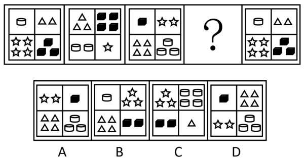

# 位置规律与数量规律综合（小元素逆时针平移1格＋数量依次加1、到4循环）

考点：[[20-考点/判断推理/图形推理/位置规律与数量规律综合（小元素逆时针平移1格＋数量依次加1、到4循环）|图形推理 / 位置规律与数量规律综合（小元素逆时针平移1格＋数量依次加1、到4循环）]]

**问法模型**：题干为五幅2×2四宫格小元素图（第4幅为问号），每种小元素位置和个数都在变 → 拆成'位置怎么移'和'数量怎么变'两条叠加规律：先跟踪一种元素定移动方向，再用数量递增循环验证选项

## 推理链
1. 第1步：题干每幅图均由圆柱、三角形、五角星、黑色方块4种小元素分布在2×2宫格四个区域，种类不变但位置、个数逐图变化，故从'位置+数量'双规律入手
2. 第2步：单跟踪'圆柱'定位置规律：图1左上1个→图2左下2个→图3右下3个，得出每种元素每次沿'左上→左下→右下→右上'逆时针平移1格
3. 第3步：再定数量规律：同一元素数量逐图加1，且加到4后从1重新循环（图2右上黑方块4个、图3左上黑方块1个即体现'4→1'循环）
4. 第4步：据此推图4（问号处）：五角星（图3右上2个→逆时针到左上、数量3），圆柱（图3右下3个→右上、数量4），黑方块（图3左上1个→左下、数量2），三角形（图3左下4个→右下、数量1）
5. 第5步：验证周期：位置4步回原位、数量1→2→3→4循环，故第5幅图应与第1幅图完全相同，与题干首尾图一致，规律自洽
6. 第6步：对照选项：只有C项为'左上3个五角星、右上4个圆柱、左下2个黑方块、右下1个三角形'，完全吻合，当选

**最快解法**：⚡ 单元素追踪法+数量口诀：只盯'圆柱'一条线——左上1个→左下2个→右下3个，立刻得出问号处圆柱应移到右上且为4个；再按'逆时针移1格+数量加1（到4回1）'排其余元素，对照'3星、4圆柱、2方块、1三角'的组合直选C

## 易错点
- ⚠ 只看位置移动或只数数量，单一规律无法排除全部干扰项，必须位置+数量双规律叠加验证
- ⚠ 忽略'到4之后从1重新循环'，误以为数量一直递增；黑方块图2为4个、图3变1个正是循环的体现
- ⚠ 数量是绑定元素本身的、随元素一起逆时针移动，若按固定格子记数量（如认为左上格永远1个）会全盘推错

## 母题抽象
> 🧩 当一组图形由固定的几种小元素组成、元素在宫格间逐图换位时，先选一种元素跟踪出'移动方向与步长'，再看其数量得出'递变规则（加1/减1/到几循环）'，两规律叠加后逐一对照选项数量与位置

**同类特征**：2×2四宫格、4种小元素种类固定、元素逐图逆时针平移1格、每种元素数量逐图加1、到4循环回1、首尾两幅图相同（周期为4）、问号居序列中部第4位

## 相关题
- [[10-真题/判断推理/图形推理/5509938 数量规律-元素数量（灰色小方块个数的交替周期）|5509938]]（甘肃 2023，相关度1）

---

### 题干

从所给四个选项中，选择最合适的一个填入问号处，使之呈现一定的规律性：

### 选项
- A. A
- B. B
- C. C　✅
- D. D

### 官方解析
观察发现，题干图形均由4种小元素组成，故考虑元素的位置规律。继续观察发现，题干每种元素依次逆时针平移1格的同时数量增加1个，到数量为4的时候从1开始循环，只有C项符合。 
故正确答案为C。

### 给定材料
（无）
