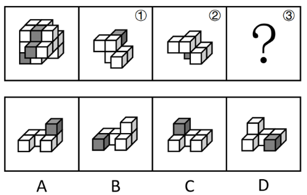
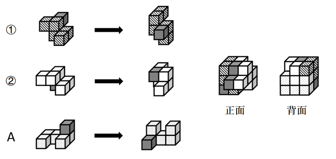

# 立体拼合（多面体组合：数量守恒+凹凸互补+旋转）

考点：[[20-考点/判断推理/图形推理/立体拼合（多面体组合：数量守恒+凹凸互补+旋转）|图形推理 / 立体拼合（多面体组合：数量守恒+凹凸互补+旋转）]]

**问法模型**：已知整体多面体与其中两块零件①②，求第三块（可旋转）→ 采用“数量守恒锁定+凹凸互补挖空+旋转比对”的立体拼合模型

## 推理链
1. 第1步：题干整体由15个白色+3个灰色正方体共18块组成，图中可见灰色块分布在顶层及前排等处，即拼成后灰色块位置固定
2. 第2步：数零件①与②：①约6块且顶部含1个灰色块，②约6块且含1个灰色小块，两块合计约12块、含2个灰色块
3. 第3步：由块数与颜色守恒，③应约6个小正方体且恰含1个灰色块，四个选项数量均相符，须进入形状比对
4. 第4步：用凹凸互补法：把①、②按其凸出与凹陷方向从整体中“拔出”，剩余空腔的轮廓即为③的形状（允许三维旋转）
5. 第5步：将A项旋转后，其凸起部分与①②留下的凹陷一一咬合，且其灰色块恰好落到整体中第三处灰色位置
6. 第6步：B、C、D无论怎样旋转，灰色块落点或凹凸朝向均与剩余空腔不吻合，逐一排除
7. 第7步：只有A旋转后能与①、②完整拼合为题干多面体，与官方解析“①、②以及A项旋转后拼合”一致，故选A

**最快解法**：⚡ 数量守恒+凹凸互补法：先用18=①+②+③数出③的块数与灰色块个数做粗筛；再把①②从整体中“挖去”，以剩余空腔为模板与选项逐一旋转比对，仅A能凹凸咬合且灰色块归位。

## 易错点
- ⚠ 误认为零件只能按图中姿态平移、不能三维旋转，从而错选与①②姿态“顺眼”的选项
- ⚠ 只做小正方体计数，发现四个选项数量相同后不知用凹凸形状与灰色落点做二次排除
- ⚠ 只比对整体轮廓、忽略灰色正方体的位置对应，导致拼合后颜色对不上

## 母题抽象
> 🧩 当题干出现“整体由几个多面体零件拼合、求缺失一块”的特征时，先按小正方体总数与灰色（特征）块数做守恒锁定，再将已给零件从整体中“挖去”，把剩余空腔与选项逐一旋转比对凹凸咬合与颜色落点。

**同类特征**：立体拼合、15白3灰共18个小正方体、三个多面体组合（①②③）、求问号处第三块、选项可旋转比对、灰色块位置需一一对应

## 相关题
- [[10-真题/判断推理/图形推理/2776149 图形推理-立体拼合（小方块计数守恒+分层形状咬合）|2776149]]（浙江 2021，相关度1）
- [[10-真题/判断推理/图形推理/12019797 立体拼合-由两视图及全等小块反推小立体（数小立方体+旋转试装）|12019797]]（浙江 2026，相关度1）
- [[10-真题/判断推理/图形推理/12536475 图形推理-立体拼合（正方体堆叠多面体组合）|12536475]]（四川 2024，相关度1）
- [[10-真题/判断推理/图形推理/12881949 立体拼合-多块拼合正方体（凹凸互补+旋转）|12881949]]（广东 2025，相关度1）
- [[10-真题/判断推理/图形推理/13504321 立体拼合-多面体组合（选非题）|13504321]]（云南 2025，相关度1）

---

### 题干

下图为15个白色和3个灰色正方体组合而成的多面体，其可以由①、②和③三个多面体组合而成，问能填入问号处的是：

### 选项
- A. A　✅
- B. B
- C. C
- D. D

### 官方解析

本题考查立体拼合。题干立体图形可以由①、②以及A项旋转后拼合而成，具体过程如下图所示：

故正确答案为A。

### 给定材料
（无）
