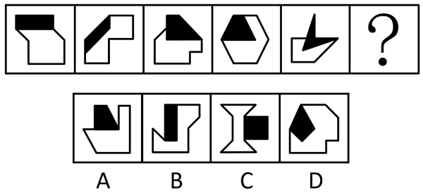
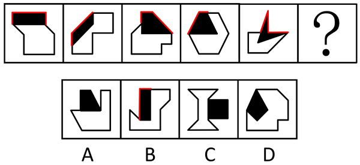

# 图形间关系-相交图形中不相交边数量（黑白图形相交）

考点：[[20-考点/判断推理/图形推理/图形间关系-相交图形中不相交边数量（黑白图形相交）|图形推理 / 图形间关系-相交图形中不相交边数量（黑白图形相交）]]

**问法模型**：一列图形依次排布求问号处图形 → 观察每幅图共同的空间/数量特征，找出规律并延续到下一项

## 推理链
1. 第1步：题干5幅图元素组成不同，但每幅图均由黑色图形与白色图形相交构成，考虑图形间关系
2. 第2步：聚焦黑色图形，发现其中存在与白色图形不相交（不共边）的边，改用数量规律验证
3. 第3步：依次计数黑色图形中与白色图形不相交的边数：第1幅=3、第2幅=2、第3幅=3、第4幅=2、第5幅=3，呈3、2、3、2、3的交替规律
4. 第4步：由规律推知问号处应为黑色图形有2条边与白色图形不相交
5. 第5步：逐项对照，A、C、D的不相交边数均不是2，只有B项黑色图形恰有2条边与白色图形不相交，符合规律

**最快解法**：⚡ 数边法+交替规律口诀：只数黑色图形中不与白色图形接触的边数，得3、2、3、2、3，问号处需2条，直接锁定B

## 易错点
- ⚠ 误数白色图形或整体外轮廓的边数，而非黑色图形中与白色不相交的边
- ⚠ 把'相交'的判定搞反，数成了相交边/公共边的数量
- ⚠ 忽略3、2交替规律，以为问号应延续前一幅的3，错选有3条不相交边的选项

## 母题抽象
> 🧩 当每幅图均由黑白两个图形相交组成且元素组成不同时，优先数黑色（或白色）图形中与另一图形不相交的边数，验证是否呈常数或交替规律

**同类特征**：黑白两图形相交、元素组成不同、黑图形有部分边不与白图形接触、数量呈3、2交替、图形间关系类考点

## 相关题
- [[10-真题/判断推理/图形推理/10204454 数量规律-部分数（黑白球连通区域数做和）|10204454]]（甘肃 2024，相关度1）
- [[10-真题/判断推理/图形推理/10204604 数量规律-线数量（汉字横线数）|10204604]]（辽宁 2024，相关度1）
- [[10-真题/判断推理/图形推理/10297050 数量规律-特殊计数（线条穿过小白球的数量）|10297050]]（天津 2025，相关度1）
- [[10-真题/判断推理/图形推理/10297148 数量规律-线的细化（端点连线穿过线条数；备选：平行线组数）|10297148]]（天津 2025，相关度1）
- [[10-真题/判断推理/图形推理/10297248 图形间关系-相交于面（相交面形状）|10297248]]（浙江 2025，相关度1）

---

### 题干

从所给的四个选项中，选择最合适的一个填入问号处，使之呈现一定的规律性：

### 选项
- A. A
- B. B　✅
- C. C
- D. D

### 官方解析

元素组成不同，且每幅图形均有黑白两个图形相交，考虑图形间关系。观察发现，题干黑色图形中均存在与白色图形不相交的边，数量分别为3、2、3、2、3，如下图所示，故？处应选择一个黑色图形与白色图形有2条边不相交的图形，只有B项符合。

故正确答案为B。

### 给定材料
（无）
