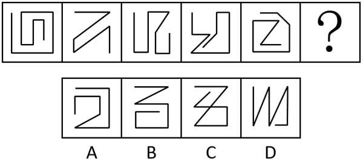
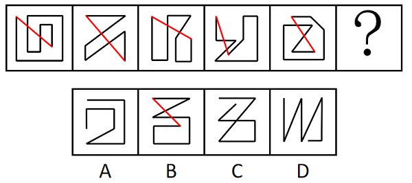
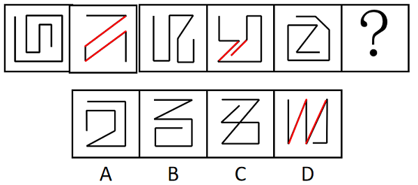

# 数量规律-线的细化（端点连线穿过线条数；备选：平行线组数）

考点：[[20-考点/判断推理/图形推理/数量规律-线的细化（端点连线穿过线条数；备选：平行线组数）|图形推理 / 数量规律-线的细化（端点连线穿过线条数；备选：平行线组数）]]

**问法模型**：常规问法'选择最合适的一个填入问号处使之呈现一定的规律性'+元素组成不同 → 属性规律无唯一解时进入数量规律，整体数线无规律则做'线的细化'验证（端点连线/平行线），整体性规律优先于间隔规律

## 推理链
1. 第1步：题干五幅图元素组成不同，先查属性规律（对称、曲直、开闭），无法选出唯一答案，转入数量规律
2. 第2步：所有图形均由直线构成，但整体数直线总数无明显常数或递变规律，需进一步做'线的细化'观察
3. 第3步：发现每幅图均为一条两端外露的连续折线，将线条的两个端点相连，其连线均恰好穿过两条线，五幅图全部满足该整体规律
4. 第4步：备选思路——题干出现较多平行线，斜向平行线组数依次为0、1、0、1、0，间隔规律指向D项，但间隔规律仅覆盖部分图形，弱于贯穿全组的整体规律
5. 第5步：逐项检验端点连线穿过线条数：仅B项的端点连线穿过两条线，A、C、D均不满足
6. 第6步：依据'所有题干图形均满足的整体性规律优先'，问号处选B，与官方答案一致

**最快解法**：⚡ 端点连线法：快速找出每幅折线图形的两个外露端点并画连线，数连线穿过几条线——题干五图均穿过2条；对照选项只有B的端点连线穿过2条线，直接锁定B

## 易错点
- ⚠ 被'斜向平行线组数0、1、0、1、0'的间隔规律带偏而误选D，忽略间隔规律优先级低于整体规律
- ⚠ 只数直线总数或交点数，未发现'端点连线穿过两条线'这一细化规律
- ⚠ 未识别每幅图实为一条两端外露的单条连续折线，误当作多笔画或封闭图形处理

## 母题抽象
> 🧩 当题干为一组元素不同、全由直线构成且整体数线无规律的端点外露连续折线图时，用'两端点连线数穿过线条数'的整体规律验证选项；若同时存在间隔性规律（如平行线组数交替），整体性规律优先于间隔规律

**同类特征**：元素组成不同、均由直线构成、单条端点外露的连续折线、整体数直线无规律、出现较多平行线（干扰规律）、问'呈现一定的规律性'

## 相关题
- [[10-真题/判断推理/图形推理/5832459 数量规律-平行线组数|5832459]]（浙江 2021，相关度2）
- [[10-真题/判断推理/图形推理/10204454 数量规律-部分数（黑白球连通区域数做和）|10204454]]（甘肃 2024，相关度1）
- [[10-真题/判断推理/图形推理/10204604 数量规律-线数量（汉字横线数）|10204604]]（辽宁 2024，相关度1）
- [[10-真题/判断推理/图形推理/10297050 数量规律-特殊计数（线条穿过小白球的数量）|10297050]]（天津 2025，相关度1）
- [[10-真题/判断推理/图形推理/10297127 图形间关系-相交图形中不相交边数量（黑白图形相交）|10297127]]（天津 2025，相关度1）

---

### 题干

从所给的四个选项中，选择最合适的一个填入问号处使之呈现一定的规律性：

### 选项
- A. A
- B. B　✅
- C. C
- D. D

### 官方解析

思路一：元素组成不同，且属性规律无法选出唯一答案，考虑数量规律。观察发现，题干图形均由直线构成，但整体数直线并无规律。继续观察发现，题干图形线条的端点相连均穿过两条线，如下图所示，故？处的图形端点连线应穿过两条线，只有B项符合。

故正确答案为B。

思路二：元素组成不同，且属性规律无法选出唯一答案，考虑数量规律。观察发现，题干图形均由直线构成，但整体数直线并无规律，考虑直线的细化考点。再次观察发现，题干图形出现较多平行线，考虑平行线，其中斜向平行线的组数分别为0、1、0、1、0，如下图所示，故？处的图形斜向平行线组数应为1，只有D项符合。

故正确答案为D。

注：观察图形规律时，优先观察整体性规律，思路一的题干中所有的图形均满足端点相连穿过两条线，而思路二的规律是平行线的组数间隔出现，故粉笔更倾向于思路一。

### 给定材料
（无）

<!-- CODEX-ANSWER-REVIEW:BEGIN -->
### 本次独立复核

**复核状态：** `resolved`（答案与解析已核定）

**计分答案：** B（可计分）

**复核解析：**

固定题图已知图形的端点连线均穿过两条图形线；逐一检查选项，B也穿过两条，满足修订规则。原解析另按平行线组数会导向D，题面没有指定维度，因此本修订明确采用端点连线穿越线条数规则。

**修订题干：**

【编辑修订】只按每幅图中“连接线段两端点的直线穿过几条图形线”判断，选择该数量与题干已知图形相同的选项。

**相关信息：**

图形推理—线的细化计数；区分端点连线与题图内部线，逐条统计相交穿过次数。

**题源依据：** [固定版本原题](https://github.com/Mentat-Uran/kaogongzhentizhengliu/blob/84ab93d4b64b61d897bece8a1c0a5bab06b4feb2/10-%E7%9C%9F%E9%A2%98/%E5%88%A4%E6%96%AD%E6%8E%A8%E7%90%86/%E5%9B%BE%E5%BD%A2%E6%8E%A8%E7%90%86/10297148%20%E6%95%B0%E9%87%8F%E8%A7%84%E5%BE%8B-%E7%BA%BF%E7%9A%84%E7%BB%86%E5%8C%96%EF%BC%88%E7%AB%AF%E7%82%B9%E8%BF%9E%E7%BA%BF%E7%A9%BF%E8%BF%87%E7%BA%BF%E6%9D%A1%E6%95%B0%EF%BC%9B%E5%A4%87%E9%80%89%EF%BC%9A%E5%B9%B3%E8%A1%8C%E7%BA%BF%E7%BB%84%E6%95%B0%EF%BC%89.md)；固定内容 commit `84ab93d4b64b61d897bece8a1c0a5bab06b4feb2`，Markdown blob `2c96aca1e510b6740b2449862a0a4187e807184d`。
<!-- CODEX-ANSWER-REVIEW:END -->
