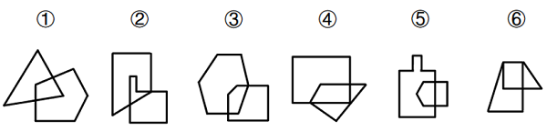

# 图形间关系-相交于面（相交面形状）

考点：[[20-考点/判断推理/图形推理/图形间关系-相交于面（相交面形状）|图形推理 / 图形间关系-相交于面（相交面形状）]]

**问法模型**：六个图形分成两类 → 找两两分组的共同规律，两图相交时优先观察相交（重叠）面的形状特征

## 推理链
1. 第1步：六个图形元素组成不同，且每幅图均由两个封闭图形相交而成 → 考虑图形间关系
2. 第2步：题干六图均为'相交于面'，故聚焦相交面（两图重叠的封闭区域），比较其形状
3. 第3步：逐一辨认图①④⑥的重叠区域，其相交面均为四边形（四条边）
4. 第4步：逐一辨认图②③⑤的重叠区域，其相交面均为五边形（五条边）
5. 第5步：按相交面边数分组：①④⑥为一组，②③⑤为一组，对照选项得C

**最快解法**：⚡ 相交面数边法：只盯两图形重叠部分的封闭区域，数其边数——①④⑥相交面为4边形、②③⑤相交面为5边形，直接锁定C

## 易错点
- ⚠ 把相交面形状误看成单个图形自身的形状，只数某一个图形的边数导致分组错乱
- ⚠ 数相交面边数时漏数被另一图形遮挡的边，五边形误当四边形
- ⚠ 受外轮廓或直观相似度干扰，忽略'相交于面后看相交面形状'这一细化考点

## 母题抽象
> 🧩 当题干六图均为两个封闭图形'相交于面'时，优先观察相交面（重叠区域）的形状或边数，按边数奇偶/多少分类分组

**同类特征**：两图相交、相交于面、相交面形状、边数差异、元素组成不同、两两分组

## 相关题
- [[10-真题/判断推理/图形推理/2444709 图形推理-图形间关系（两图相交，相交面的形状）|2444709]]（四川 2019，相关度2）
- [[10-真题/判断推理/图形推理/10204454 数量规律-部分数（黑白球连通区域数做和）|10204454]]（甘肃 2024，相关度1）
- [[10-真题/判断推理/图形推理/10204604 数量规律-线数量（汉字横线数）|10204604]]（辽宁 2024，相关度1）
- [[10-真题/判断推理/图形推理/10297050 数量规律-特殊计数（线条穿过小白球的数量）|10297050]]（天津 2025，相关度1）
- [[10-真题/判断推理/图形推理/10297127 图形间关系-相交图形中不相交边数量（黑白图形相交）|10297127]]（天津 2025，相关度1）

---

### 题干

把下面的六个图形分为两类，使每一类图形都有各自的共同特征或规律，分类正确的一项是：

### 选项
- A. ①②③，④⑤⑥
- B. ①②⑥，③④⑤
- C. ①④⑥，②③⑤　✅
- D. ①⑤⑥，②③④

### 官方解析
元素组成不同，且每幅图均为两个封闭图形相交而成，考虑图形间关系。观察发现，题干图形均相交于面，考虑相交面的形状。图①④⑥相交面为四边形，图②③⑤相交面为五边形，即图①④⑥为一组，图②③⑤为一组。
故正确答案为C。

### 给定材料
（无）
