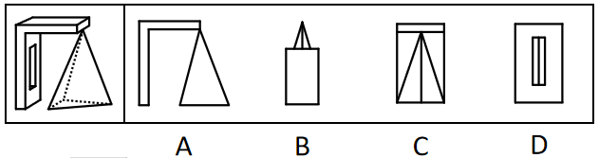
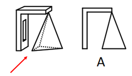
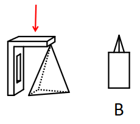
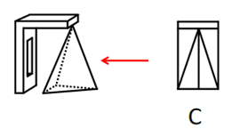
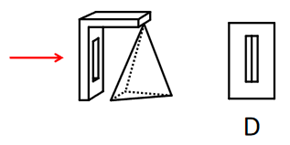

# 三视图（立体组合体视图辨析·选非）

考点：[[20-考点/判断推理/图形推理/三视图（立体组合体视图辨析·选非）|图形推理 / 三视图（立体组合体视图辨析·选非）]]

**问法模型**：『哪一个不可能是其视图』（选非题）→ 按各选项箭头还原观察方向，逐一与主/俯/左/右视图比对，锁定投影不符项

## 推理链
1. 第1步：拆解题干组合体：左侧带矩形孔的竖板（挖孔长方体）、顶部横板（实心长方体）、右下悬挂的四面体（题干图中虚线为被遮挡的棱）
2. 第2步：运用三视图规则：从前往后为主视图、从上往下为俯视图、从右往左/从左往右为左右视图，可见轮廓与棱画实线，比对轮廓形状及内部棱线
3. 第3步：A项按箭头从前往后看：竖板与孔的轮廓、顶部横板、四面体的三角形投影组合正与A图吻合，是主视图，排除
4. 第4步：B项按箭头从上往下看：横板呈顶部横条、竖板呈左侧竖条、四面体投影为带中线的三角形，与B图吻合，是俯视图，排除
5. 第5步：C项按箭头从右往左看：横板呈顶部横条、四面体投影为三角形且中间有可见棱线，与C图吻合，是右视图，排除
6. 第6步：D项按箭头应从左往右观察，真实左视图中四面体投影所成的中间四边形内部不存在竖线，而D图中间四边形内部画有竖线（内含小长方形），与实际投影不符，故D不可能是该多面体的视图，当选

**最快解法**：⚡ 方向还原法+排除法：按选项箭头逐一还原'前→A、上→B、右→C'三个方向直接排除，剩下D从左往右核对——中间四边形内部本应无竖线而D画了竖线，选D

## 易错点
- ⚠ 忽略本题为选非题，误选三个能对应视图的选项
- ⚠ 混淆左视图与右视图：从左往右与从右往左观察的投影轮廓相近但内部棱线不同
- ⚠ 只比对外轮廓不查内部线条：D项外框与左视图相似，破绽在中间四边形内部多出的竖线

## 母题抽象
> 🧩 当题干给出立体组合体并问'哪个是/不是其视图'时，先拆分组成几何体，再按各选项箭头还原观察方向逐一比对，外轮廓吻合时须进一步核对内部棱线有无，线条对不上者即答案（选非题锁定不符项）

**同类特征**：实心长方体+挖孔长方体+四面体组合体、问'不可能是其视图'、选项带观察方向箭头、考查三视图、需辨析内部棱线（竖线）有无、选非题

## 相关题
- [[10-真题/资料分析/综合/250219 综合分析选非题（图表数据可推断性判断）|250219]]（深圳市考 2008，相关度1）
- [[10-真题/资料分析/综合/10297333 综合分析选非题（同比增速逐年比较+年均增长量+比重百分点还原）|10297333]]（浙江 2025，相关度1）
- [[10-真题/资料分析/综合/14355349 综合分析-选非题（增长率计算比较+人均值计算）|14355349]]（浙江 2024，相关度1）
- [[10-真题/资料分析/综合/17097816 综合判断·选非题（增长率与增长量偷换）|17097816]]（山西 2024，相关度1）
- [[10-真题/资料分析/综合/2052088 综合分析-选非题（趋势判断+增速排序+增长量比较+增长率计算逐项核对）|2052088]]（吉林 2017，相关度1）

---

### 题干

左图为一个实心长方体、一个挖孔长方体和一个四面体组合成的多面体，问下列哪一个不可能是其视图？

### 选项
- A. A
- B. B
- C. C
- D. D　✅

### 官方解析

本题考查三视图。

如下图所示：

A项按照箭头所指示方向，可从正面观察，为题干多面体的主视图，排除；

B项按照箭头所指示方向，可从上往下观察，为题干多面体的俯视图，排除；

C项按照箭头所指示方向，可从右往左观察，为题干多面体的右视图，排除；

D项按照箭头所指示方向，应是从左往右观察题干所得图形，最中间四边形内部不存在竖线，不可能为题干多面体的视图，当选。

本题为选非题，故正确答案为D。

### 给定材料
（无）
