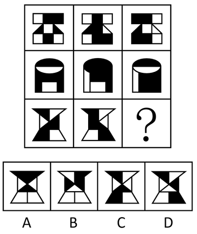

# 样式规律-黑白运算

考点：[[20-考点/判断推理/图形推理/样式规律-黑白运算|图形推理 / 样式规律-黑白运算]]

**问法模型**：'选择最合适的一个填入问号处，使之呈现一定的规律性'＋九宫格且图形均由黑白块构成 → 优先横向逐位置做黑白运算：先从第一行归纳叠加规则，再验证、后应用

## 推理链
1. 第1步：九宫格中各图元素组成相似，均由黑块和白块构成，优先考虑样式规律中的黑白运算
2. 第2步：九宫格优先横向看，将第一行图1与图2对应位置逐一叠加，归纳出本题运算规则：白+白=黑、黑+黑=黑、黑+白=白、白+黑=白，即'同色得黑、异色得白'
3. 第3步：将此规则代入第二行图1与图2逐位置叠加，结果与第二行图3完全吻合，验证规律成立
4. 第4步：第三行应用规则：对第三行图1与图2对应位置逐一运算，同色位置变黑、异色位置变白，得到问号处图形应有的黑白分布
5. 第5步：对照选项逐位置核验：A项黑白分布与运算结果一致，B、C、D项在顶部、中部及底部多处位置的黑白与运算结果相反或错位，排除

**最快解法**：⚡ 黑白运算法＋口诀'同色得黑、异色得白'：九宫格横看，先从第一行图1、图2叠出规则，只需再运算第三行几个最易分辨的位置（如最上方、最下方区域），即可排除三项锁定A

## 易错点
- ⚠ 思维定势：默认'黑+白=黑'等常见黑白运算规则，未从第一行逐格归纳出本题特有的'同色得黑、异色得白'
- ⚠ 观察顺序错误：未优先横向看，误从纵列或整体特征找规律
- ⚠ 只运算一两个位置就定答案，未多处核验，在B、C、D之间误选

## 母题抽象
> 🧩 当九宫格图形均由黑白块（或阴影与空白）构成且元素组成相似时，优先横看做黑白运算：先由第一行归纳叠加规则，用第二行验证，再应用于第三行对照选项排除

**同类特征**：九宫格、元素组成相似、均由黑块和白块构成、问号位于第三行末尾、黑白运算、同色得黑、异色得白

## 相关题
- [[10-真题/判断推理/图形推理/3018853 样式规律-黑白运算|3018853]]（广东 2021，相关度3）
- [[10-真题/判断推理/图形推理/5660586 图形推理-样式规律（黑白运算-定义叠加，含'点'三种元素）|5660586]]（上海 2020，相关度3）
- [[10-真题/判断推理/图形推理/10204610 样式规律-加减同异（去同存异），九宫格列规律|10204610]]（辽宁 2024，相关度2）
- [[10-真题/判断推理/图形推理/10297407 样式规律-黑白运算（定义叠加）|10297407]]（四川 2025，相关度2）
- [[10-真题/判断推理/图形推理/12019768 样式规律-加减同异（求同）与位置旋转的复合规律|12019768]]（浙江 2026，相关度2）

---

### 题干

从所给的四个选项中，选择最合适的一个填入问号处，使之呈现一定的规律性。

### 选项
- A. A　✅
- B. B
- C. C
- D. D

### 官方解析
图形元素组成相似，优先考虑样式规律。观察发现，题干图形均由黑块和白块构成，考虑黑白运算。九宫格优先横向看，第一行图形的黑白运算规律为：白+白=黑，黑+黑=黑，黑+白=白，白+黑=白；第二行图形经验证符合此规律；第三行图形应用此规律，只有A项符合。
故正确答案为A。

### 给定材料
（无）
