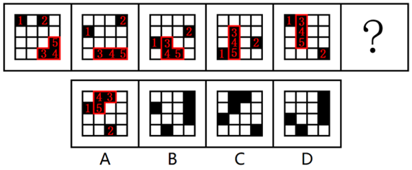

# 位置规律—平移（多黑块分组循环平移）

考点：[[20-考点/判断推理/图形推理/位置规律—平移（多黑块分组循环平移）|图形推理 / 位置规律—平移（多黑块分组循环平移）]]

**问法模型**：“元素组成相同、黑块位置逐图变化，选最合适图形续接规律” → 位置规律之平移：对黑块编号分组，分别追踪各自的移动路径、方向与步长，再比对选项。

## 推理链
1. 第1步：五幅已知图形元素组成相同（均为4×4宫格、5个黑块，仅位置变化），按解析“元素组成相同，优先考虑位置规律”切入。
2. 第2步：黑块多达5个，采用“编号分组追踪法”，把黑块拆成三条独立移动路径分别观察（对应解析“黑块位置发生变化，优先考虑平移”）。
3. 第3步：1号黑块沿所在列每图向下平移一格，到最底行后循环回到顶部，即“依次向下平移一格（到头时循环走）”。
4. 第4步：2号黑块沿4×4宫格最外圈顺时针方向每图平移一格，即“在外圈沿顺时针方向依次平移一格”。
5. 第5步：3号、4号、5号黑块被限定在去掉最左侧一列后的右侧3×4宫格区域内，沿顺时针方向每图依次平移一格。
6. 第6步：将三条路径同时各推进一格，推出问号处5个黑块应处的位置组合。
7. 第7步：逐项对照A/B/C/D，只有A项的5个黑块位置与三条移动规律同时吻合，其余选项至少有一条路径上的黑块错位，故选A。

**最快解法**：⚡ 分组追踪＋排除法：先锁定“循环下移”的1号黑块与“外圈顺时针”的2号黑块在问号处应在的位置，即可排除明显错位选项；再用右侧3×4区域内顺时针移动的3、4、5号黑块验证，唯一吻合者为A。

## 易错点
- ⚠ 5个黑块混在一起整体观察，未编号分组追踪，误判为黑白叠加或数量规律而出错
- ⚠ 忽略“到头时循环走”，误以为黑块到边界即停止或反向弹回，导致下一位置推错
- ⚠ 忽视3、4、5号黑块的移动范围被限定在右侧3×4宫格内，误按全图外圈规律处理而误选

## 母题抽象
> 🧩 当题干出现“相同宫格＋多个小元素（黑块）数量不变、仅位置逐图变化”的特征时，用“编号分组追踪法”，逐一验证每个（组）元素的移动路径、方向与步长，并注意“到头循环”的平移处理。

**同类特征**：4×4宫格、5个黑块且数量恒定、元素组成相同、黑块位置逐图变化、多条独立移动路径（列内循环/外圈/右侧区域）、循环平移

## 相关题
- [[10-真题/判断推理/图形推理/5797387 图形推理-位置规律（循环平移）|5797387]]（浙江 2023，相关度2）
- [[10-真题/判断推理/图形推理/2172768 位置规律（旋转-翻转）|2172768]]（海南 2021，相关度1）
- [[10-真题/判断推理/图形推理/10204458 位置规律-平移（特征交点沿内圈循环平移）|10204458]]（甘肃 2024，相关度1）
- [[10-真题/判断推理/图形推理/10204614 图形推理-位置规律（旋转+翻转交替循环）|10204614]]（黑龙江 2024，相关度1）
- [[10-真题/判断推理/图形推理/11226892 位置规律-九宫格小元素沿固定循环链移动|11226892]]（上海 2025，相关度1）

---

### 题干

从所给四个选项中，选择最合适的一个填入问号处，使之呈现一定规律性：

### 选项
- A. A　✅
- B. B
- C. C
- D. D

### 官方解析

元素组成相同，优先考虑位置规律。观察发现，黑块位置发生变化，优先考虑平移。如下图所示，1号黑块依次向下平移一格（到头时循环走），2号黑块在外圈沿顺时针方向依次平移一格，3号、4号、5号黑块在右侧3×4在最左侧一列宫格中，沿顺时针方向依次平移一格，只有A项符合。

故正确答案为A。

### 给定材料
（无）

> [!warning] 疑点（官方解析可能有误，待人工复核）
> 官方解析中“3号、4号、5号黑块在右侧3×4在最左侧一列宫格中”一句文字残缺、表述不清，合理理解应为“在去掉最左侧一列后的右侧3×4宫格区域内顺时针平移”；此为解析文字问题，不影响规律成立及答案A的正确性。
