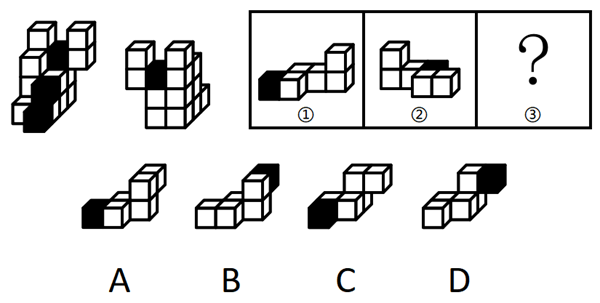

# 图形推理-立体拼合（正方体堆叠的拆分与重组）

考点：[[20-考点/判断推理/图形推理/图形推理-立体拼合（正方体堆叠的拆分与重组）|图形推理 / 图形推理-立体拼合（正方体堆叠的拆分与重组）]]

**问法模型**：已知整体多面体及组件①②，求问号处组件③→采用'数量守恒＋黑块定位＋凹凸互补旋转验证'三步逆推拼合模型

## 推理链
1. 第1步：整体计数——题干明确原图由'等大的15个白色正方体和3个黑色正方体'堆叠而成，共18块；黑色正方体是个天然的'定位标记'，正视图与后视图共同确定三个黑块的空间分布（正面可见的黑块在底层前部一角与中部，其余信息由后视图补足）。
2. 第2步：清点组件黑块——图中①左端含1个黑色正方体（其余为白色阶梯状白块），②中部嵌有1个黑色正方体（其余为白块）；①②各仅1黑，由黑块数量守恒，③必须恰好含1个黑色正方体——四个选项均为1黑，此步不能排除，须继续比对形状与黑块相对位置。
3. 第3步：定位③中黑块的相对位置——①的黑块在其低平端，②的黑块嵌在中部，原图中尚未被占据的第三个黑块位于较高一端的角部；③经空间旋转拼入后，其黑块应落在该高凸端顶部，故排除黑块处于低平端的A、C。
4. 第4步：凹凸互补比对B与D——立体拼合允许组件任意旋转，将B旋转后与其余空间试嵌：B底排白块的延伸走向与①②拼合后剩余空位的凹凸走向不咬合，出现重叠或缺空。
5. 第5步：验证D——将D适当旋转，其阶梯状白块与顶端黑块恰与①、②凹凸咬合，拼合后正面与背面均与题干正视图、后视图一致，块数合计回到18块（15白+3黑）。
6. 第6步：结论——问号处应填D，与官方答案一致。

**最快解法**：⚡ 黑块定位法＋凹凸互补排除法：先由①②各含1黑推出③必含1黑（四选项同，不排除）；再看黑块相对位置——原图第三个黑块在高凸端角部，B、D黑块在凸起顶端、A、C黑块在低平端，秒杀排除A、C；最后旋转嵌入验证，仅D与①②咬合无重叠，锁定D。

## 易错点
- ⚠ 只验证'每块含1个黑块'的数量守恒就草率作答，忽略黑块在组件中的相对位置（高凸端还是低平端），无法区分A/C与B/D
- ⚠ 误以为选项图形必须与拼入方向一致摆放；实际立体拼合中组件可任意旋转，D需旋转后才能嵌入，不能因'画向不同'而误排
- ⚠ A与C、B与D外形极为相近，仅白块阶梯走向或黑块位置有细微差异，需逐层逐块比对凹凸，粗看易选错

## 母题抽象
> 🧩 当立体拼合题的组件中出现黑色标记块时，先用'黑块数量守恒'确定待求组件的黑块个数，再用黑块在组件中的相对位置（高端/低端/中部嵌入）排除选项，最后对剩余项做凹凸互补＋旋转验证。

**同类特征**：立体拼合（正方体堆叠）、15白+3黑共18块、给出正视图和后视图、①②③三个组件拼合、黑色正方体作定位标记、问号处求第三个组件

## 相关题
- [[10-真题/判断推理/图形推理/2264364 立体拼合-小立方体计数（视图分排计数+体积守恒）|2264364]]（国考 2019，相关度1）
- [[10-真题/判断推理/图形推理/4818019 立体拼合（正方体堆叠多面体的拆分与重组）|4818019]]（四川 2022，相关度1）

---

### 题干

左图给定的是由等大的15个白色正方体和3个黑色正方体堆叠而成的多面体的正视图和后视图，该多面体可以由①、②和③三个多面体拼合而成，问以下哪一项能填入问号处？

### 选项
- A. A
- B. B
- C. C
- D. D　✅

### 官方解析

本题考查立体拼合。题干立体图形可以由①、②以及D项旋转拼合而成，如下图所示：

故正确答案为D。

### 给定材料
（无）
