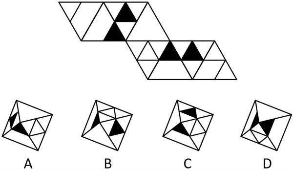
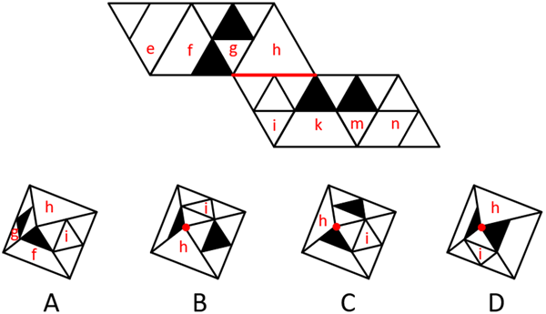

# 空间重构-多面体折叠（相邻面公共边-公共点定位法）

考点：[[20-考点/判断推理/图形推理/空间重构-多面体折叠（相邻面公共边-公共点定位法）|图形推理 / 空间重构-多面体折叠（相邻面公共边/公共点定位法）]]

**问法模型**：给出多面体外表面展开图，问哪个选项可折叠而成 → 用相邻面公共关系（共棱/共点）定位法逐项排除

## 推理链
1. 第1步：题干展开图由多个三角形面拼成，其中含黑色三角形的特征面中，面h与面i在展开图里直接相邻且共享一条公共边
2. 第2步：折叠规则——展开图中以公共边相连的面，折叠成体后仍以棱（公共边）相接；相邻关系不因折叠而改变，若立体图中两面仅以顶点相接则与展开图矛盾
3. 第3步：逐项检查：B、C、D三项中面h与面i均以点相接（只共用顶点、无公共棱），与展开图'共边相邻'的关系不符，排除B、C、D
4. 第4步：A项中面h与面i仍以公共边（棱）相接，与展开图一致，故选A

**最快解法**：⚡ 公共边定位法：锁定展开图中以边相邻的两个特征面（面h与面i，含黑色三角形），折叠后必共棱；对照立体图，B/C/D中两面均为点相接直接排除，仅A共棱，秒选A

## 易错点
- ⚠ 误以为展开图中相邻的两面折叠后可以变成点相接，忽略'相邻关系折叠后保持不变'这一规则
- ⚠ 在立体图中认错面h、面i的对应位置，多个三角形面视觉相似易标错序号
- ⚠ 陷入纠结黑色三角形的具体指向和图案细节，而忽略公共边关系这一更快更稳的排除依据

## 母题抽象
> 🧩 当题干为三角形面拼成的展开图、选项为折叠立体图时，先找展开图中以公共边相邻的两个特征面，折叠后必须仍共棱；凡两面变成仅以点相接的选项一律排除

**同类特征**：三角形面外表面展开图、含黑色三角形特征面、面h与面i以公共边相邻、问哪个可折叠而成、选项为同一多面体不同角度立体图

## 相关题
（暂无）

---

### 题干

下图为给定的多面体的外表面展开图，四个选项中哪一个可以由展开图折叠而成？

### 选项
- A. A　✅
- B. B
- C. C
- D. D

### 官方解析

本题为空间重构题。将题干展开图和选项中的面标上序号，如下图所示：

题干展开图中，面h和面i存在公共边，但在B、C、D三项中，面h和面i均以点相接，并不存在公共边，与题干展开图不一致，只有A项符合。

故正确答案为A。

### 给定材料
（无）
