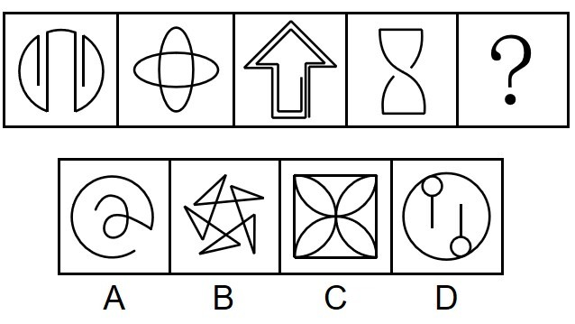

# 数量规律-笔画数（一笔画与奇点数）

考点：[[20-考点/判断推理/图形推理/数量规律-笔画数（一笔画与奇点数）|图形推理 / 数量规律-笔画数（一笔画与奇点数）]]

**问法模型**：选非问法'哪一项不能呈现规律性'→先归纳题干图形共同规律（均为一笔画），再找唯一不符合该规律的选项

## 推理链
1. 第1步：题干五图元素组成不同，对称、曲直等属性规律不明显，转向数量规律
2. 第2步：图一、图三、图四均为多端点图形（有明显线头），图二为圆相交的变形图，此类特征优先考虑笔画数
3. 第3步：数奇点验证，题干图一至图四奇点数均为0或2个，全部为一笔画图形
4. 第4步：本题为选非题，问号处应填入'不是一笔画'的图形
5. 第5步：逐项数奇点——A项螺旋带圈、B项折线星形、C项正方形内嵌四弧（交点均为偶点），奇点数均为0或2，均为一笔画
6. 第6步：D项由大圆及两组带端点的独立线条/小圆组成，奇点数为4，为两笔画图形，不符合题干一笔画规律，当选

**最快解法**：⚡ 口诀法'多端点、圆相交变形→数奇点查笔画'：题干四图均为一笔画，选非题即找多笔画项；D项图形分散且带明显线头，奇点数4=4÷2=两笔画，直接锁定D

## 易错点
- ⚠ 选非题问法看反，误以为选'能呈现规律'的一项而错选A/B/C
- ⚠ C项正方形加内嵌弧线看似复杂，实际所有交点均为偶点（0奇点），是一笔画，勿凭视觉复杂度误判为多笔画
- ⚠ D项漏数小圆内独立线段的端点，把两笔画误判为一笔画

## 母题抽象
> 🧩 当题干出现多端点图形或圆相交变形图且属性规律不明显时，优先数奇点考一笔画；若为'不能呈现规律'的选非问法，直接找奇点数大于2（多笔画）的选项

**同类特征**：元素组成不同、多端点图形（线头明显）、圆相交变形图、一笔画规律、选非题（问'不能'）、数奇点定笔画

## 相关题
- [[10-真题/判断推理/图形推理/4714952 数量规律-笔画数（一笔画与奇点数）|4714952]]（福建 2018，相关度3）
- [[10-真题/判断推理/图形推理/17097244 数量规律-笔画数（一笔画-奇点数）|17097244]]（山西 2024，相关度2）
- [[10-真题/判断推理/图形推理/2274546 图形推理-数量规律-笔画数（奇点计数与一笔画判定）|2274546]]（北京 2019，相关度2）
- [[10-真题/判断推理/图形推理/4673170 数量规律-笔画数（多端点图形的最少一笔画拆分）|4673170]]（广东 2022，相关度2）
- [[10-真题/判断推理/图形推理/5102356 数量规律-笔画数（一笔画判定）|5102356]]（浙江 2022，相关度2）

---

### 题干

从所给的四个选项中，哪一项填入问号处，不能使之呈现一定的规律性：

### 选项
- A. A
- B. B
- C. C
- D. D　✅

### 官方解析
元素组成不同，且无明显属性规律，考虑数量规律。观察发现，图一、图三和图四均为多端点图形，图二为圆相交的变形图，优先考虑笔画数。题干图形均为一笔画图形，本题为选非题，故？处应选择不是一笔画的图形。A、B、C三项均为一笔画图形，D项为两笔画图形，只有D项不符合规律。
本题为选非题，故正确答案为D。

### 给定材料
（无）
