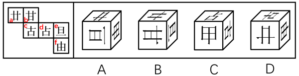
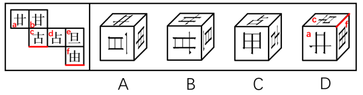

# 空间重构-六面体折叠（相邻面公共边+特征线定位法）

考点：[[20-考点/判断推理/图形推理/空间重构-六面体折叠（相邻面公共边+特征线定位法）|图形推理 / 空间重构-六面体折叠（相邻面公共边+特征线定位法）]]

**问法模型**：『左边展开图，右边哪一项能由它折叠而成』→ 空间重构题：先用相对面排除，当各选项三面均不含相对面时，改用『相邻面公共边与面上特征线的紧挨/垂直/平行关系』逐项验证

## 推理链
1. 第1步：给展开图六面标号：第一行为面a（卅形图案）、面b（甘），第二行为面c（古）、面d（占）、面e（旦），第三行为面f（由），位于面e正下方；折叠后三组相对面为a-d、b-f、c-e
2. 第2步：四个选项的三面组合A(a、e、f)、B(a、b、e)、C(c、d、f)、D(a、c、f)均不含相对面，相对面排除法失效，须转入相邻面公共边与特征线方位验证
3. 第3步：验证A项：展开图中面e『旦』字的单一长横线紧挨着面f，A项由a、e、f构成，『旦』的长横线仍紧贴e与f的公共边，与展开图一致
4. 第4步：验证B项：折叠后『旦』的长横线只能紧贴面f，而B项（a、b、e）中该长横线紧挨的是面b，方位不符，排除
5. 第5步：验证C项：展开图中面c与面d的公共边不挨着面d『占』字上半部分的短横线，而C项中该公共边紧挨此短横线，排除
6. 第6步：验证D项：展开图折叠后，面c与面f的公共边应与面f『由』字的最长线垂直，而D项中二者为平行关系，排除
7. 第7步：仅A项三面组合及特征线方位全部与展开图吻合，故选A

**最快解法**：⚡ 特征线公共边定位法：抓住三个特征直接排除——①面e『旦』长横线必须紧贴面f『由』（排B）；②面c与面d公共边不挨面d『占』上半部短横线（排C）；③面c与面f公共边与面f『由』最长线垂直（排D），三步排除后仅剩A

## 易错点
- ⚠ 只核对选项『出现了哪些面』而不核对图案方向：B、C、D的三面组合本身均合法（不含相对面），错都错在特征线方位，极易误判
- ⚠ 公共边与面上线条的『垂直/平行』关系看反，D项即为典型：折叠后应为垂直，误看成平行一致
- ⚠ 忽略『旦』长横线所贴邻面折叠后是唯一的（只能贴f不能贴b），仅因B项含『旦』面就误选

## 母题抽象
> 🧩 当六面体展开图六个面都是相似线条/字符图案、选项三面又都不含相对面时，改用『相邻面公共边—面上特征线』的位置关系（紧挨、垂直、平行）逐项比对，与展开图不符者排除，全符者当选

**同类特征**：六面体外表面展开图折叠问法、各面为『甘、古、占、旦、由』类相似字符线条图案、四个选项三面组合均无相对面、需比对公共边与特征线的紧挨/垂直/平行关系、『旦』长横线紧贴『由』面、『由』最长线与c-f公共边垂直

## 相关题
（暂无）

---

### 题干

左边给定的是六面体的外表面展开图，右边哪一项能由它折叠而成？

### 选项
- A. A　✅
- B. B
- C. C
- D. D

### 官方解析

将题干展开图中的面依次标上序号，如下图所示，逐一分析选项。

A项：选项由面a、面e与面f构成，选项与题干展开图一致，当选。

B项：选项由面a、面b与面e构成，题干展开图中面e内“旦”字的单一长横线紧挨着面f，而选项中面e内“旦”字的单一长横线紧挨着面b，选项与题干展开图不一致，排除。

C项：选项由面c、面d与面f构成，题干展开图中面c与面d的公共边不挨着面d内“占”字上半部分的短横线，而选项中面c与面d的公共边挨着面d内“占”字上半部分的短横线，选项与题干展开图不一致，排除。

D项：选项由面a、面c与面f构成，题干展开图中面c与面f的公共边与面f内“由”字的最长线垂直，而选项中面c与面f的公共边与面f内“由”字的最长线平行，选项与题干展开图不一致，排除。

故正确答案为A。

### 给定材料
（无）
