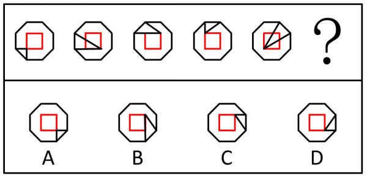

# 位置规律（端点沿外框顺时针移动+交点沿内部路径逆时针移动的双轨迹平移）

考点：[[20-考点/判断推理/图形推理/位置规律（端点沿外框顺时针移动+交点沿内部路径逆时针移动的双轨迹平移）|图形推理 / 位置规律（端点沿外框顺时针移动+交点沿内部路径逆时针移动的双轨迹平移）]]

**问法模型**：题干问'符合所给图形变化规律的是'且各图元素组成基本相同 → 优先考虑位置规律，分别追踪内部线条端点与交点的移动轨迹

## 推理链
1. 第1步：题干五幅图均由一个八边形外框和内部两条直线组成，元素组成基本相同，排除样式类规律，锁定位置规律
2. 第2步：给八边形外框按'格'编号，单独标记内部两条直线的端点在框上的位置，发现两条直线的端点依次沿外框顺时针移动1格
3. 第3步：再单独标记两条直线的交点，发现交点沿内部正方形路径依次逆时针移动1格
4. 第4步：将两条轨迹同时外推一格（端点顺时针+1格、交点沿内部正方形逆时针+1格），确定问号处端点与交点的应有位置
5. 第5步：逐项对照，A、B、C项的端点位置或交点位置与双轨迹外推结果不符
6. 第6步：D项端点与交点位置均吻合，故选D

**最快解法**：⚡ 双轨迹标记法：把八边形外框看作8格，口诀'端点顺时针走一格，交点沿内部小方框逆时针走一格'，从图5直接外推一步，对照选项秒选D

## 易错点
- ⚠ 只盯交点或只盯其中一条线的端点，漏掉'端点顺时针+交点逆时针'的双重独立移动规律
- ⚠ 把内部两条线误看成一个小三角形整体在旋转/翻转，套错整体位置规律
- ⚠ 外框为八边形应按'格'数移动步数，误按角度旋转或方向数反导致选错

## 母题抽象
> 🧩 当题干图形外框相同、内部线条元素组成相同时，用位置规律拆分追踪：给每个关键点（端点、交点）分别确立移动路径、方向和步长，双轨迹同步外推再验证选项

**同类特征**：八边形外框相同、内部两条直线、元素组成基本相同、端点沿外框逐图移动、交点沿内部正方形路径移动、顺时针与逆时针双轨迹

## 相关题
- [[10-真题/判断推理/图形推理/11226914 图形推理-位置规律（交点沿轨迹移动：定点+动点分轨追踪）|11226914]]（上海 2025，相关度1）
- [[10-真题/判断推理/图形推理/13432277 位置规律（旋转）+数量规律（端点加线递增）复合考点|13432277]]（深圳市考 2025，相关度1）
- [[10-真题/判断推理/图形推理/15419024 位置规律-相邻比较（黑白三角形拼接图中相邻两图相同黑块数恒定）|15419024]]（湖北 2025，相关度1）
- [[10-真题/判断推理/图形推理/16095253 功能元素-小白圆标记线条的序号规律|16095253]]（江苏 2024，相关度1）
- [[10-真题/判断推理/图形推理/16593143 位置规律（多元素分组追踪：平移+旋转）|16593143]]（甘肃 2024，相关度1）

---

### 题干

下列选项中，符合所给图形变化规律的是：

### 选项
- A. A
- B. B
- C. C
- D. D　✅

### 官方解析

元素组成基本相同，优先考虑位置规律。观察发现，题干图形均由一个八边形外框和内部的两条直线组成，如下图所示，内部两条直线的端点依次沿外框顺时针移动1格，内部两条直线的交点依次沿内部正方形路径逆时针移动1格，只有D项符合。

故正确答案为D。

### 给定材料
（无）
