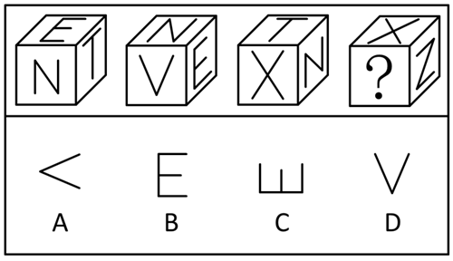

# 空间重构-立方体多视角（相邻面公共边定相对面+图案指向定方向）

考点：[[20-考点/判断推理/图形推理/空间重构-立方体多视角（相邻面公共边定相对面+图案指向定方向）|图形推理 / 空间重构-立方体多视角（相邻面公共边定相对面+图案指向定方向）]]

**问法模型**：同一立方体的多个视角中问'？'处图形 → 先用相邻面公共边与字母笔画的方向关系确定相对面做排除，再用字母开口/笔画指向校验剩余选项的方向

## 推理链
1. 第1步：图1中顶面为E、前面为N、右面为T，E字面与T字面的公共边平行于T字的横线
2. 第2步：图3中顶面为T、前面为X、右面为N，T字面与X字面的公共边垂直于T字的竖线（即同样平行于横线），说明E与X分别贴在T面两条相互平行的相对边上
3. 第3步：由此判定E字面与X字面为相对面；同理，根据图1和图2中E字的方向，T字面与V字面也为相对面，得到三组相对面(E,X)、(T,V)、(N,第六面)
4. 第4步：相对面'必见其一、必藏其一'：图4顶面为X（E隐藏）、右面为N（其相对面隐藏），故？处只能是T字或V字，选项中无T（B、C均为E字），排除B、C，？处为V字
5. 第5步：方向校验：图2中V字开口朝上，指向顶面N，即V的开口恒指向N字面
6. 第6步：图4中N字面位于右侧面，故前面V字的开口应朝右，呈'＜'形；D项'V'开口朝上指向顶面X，与图2矛盾，排除D
7. 第7步：只有A项'＜'符合，故？处图形为A

**最快解法**：⚡ 公共边法+指向法：由T字与E字的公共边方向快速定出(E,X)、(T,V)两组相对面，图4中？必为T或V，直接排除B、C；再看图2中V开口指向N面，而图4中N面在右侧，故V开口应朝右呈'＜'，秒选A

## 易错点
- ⚠ 只判断？处字母种类而不校验方向，误选开口朝上的D项（其开口指向X面，与图2中开口指向N面矛盾）
- ⚠ 把图4右面横置的N（形似Z）误认为新字母Z，打乱相对面配对关系
- ⚠ 忽略'相对面必见其一定理'：由顶面X、右面N即知？只能是T或V，未做此排除会盲目比对方向

## 母题抽象
> 🧩 当同一立方体给出多个视角、各面为带方向的字母/图案时，用'相邻面公共边与图案笔画的方向关系'先确定相对面排除选项，再用'某图案开口恒指向某一面'校验剩余选项方向

**同类特征**：同一立方体不同视角、各面为字母图案、问'？'处图形、需同时定面和定方向、相邻面公共边方向、字母开口/笔画指向

## 相关题
（暂无）

---

### 题干

以下是同一个立方体的不同视角，则“？”处的图形是：

### 选项
- A. A　✅
- B. B
- C. C
- D. D

### 官方解析

本题为空间重构题，如下图所示。

根据图1和图3中“T”字的方向可知，图1中“E”字面和“T”字面的公共边平行于“T”字面中“T”字的横线，图3中“T”字面和“X”字面的公共边垂直于“T”字面中“T”字的竖线，故“E”字面与“X”字面为相对面，同理，根据图1和图2中“E”的方向可知，“T”字面和“V”字面也为相对面。由于相对面不可能同时出现，也不可能同时不出现，故？处应为“T”字或“V”字，结合选项可知，？处应为“V”字，排除B、C两项。根据图2可知，“V”字中“V”的开口指向的面不是“X”字，排除D项，只有A项符合。

故正确答案为A。

### 给定材料
（无）
