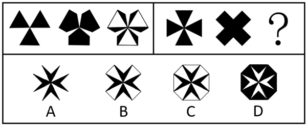

# 样式规律-图形叠加（重叠部分变白）

考点：[[20-考点/判断推理/图形推理/样式规律-图形叠加（重叠部分变白）|图形推理 / 样式规律-图形叠加（重叠部分变白）]]

**问法模型**：两组图对照、第一组给规律第二组求'？'处图形 → 先从第一组归纳图1与图2到图3的叠加规则，再原样套用到第二组选答案

## 推理链
1. 第1步：两组图元素组成相似、均由黑色块构成，优先考虑样式叠加规律
2. 第2步：对比第一组发现，图1（三个黑三角）与图2相加摆放后，非重叠区域保持黑色、重叠（重合）部分变为白色，即得到图3的白色镂空轮廓
3. 第3步：将'相加取并集为黑、重叠变白'的规则应用到第二组：图1为四个黑三角组成的十字形，图2为粗X形
4. 第4步：两图重合后，外轮廓取并集，粗X形的四个端角补齐外围，形成近似八边形的黑色外框
5. 第5步：十字形三角与X形重合的内部区域按规律变白，形成黑色八边形内嵌白色十字镂空的图形
6. 第6步：逐项对照：A项无八边形外框，B项缺X形并集轮廓，C项外框为白色描边而非黑色填充，均不符
7. 第7步：只有D项为黑色八边形外框且内部重叠区域变白，符合规律，故选D

**最快解法**：⚡ 样式叠加口诀'相加重叠变白'：将第二组图1与图2直接重合，轮廓取并集涂黑、重合处涂白，一步锁定D

## 易错点
- ⚠ 只关注形状叠加而忽略颜色规则'重叠部分变白'，误选内部仍为黑色的图形
- ⚠ 忘记外轮廓应取两图并集（保留黑色），漏掉X形超出部分而误选A或B
- ⚠ 把外框颜色看反，误选白色描边的C项而非黑色填充的D项

## 母题抽象
> 🧩 当两组图元素组成相似且问变化规律时，用样式叠加法：从第一组找出颜色运算规则（如此题'重叠变白'），第二组按'轮廓取并集＋重叠处变色'套用，再对照选项外框与镂空形状

**同类特征**：两组对照式图形、元素组成相似、黑色块叠加、重叠部分变白、求？处图形、外轮廓取并集

## 相关题
- [[10-真题/判断推理/图形推理/10204610 样式规律-加减同异（去同存异），九宫格列规律|10204610]]（辽宁 2024，相关度1）
- [[10-真题/判断推理/图形推理/10297349 样式规律-黑白运算|10297349]]（浙江 2025，相关度1）
- [[10-真题/判断推理/图形推理/10297407 样式规律-黑白运算（定义叠加）|10297407]]（四川 2025，相关度1）
- [[10-真题/判断推理/图形推理/11226895 图形推理-样式规律（叠加求同-保留相同部分）|11226895]]（上海 2025，相关度1）
- [[10-真题/判断推理/图形推理/11226896 样式规律-加减同异（分区域：上圆内部求异+下椭圆内部求同）|11226896]]（上海 2025，相关度1）

---

### 题干

下列选项中，符合所给图形变化规律的是： 

### 选项
- A. A
- B. B
- C. C
- D. D　✅

### 官方解析
元素组成相似，优先考虑样式规律。观察第一组图形发现，图1与图2相加后重叠的部分变为白色，即得到图3，第二组图形运用此规律，故？处的图形应为图1与图2相加后重叠的部分变为白色而得到，只有D项符合。
故正确答案为D。

### 给定材料
（无）
