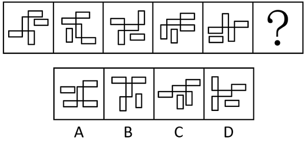

# 图形推理-元素方向规律（单独矩形水平-竖直交替+同向数量2、1交替）

考点：[[20-考点/判断推理/图形推理/图形推理-元素方向规律（单独矩形水平-竖直交替+同向数量2、1交替）|图形推理 / 图形推理-元素方向规律（单独矩形水平/竖直交替+同向数量2、1交替）]]

**问法模型**：问'？处使图形呈现规律性'→ 先归纳独立元素属性交替规律，再归纳组合体中与独立元素同属性数量的交替规律，双重规律锁定答案

## 推理链
1. 第1步：题干5幅图均由'1个单独小矩形+4个相连小矩形'构成，构成元素相同，优先比较单独小矩形的方向
2. 第2步：单独小矩形方向依次为水平、竖直、水平、竖直、水平，呈交替规律，故？处单独小矩形应竖直放置
3. 第3步：逐项检验方向：A项单独小矩形水平、D项单独小矩形水平，均排除；B、C项单独小矩形均竖直，保留
4. 第4步：第二层规律——数相连小矩形中与单独小矩形方向一致的个数：图1为2、图2为1、图3为2、图4为1、图5为2，呈2、1交替
5. 第5步：故？处相连小矩形中与竖直单独小矩形同向（竖直）的应为1个
6. 第6步：对照B、C：B项相连小矩形中有2个竖直（同向数2，不符）；C项相连小矩形中仅1个竖直（同向数1，符合），故选C

**最快解法**：⚡ 排除法+双重交替口诀：第一步看'单独矩形'方向，水平/竖直交替→？处须竖直，秒排A、D；第二步数'相连矩形中与单独矩形同向的个数'，2、1交替→？处须1个同向，B项2个、C项1个，锁定C

## 易错点
- ⚠ 只发现单独矩形方向交替这一层规律，忽略'同向相连矩形个数2、1交替'的第二层规律，在B、C之间误选B
- ⚠ 数同向相连矩形个数时漏数或把相连整体当单一方向，导致计数错误
- ⚠ 把'4个相连小矩形'误看作一个大整体轮廓，未拆解单个矩形的水平/竖直方向

## 母题抽象
> 🧩 当一组图形由'1个独立元素+1个组合体'构成且元素构成相同时，先看独立元素的属性（方向/位置/颜色）是否交替，再看组合体中与独立元素同属性的元素个数是否交替，双重交替即可锁定问号处答案

**同类特征**：六宫格前5图+问号求规律、每图由1个单独矩形+4个相连矩形构成、单独矩形方向水平/竖直交替、相连矩形中与单独矩形同向个数2、1交替、小元素方向（水平/竖直）为比较维度

## 相关题
（暂无）

---

### 题干

请从四个选项中选出最恰当的一项填入问号处，使题干图形呈现一定的规律性。

### 选项
- A. A
- B. B
- C. C　✅
- D. D

### 官方解析
题干中每幅图形均由1个单独小矩形和4个相连的小矩形构成。观察发现，单独小矩形的方向在每幅图中依次呈水平、竖直，交替放置，故？处应选择一个单独小矩形竖直放置的图形，排除A、D两项；继续观察发现，4个相连的小矩形中，与单独小矩形方向一致的数量依次为2、1、2、1、2，交替出现，只有C项符合。
故正确答案为C。

### 给定材料
（无）
