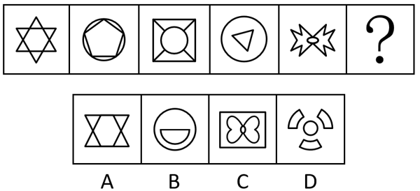

# 属性规律-对称性（对称轴数量等差递减）

考点：[[20-考点/判断推理/图形推理/属性规律-对称性（对称轴数量等差递减）|图形推理 / 属性规律-对称性（对称轴数量等差递减）]]

**问法模型**：问号处填入图形使整体呈现规律性 → 元素组成不同时优先看属性规律，图形规整含等腰元素则数各图对称轴条数找数量规律

## 推理链
1. 第1步：题干五幅图元素组成不同，但图形整体规整，且出现六角星、正五边形、等边三角形等明显等腰/对称元素，优先考虑对称性属性
2. 第2步：对每幅图作出其对称轴：图1六角星有6条对称轴；图2圆内接正五边形有5条对称轴；图3正方形套圆（方中圆）有4条对称轴；图4圆内等边三角形有3条对称轴；图5蝴蝶形有2条（横、竖各1条）对称轴
3. 第3步：对称轴数量依次为6、5、4、3、2，构成公差为-1的等差数列，故问号处图形应恰好只有1条对称轴
4. 第4步：逐项数选项对称轴：A项双三角形结构有2条，C项矩形内蝴蝶有2条（横竖各1），D项圆与三个扇弧组合有3条，均不符合
5. 第5步：B项为圆形内嵌半圆（直边在上），仅剩1条竖直对称轴，符合'1条对称轴'的规律，故选B

**最快解法**：⚡ 对称轴计数法：题干对称轴数量6→5→4→3→2递减，直接在选项中找仅有1条对称轴的图形——只有B（圆内半圆，仅1条竖直对称轴）符合，秒选B

## 易错点
- ⚠ 只定性判断'是否为轴对称图形'而不数条数——A、C、D也均为轴对称图形，若不停在'轴对称'这一层将无法排除
- ⚠ 数图3对称轴时被内部线条干扰：应以外框正方形（4条对称轴）确定整体对称轴数量
- ⚠ 把中心对称误当轴对称：D项图形易因旋转重合被误判，实际它有3条对称轴而非1条

## 母题抽象
> 🧩 当题干图形元素组成不同、外形规整且含星形/多边形/圆等明显对称元素时，逐图数对称轴条数；若条数构成等差数列，则按公差外推选出对应条数（尤其是1条）的选项

**同类特征**：元素组成不同、图形规整、出现等腰/星形等明显对称元素、对称轴数量呈等差递减、六角星、圆内接多边形等组合图形、属性规律优先

## 相关题
- [[10-真题/判断推理/图形推理/15833781 属性规律-对称性（轴对称与中心对称组合分组）|15833781]]（内蒙古 2026，相关度2）
- [[10-真题/判断推理/图形推理/2137206 属性规律-轴对称（对称轴数量递增）|2137206]]（上海 2018，相关度2）
- [[10-真题/判断推理/图形推理/2144525 属性规律-曲直性（线条的曲直组成分类）|2144525]]（选调 2018，相关度2）
- [[10-真题/判断推理/图形推理/2144539 属性规律-对称轴数量（按行递变）|2144539]]（选调 2018，相关度2）
- [[10-真题/判断推理/图形推理/2172151 属性规律-对称性（轴对称与非轴对称分组）|2172151]]（广州市考 2018，相关度2）

---

### 题干

从所给的四个选项中，选出最合适的一个填入问号处，使图形呈现一定的规律性。

### 选项
- A. A
- B. B　✅
- C. C
- D. D

### 官方解析
元素组成不同，优先考虑属性规律。题干图形规整，且出现明显的等腰元素，考虑对称性。观察发现，题干图形均为轴对称图形，且对称轴数量分别是6、5、4、3、2，因此？处图形应仅有1条对称轴，只有B项符合。
故正确答案为B。

### 给定材料
（无）
