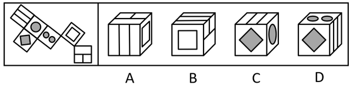
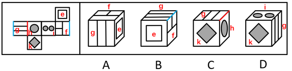

# 空间重构-六面体折叠（相对面排除＋公共边特征验证）

考点：[[20-考点/判断推理/图形推理/空间重构-六面体折叠（相对面排除＋公共边特征验证）|图形推理 / 空间重构-六面体折叠（相对面排除＋公共边特征验证）]]

**问法模型**：给出展开图问'折叠后是哪一项'→ 先用相对面排除，再用相邻面公共边与面上图案的位置关系（紧邻/垂直/平行）逐项验证

## 推理链
1. 第1步：观察展开图，六个面图案各不相同但多个面含相似线条：双斜线条纹面（面g）、圆点面、双小圆面、小方块面、双正方形（方框）面、带分割线长方形面，需精细辨析各面
2. 第2步：方法一相对面排除——按展开图'同行/同列隔一面'规则定位相对面：面g与面i为相对面，折叠后不能同时可见
3. 第3步：D项由面g、面i和面k构成，同时出现相对面g和i，与相对面规则矛盾，排除D
4. 第4步：A、B项均由面e、面f和面g构成，转入公共边特征比对：展开图中面f与面g的公共边紧邻面f中的大长方形
5. 第5步：A项中该公共边紧邻面f的大长方形，与题干一致；B项中面f与面g的公共边不挨着面f中的大长方形，排除B
6. 第6步：C项由面g、面h和面k构成，展开图中面g与面h的公共边与面g中的线条垂直，而C项中该公共边与面g中的线条平行，排除C
7. 第7步：A项三个面的相邻组合及公共边与图案的位置关系均与展开图一致，故选A

**最快解法**：⚡ 相对面排除法＋公共边法（画边法）：第一步用相对面秒杀D（g与i同现）；第二步抓住'公共边是否紧邻面f的大长方形'排除B；第三步抓住'公共边与面g中线条垂直还是平行'排除C，锁定A

## 易错点
- ⚠ 只看三个面能否拼合、忽略公共边与面上图案的相对位置（是否紧邻大长方形、与线条垂直还是平行），误选B或C
- ⚠ 展开图需先移动调整面再标号，直接按原图相邻关系判断公共边易出错
- ⚠ 相对面判断失误，未发现面g与面i为相对面而误选D

## 母题抽象
> 🧩 当六面体展开图中多个面含相似线条/方框图案、难以单靠图案区分时，先用相对面排除明显错误项，再用'公共边与面上图案的位置关系（紧邻、垂直、平行）'验证剩余选项

**同类特征**：六面体外表面展开图、空间重构、相对面不能同现、公共边与图案位置关系、多个面含相似线条图案、逐项排除

## 相关题
- [[10-真题/判断推理/图形推理/16095261 空间重构-六面体折叠（特征面字母朝向定位）|16095261]]（江苏 2024，相关度2）
- [[10-真题/资料分析/比重/2452711 现期比重构成（饼图对照判断）|2452711]]（江苏 2020，相关度1）
- [[10-真题/判断推理/类比推理/1796412 对应关系-载体关系（物质载体与机构主体的二级辨析）|1796412]]（黑龙江 2016，相关度1）
- [[10-真题/判断推理/类比推理/1796478 功能关系-功能相同+驱动方式（非电力：电力）二级辨析|1796478]]（广东 2016，相关度1）
- [[10-真题/判断推理/类比推理/19181472 三词型类比-地点对应关系+种属关系|19181472]]（吉林 2024，相关度1）

---

### 题干

左边给定的是六面体的外表面展开图，右边哪一项是由它折叠而成？

### 选项
- A. A　✅
- B. B
- C. C
- D. D

### 官方解析

本题为空间重构题。将题干展开图右侧的面进行移动，并为每个面标上序号，如下图所示，逐一分析选项。

A项：选项由面e、面f和面g构成，选项与题干展开图一致，当选；

B项：选项由面e、面f和面g构成，题干展开图中面f和面g的公共边挨着面f中的大长方形，而选项中面f和面g的公共边不挨着面f中的大长方形，选项与题干展开图不一致，排除；

C项：选项由面g、面h和面k构成，题干展开图中面g和面h的公共边与面g中的线条垂直，而选项中面g和面h的公共边与面g中的线条平行，选项与题干展开图不一致，排除；

D项：选项由面g、面i和面k构成，题干展开图中面g和面i是相对面，两者不能同时出现，选项与题干展开图不一致，排除。

故正确答案为A。

### 给定材料
（无）
