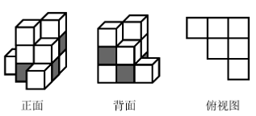

# 图形推理-三视图（立体图形投影的遮挡与颜色分布）

考点：[[20-考点/判断推理/图形推理/图形推理-三视图（立体图形投影的遮挡与颜色分布）|图形推理 / 图形推理-三视图（立体图形投影的遮挡与颜色分布）]]

**问法模型**：问'哪个立体图形的某一视图可能由纯白小方格组成'→ 采用三视图遮挡投影模型：逐一检验正面/侧面/顶面方向，看深色（灰色）方块能否在某视线方向上被白色方块完全遮挡

## 推理链
1. 第1步：题干限定每个立体图形均由8个白色+4个灰色共12个大小相同的小立方体堆叠，目标是找出存在'某一视图全为白色'的图形
2. 第2步：规则——某方向视图的颜色由该视线方向上最外侧（未被遮挡）小立方体的颜色决定，位于后排、底层的方块可被前排、上层的方块遮挡而不出现在视图中
3. 第3步：逐项检验A、B、C：灰色小立方体的摆位使得无论从正面、侧面还是顶面观察，总有灰色方块处于视线方向的最外层而无法被白色方块完全遮挡，故不存在纯白视图，排除
4. 第4步：分析D项：从正面能看到7个白色和3个灰色小立方体（共10个方格），由总数12个可知背面还藏着1个白色和1个灰色小立方体
5. 第5步：将这个被遮挡的灰色小立方体摆放在最底层，白色小立方体叠放在其正上方
6. 第6步：此时从顶面俯视，该列最上方是白色小立方体，灰色被完全遮挡，俯视图上所有可见方格均为白色，即俯视图由纯白小方格组成，D符合

**最快解法**：⚡ 遮挡投影法（三视图法）：数出D项正面可见为7白3灰→推出背面藏1白1灰→把灰放最底层、白叠其上→俯视时灰被白遮挡，俯视图纯白；A、B、C中灰色无法在任何方向被全部遮挡，直接排除

## 易错点
- ⚠ 忽略视图的'遮挡'原理，误以为视图必须画出所有12个小立方体的颜色，从而认为含灰色就一定不可能出现纯白视图
- ⚠ 只检查正面和侧面视图，漏掉俯视图（顶面）这一观察方向，错失D项的纯白俯视图
- ⚠ 未先数清可见方块数量推出被遮挡方块（1白1灰）的位置，导致无法对隐藏方块的摆法做假设验证

## 母题抽象
> 🧩 当题干出现'若干灰白小立方体堆叠，问某一视图的颜色组成'特征时，用三视图遮挡投影法，验证是否存在一个观察方向使所有深色方块都被浅色方块完全遮挡

**同类特征**：8个白色与4个灰色小立方体堆叠、某一视图由纯白小方格组成、三视图/视图方向、立体图形折叠堆叠、前后遮挡关系

## 相关题
（暂无）

---

### 题干

下面4个立体图形均由大小相同的8个白色小立方体和4个灰色小立方体堆叠而成，其中一个立体图形的某一视图可能是由纯白小方格组成的，请把它找出来。

### 选项
- A. A
- B. B
- C. C
- D. D　✅

### 官方解析

本题考查三视图。A、B、C三项中的立体图形不可能某一视图由纯白小方格组成，排除。D项中，立体图形的正面能看到7个白色小立方体和3个灰色小立方体，所以其背面应还有1个白色小立方体和1个灰色小立方体。如下图所示，当灰色小立方体在最下层摆放，白色小立方体摆放在该灰色小立方体的上方时，其俯视图由纯白小方格组成。

故正确答案为D。

### 给定材料
（无）
