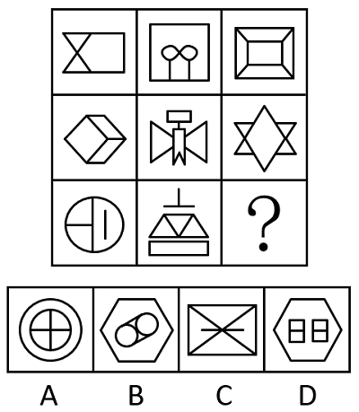

# 属性类-对称性（对称轴方向与条数、轴对称+中心对称）＋数量类-面数量（九宫格横行复合规律）

考点：[[20-考点/判断推理/图形推理/属性类-对称性（对称轴方向与条数、轴对称+中心对称）＋数量类-面数量（九宫格横行复合规律）|图形推理 / 属性类-对称性（对称轴方向与条数、轴对称+中心对称）＋数量类-面数量（九宫格横行复合规律）]]

**问法模型**：九宫格'？'处填图 → 优先按横行找规律，元素组成不同先看属性（对称轴方向/条数），一级规律排除后若仍剩多选项，再叠加数量规律（面数量）二次筛选

## 推理链
1. 第1步：九宫格各图元素组成不同，且图形含明显等腰、封闭特征，优先考虑属性规律中的对称性，其次看封闭面数量
2. 第2步：看第一行——图一（带斜线的梯形组合）仅横轴对称，图二（外框内双圆）仅竖轴对称，图三（回字形画框）既轴对称又中心对称，且对称轴恰好只有一横一竖两条
3. 第3步：第二行验证——图一横轴对称、图二竖轴对称、图三（竖向拉长的六角星）双轴对称且中心对称，规律成立
4. 第4步：第三行应用——图一（圆内加横竖线）横轴对称、图二（天平形）竖轴对称，故'？'处应为既轴对称又中心对称、且只有一横一竖两条对称轴的图形；A项十字结构对称轴多于两条、B项对称轴方向非一横一竖，排除A、B
5. 第5步：一级规律后C、D仍需区分，题干图形封闭面明显，改数面数量——第一行依次为3、4、5，第二行经验证同为3、4、5
6. 第6步：第三行前两图面数分别为3、4，故'？'处图形应有5个面
7. 第7步：对照剩余选项，C项（矩形加双对角线加横线）被分割为6个面，D项为5个面，只有D项同时满足对称性与面数量两条规律，故选D

**最快解法**：⚡ 两步排除法：第一步用对称性口诀'横、竖、双轴+中心对称'排除A（对称轴4条，超出'一横一竖'）、B（对称轴方向不符）；第二步数面，第三行按3、4、？递增需5个面，C项6面排除，锁定D

## 易错点
- ⚠ 只验证'是轴对称'就选A，忽略对称轴条数限制（题干要求只有一横一竖两条，A项十字有4条）
- ⚠ 找到对称规律排除A、B后即停手，漏掉面数量这一复合第二规律，在C、D间误选
- ⚠ 数面时漏数外框与内部图形之间形成的封闭区域，或对C项斜线+横线分割出的面数错数成5个（实为6个）

## 母题抽象
> 🧩 当九宫格图形元素组成不同且含等腰/封闭特征时，先按横行归纳对称性规律（对称轴方向、条数、是否中心对称）排除部分选项；若仍剩多个选项，再叠加面/线/点等数量规律（常呈3、4、5递增）二次验证

**同类特征**：九宫格、元素组成不同、等腰元素明显、对称规律按行呈现（横轴→竖轴→双轴+中心对称）、封闭面明显、面数量3、4、5递增

## 相关题
- [[10-真题/判断推理/图形推理/5908646 数量规律-面数量（九宫格按行求和恒定）|5908646]]（山东 2024，相关度3）
- [[10-真题/判断推理/图形推理/10297262 数量规律-面的形状种类（封闭面种类数分组）|10297262]]（浙江 2025，相关度2）
- [[10-真题/判断推理/图形推理/11881082 属性规律-对称性（对称轴方向）|11881082]]（黑龙江 2024，相关度2）
- [[10-真题/判断推理/图形推理/12881896 属性规律-曲直性（九宫格横行遍历）|12881896]]（新疆 2025，相关度2）
- [[10-真题/判断推理/图形推理/14993416 数量规律-点数量（黑点个数按行求和恒值）|14993416]]（选调 2024，相关度2）

---

### 题干

请从四个选项中选出最恰当的一项填入问号处，使题干图形呈现一定的规律性。

### 选项
- A. A
- B. B
- C. C
- D. D　✅

### 官方解析
元素组成不同，优先考虑属性规律。观察发现，题干图形出现明显的等腰元素，考虑对称性。九宫格优先看横行，第一行中，图一为横轴对称图形，图二为竖轴对称图形，图三为既轴对称又中心对称图形，且对称轴只有一条横轴和一条竖轴；第二行经验证符合此规律；第三行应用此规律，排除A、B两项。继续观察发现，题干图形封闭面明显，考虑面数量。第一行中，面数量依次为3、4、5；第二行经验证符合此规律；第三行应用此规律，故“？”处图形应有5个面，只有D项符合。
故正确答案为D。

### 给定材料
（无）
