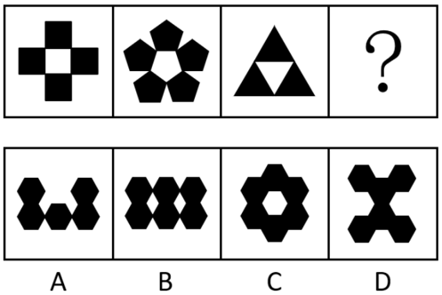

# 数量规律-小元素个数与边数的等量关系（叠加白色同形区域验证）

考点：[[20-考点/判断推理/图形推理/数量规律-小元素个数与边数的等量关系（叠加白色同形区域验证）|图形推理 / 数量规律-小元素个数与边数的等量关系（叠加白色同形区域验证）]]

**问法模型**：问号处填入图形使呈现规律性 → 元素组成不同先看数量：数黑色小元素的个数与其形状边数，验证'个数=边数'，再叠加'存在与黑色小元素同形的白色区域'复合规律筛选

## 推理链
1. 第1步：题干图1由黑色小正方形拼成十字，黑色正方形4个、每个4条边，个数4=边数4，中间留有1个白色正方形区域
2. 第2步：图2由黑色小五边形围成花朵状，黑色五边形5个、每个5条边，个数5=边数5，中心留有1个白色五边形区域
3. 第3步：图3由黑色小三角形拼成大三角形，黑色三角形3个、每个3条边，个数3=边数3，中间的白色倒三角形与黑色小三角形同形（注意只数黑色，不数白色）
4. 第4步：归纳规律——每幅图由同一种黑色小元素组成，且①黑色小元素个数=该元素边数；②图中存在与黑色小元素形状相同的白色区域
5. 第5步：验证A项：黑色小元素为六边形（6条边），但个数只有3个，3≠6，违反规律①，排除
6. 第6步：验证B、D项：黑色小元素为六边形，但图中的白色区域（缝隙）形状不是六边形、与黑色小元素不同形，违反规律②，排除
7. 第7步：验证C项：6个黑色六边形围成一圈，个数6=边数6，中心白色区域恰为六边形、与黑色小元素同形，同时满足两条规律，当选

**最快解法**：⚡ 数数法+边数对应：题干三图黑色小元素个数依次为4、5、3，恰等于各自边数（正方形4、五边形5、三角形3），问号处应找'个数=边数'的图形；选项中六边形需6个，仅C是6个六边形围圈，再以'中心白色区域与黑色小元素同形'二次确认C

## 易错点
- ⚠ 只数黑色小元素个数而忽略'个数=边数'这一等量关系，误以为数出任意数量即可而错选B或D
- ⚠ 图3中把中间白色倒三角形也计入，误数成4个三角形，导致规律错乱
- ⚠ 忽略'存在与黑色小元素同形的白色区域'这一复合规律——单看'六边形'形状B、D、C相似，必须用白色区域同形性做二次区分

## 母题抽象
> 🧩 当题干每幅图都由同一种黑色小元素拼合、且图内留有白色空隙时，优先验证'黑色小元素个数=该元素的边数'，再用'是否存在与黑色小元素形状相同的白色区域'做二次筛选锁定答案

**同类特征**：元素组成不同、无明显属性规律、每幅图由同一种黑色小元素拼合、黑色小元素个数恰好等于其边数、图内存在与黑色小元素同形的白色区域、选项均为六边形组合，需用个数（6个）与白色区域同形双重区分

## 相关题
- [[10-真题/判断推理/图形推理/2144665 数量规律-线数量（两组图运算：图一线数+图三线数=图二线数）|2144665]]（新疆 2017，相关度1）
- [[10-真题/判断推理/图形推理/2434290 数量规律-线数量（直线数与曲线数做差运算）|2434290]]（新疆 2019，相关度1）
- [[10-真题/判断推理/图形推理/4678642 图形推理-数量规律（黑白面积关系-面积比例）|4678642]]（选调 2020，相关度1）
- [[10-真题/判断推理/图形推理/5445911 图形推理-数量规律（一笔画-笔画数·奇点计数）|5445911]]（国考 2023，相关度1）
- [[10-真题/判断推理/图形推理/5509907 数量规律-汉字横线数量（折笔中的水平线段计入）|5509907]]（内蒙古 2023，相关度1）

---

### 题干

从所给四个选项中，选择最合适的一个填入问号处，使之呈现一定规律性（    ）。

### 选项
- A. A
- B. B
- C. C　✅
- D. D

### 官方解析
元素组成不同，且无明显属性规律，考虑数量规律。观察发现，每幅图形中均由一种黑色小元素组成，且黑色小元素的个数=黑色小元素的边数，排除A项；继续观察发现，题干图形都存在一个与黑色小元素相同的白色区域，排除B、D两项，只有C项符合。
故正确答案为C。

### 给定材料
（无）
