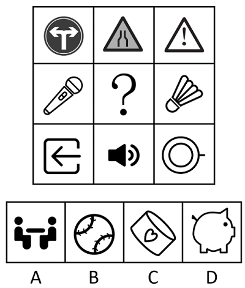

# 属性规律-对称性（对称轴方向）

考点：[[20-考点/判断推理/图形推理/属性规律-对称性（对称轴方向）|图形推理 / 属性规律-对称性（对称轴方向）]]

**问法模型**：九宫格'选择最合适的一个填入问号处'→ 元素组成不同看属性，逐行归纳对称轴方向，问号处填同方向对称轴图形

## 推理链
1. 第1步：九宫格中九个图形元素组成各不相同（交通标志、话筒、羽毛球、喇叭等实物），优先考虑属性规律；图形均较规整，锁定对称性
2. 第2步：九宫格优先看横行，逐行确定每行图形对称轴的方向是否一致
3. 第3步：第一行'双向箭头标志、三角警示牌、感叹号警示牌'均为竖轴对称；第三行'出口箭头、喇叭、同心圆带柄'均为横轴对称——规律为每行轴对称且对称轴方向相同
4. 第4步：第二行图1话筒斜放、图3羽毛球斜放，两者对称轴均为'左下—右上'的斜轴，故问号处应填入左下—右上斜轴对称图形
5. 第5步：对照选项排除——A为左右结构（非斜轴对称），B棒球缝线走向及细节使对称轴方向不符，D小猪储蓄罐被腿、耳等细节破坏，均非左下—右上斜轴对称
6. 第6步：C项卷筒沿左下—右上斜放，其对称轴恰为该方向斜轴，与第二行规律一致，故选C

**最快解法**：⚡ 对称轴描线法：九宫格按行逐格沿图形对称轴画虚线，发现每行方向统一（第一行'|'、第三行'—'）；第二行沿'左下→右上'画对角虚线验证话筒、羽毛球重合，再扫选项找同轴图形，C项卷筒长轴即该斜线，直接锁定

## 易错点
- ⚠ 只判断'是否轴对称'而忽略'对称轴方向'这一二级辨析，易被B项棒球貌似对角对称的轮廓误导
- ⚠ 未按九宫格'先横行'的观察顺序，误去竖列找规律导致方向混乱
- ⚠ D项小猪储蓄罐轮廓近似规则，易误判为横轴对称，需注意腿、耳、尾等细节破坏了对称性

## 母题抽象
> 🧩 当九宫格图形元素组成不同且均较规整时，按行检验轴对称性；若每行对称轴方向统一（竖轴/横轴/斜轴），问号处即填与该行同方向对称轴的图形

**同类特征**：九宫格、元素组成不同、实物图形较规整、每行对称轴方向一致、斜轴对称（左下—右上）、对称轴方向分组

## 相关题
- [[10-真题/判断推理/图形推理/11367791 属性类-对称性（对称轴方向与条数、轴对称+中心对称）＋数量类-面数量（九宫格横行复合规律）|11367791]]（江苏 2025，相关度2）
- [[10-真题/判断推理/图形推理/12881896 属性规律-曲直性（九宫格横行遍历）|12881896]]（新疆 2025，相关度2）
- [[10-真题/判断推理/图形推理/14993416 数量规律-点数量（黑点个数按行求和恒值）|14993416]]（选调 2024，相关度2）
- [[10-真题/判断推理/图形推理/17097275 图形间关系-点相交（点接触 vs 线接触）|17097275]]（山西 2024，相关度2）
- [[10-真题/判断推理/图形推理/17467550 数量规律-交点数（九宫格按行等差递增）|17467550]]（湖北 2026，相关度2）

---

### 题干

从所给的四个选项中，选择最合适的一个填入问号处，使之呈现一定的规律性：

### 选项
- A. A
- B. B
- C. C　✅
- D. D

### 官方解析
元素组成不同，优先考虑属性规律。观察发现，题干图形较为规整，考虑对称性。九宫格优先看横行，第一行均为竖轴对称图形，第三行均为横轴对称图形，每行图形均为轴对称图形且对称轴方向相同。第二行的图1和图3均为从左下到右上的斜轴对称图形，故？处应填入一个从左下到右上的斜轴对称图形，只有C项符合。
故正确答案为C。

### 给定材料
（无）
