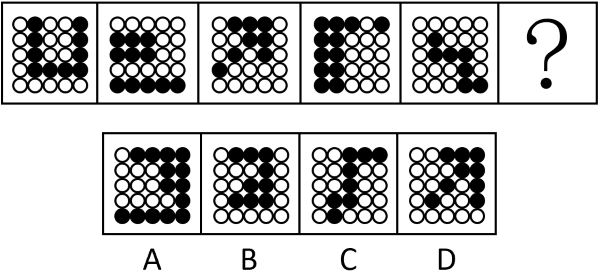

# 属性规律-对称性（黑色-白色区域分别整体看轴对称，黑白交替）

考点：[[20-考点/判断推理/图形推理/属性规律-对称性（黑色-白色区域分别整体看轴对称，黑白交替）|图形推理 / 属性规律-对称性（黑色/白色区域分别整体看轴对称，黑白交替）]]

**问法模型**：问号处填入使之呈现一定规律 → 元素组成不同，优先属性规律；黑白区域分布规整，将黑、白各自连成的整体区域分开看对称性，并按奇偶项交替验证

## 推理链
1. 第1步：题干为5幅5×5黑白圆点网格图+问号，各图黑白圆点分布均不相同，元素组成不同，排除位置类（平移/旋转）优先方向
2. 第2步：每幅图中同色圆点均连成相对规整的块状区域，依据官方解析思路，把黑色区域、白色区域分别看作两个整体，考察属性规律中的轴对称
3. 第3步：逐图检验——图1黑色区域为轴对称图形；图2白色区域为轴对称图形；图3黑色区域为轴对称图形；图4白色区域为轴对称图形；图5黑色区域为轴对称图形
4. 第4步：归纳规律：黑色区域轴对称与白色区域轴对称交替出现（奇数项黑、偶数项白），问号处为第6项（偶数项），应满足'白色区域为轴对称图形'
5. 第5步：逐项对照——A项白色区域为轴对称图形，符合规律；B、C、D项白色区域均不呈轴对称（易被其黑色区域形状干扰误选）
6. 第6步：只有A满足'白色区域轴对称'，与官方答案A一致

**最快解法**：⚡ 交替规律口诀+排除法：'奇数项黑区域轴对称、偶数项白区域轴对称'，问号是第6项→只找白色区域为轴对称的选项，快速排除B、C、D，锁定A

## 易错点
- ⚠ 只盯着黑色区域的对称性做排除，看到B/C/D中黑色（或整体）形状规整就误选，忽略黑、白对称交替规律
- ⚠ 把规律误判为黑色圆点的位置移动（平移/循环），在黑白数量变化的网格题中走错方向
- ⚠ 未把同色圆点连成一个整体区域看对称，而是逐个圆圈判断，导致对称轴找错

## 母题抽象
> 🧩 当图形由规整网格中黑白两色填充构成且元素组成不同时，把黑、白各视为一个整体区域分别考察轴对称；若呈'黑对称—白对称'交替，则按问号所处项的奇偶性，选择对应颜色区域轴对称的选项

**同类特征**：5×5黑白圆点网格、元素组成不同、黑白区域呈规整块状、黑/白区域分别整体看、奇偶交替规律、轴对称

## 相关题
- [[10-真题/判断推理/图形推理/14993420 样式规律-主体形状交替+数量规律-奇偶交替（复合规律）|14993420]]（选调 2024，相关度2）
- [[10-真题/判断推理/图形推理/2049824 属性规律-曲直性（内外分层+奇偶交替）|2049824]]（山东 2017，相关度2）
- [[10-真题/判断推理/图形推理/2444750 图形推理-属性规律（轴对称-黑白区域分别看对称性）|2444750]]（四川 2019，相关度2）
- [[10-真题/判断推理/图形推理/2633394 图形推理-属性规律（轴对称）+ 位置关系（曲线是否经过原点）|2633394]]（选调 2016，相关度2）
- [[10-真题/判断推理/图形推理/4658468 属性规律-对称性（轴对称与否分组）|4658468]]（四川 2021，相关度2）

---

### 题干

从所给的四个选项中，选择最合适的一个填入问号处，使之呈现一定的规律：

### 选项
- A. A　✅
- B. B
- C. C
- D. D

### 官方解析
元素组成不同，优先考虑属性规律。黑白色区域分布相对比较规整，优先考虑对称性。图1黑色区域为轴对称图形，图2白色区域为轴对称图形，图3黑色区域为轴对称图形，图4白色区域为轴对称图形，图5黑色区域为轴对称图形，因此“？”处应该是白色区域为轴对称图形，只有A项符合。
故正确答案为A。

### 给定材料
（无）
