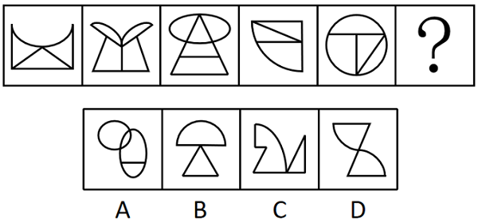

# 数量规律-交点数（曲直交点）

考点：[[20-考点/判断推理/图形推理/数量规律-交点数（曲直交点）|图形推理 / 数量规律-交点数（曲直交点）]]

**问法模型**：『选择最合适的一个填入问号处，使之呈现一定的规律性』→ 元素组成不同且无属性规律时转向数量规律，本题锁定『曲直交点数』恒定

## 推理链
1. 第1步：题干五幅图元素组成不同（矩形+弧线、曲顶冠形、椭圆+三角形、扇形+折线、圆+T形线），先排查属性规律，对称、开闭、曲直性均不成规律
2. 第2步：题干图形共同特征是均由直线和曲线复合构成，且曲线与直线出现明显相交，据此锁定细分数量考点——曲直交点数
3. 第3步：逐图数曲线与直线相交的点：图1弧线与矩形边线及内部直线相交3处、图2曲线与直线的接触点共3处、图3椭圆与三角形边线相交3处、图4弧线与上方直角折线相交3处、图5圆与T形横线两端及竖线下端相交3处，题干曲直交点数恒为3
4. 第4步：逐项验证：A项横线与下方圆弧相交2处、两圆相交属曲曲交点不计入，排除；B项半圆弧与三角形无相交，曲直交点为0，排除；C项曲直交点数不为3，排除
5. 第5步：D项两条弧线与直线的相交点恰为3个，与题干规律一致，故选D

**最快解法**：⚡ 数量规律口诀『曲直相交数曲直交点』：逐图数曲直交点均为3，再用排除法扫选项——A为2、B为0、C非3，快速锁定D

## 易错点
- ⚠ 把曲线与曲线的交点（如A项两圆相交处）误计入曲直交点
- ⚠ 误数全部交点（含直线与直线的交点）导致规律混乱，须只数曲线与直线相交的点
- ⚠ 相切或端点接触处（如图5横线端点与圆的接触点）容易漏数，造成每图计数不稳定

## 母题抽象
> 🧩 当图形元素组成不同、属性无规律，且每幅图都是『直线+曲线复合并明显相交』时，优先数曲直交点数，验证其在题干中恒定后在选项中找相同数值

**同类特征**：元素组成不同、无属性规律、直线与曲线复合图形、曲线与直线明显相交、数量规律-交点计数

## 相关题
- [[10-真题/判断推理/图形推理/5911323 数量规律-交点数（曲直交点）|5911323]]（浙江 2024，相关度4）
- [[10-真题/判断推理/图形推理/10297314 数量规律-交点数（曲直交点）|10297314]]（浙江 2025，相关度3）
- [[10-真题/判断推理/图形推理/12100997 数量规律-交点数（曲直交点）|12100997]]（江苏 2025，相关度3）
- [[10-真题/判断推理/图形推理/5510176 数量规律-交点数（曲直交点）|5510176]]（湖北 2023，相关度3）
- [[10-真题/判断推理/图形推理/12536392 数量规律-黑色区域面积（宫格面积折算）|12536392]]（四川 2024，相关度2）

---

### 题干

从所给的四个选项中，选择最合适的一个填入问号处，使之呈现一定的规律性：

### 选项
- A. A
- B. B
- C. C
- D. D　✅

### 官方解析
元素组成不同，且无明显属性规律，考虑数量规律。观察发现，题干图形均由直线和曲线构成，且直线和曲线出现明显相交，考虑曲直交点数。题干图形的曲直交点数均为3，故“？”处应选择有3个曲直交点的图形，只有D项符合。
故正确答案为D。

### 给定材料
（无）
