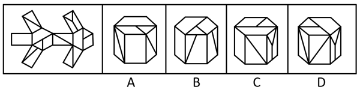
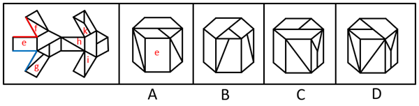

# 空间重构-多面体（六棱柱）纸盒折叠-相邻面与公共点排除法

考点：[[20-考点/判断推理/图形推理/空间重构-多面体（六棱柱）纸盒折叠-相邻面与公共点排除法|图形推理 / 空间重构-多面体（六棱柱）纸盒折叠-相邻面与公共点排除法]]

**问法模型**：给出外表面展开图问'哪一项能由它折叠而成' → 空间重构模型：用相邻面关系、面形状唯一性、公共点/公共边特征逐一排除错误选项

## 推理链
1. 第1步：题干为多面体展开图，需关注三类特征：面与面的相邻关系、每种形状/图案面的数量、公共点引出的线条数
2. 第2步：采用空间重构的'相邻面排除法+唯一面排除法+公共点法'逐项验证
3. 第3步：A项正面为面e，展开图中面e的两侧分别与面f和面g相邻，而A项中面e两侧相邻面里没有面g，相邻关系不符，排除
4. 第4步：B项正面为面g，其右侧面与面g形状相同，但展开图中面g形状的面只有1个，B项右侧为'无中生有'的面，排除
5. 第5步：C项右侧面为面k，展开图中面k与其左侧相邻面上方的公共点引出两条面上的线，而C项该公共点只引出一条线，公共点特征不符，排除
6. 第6步：D项各面的相邻关系、面形状及公共点线条特征均与展开图一致，当选D

**最快解法**：⚡ 排除法三连击：①先看唯一形状面——展开图中面g形状仅1个，B项右侧面却与面g同形，无中生有秒排B；②再看相邻面——面e两侧必邻面f和面g，A项缺面g秒排A；③最后看公共点——面k与左侧相邻面上方公共点应引出两条线，C项只引一条线排除，锁定D

## 易错点
- ⚠ 只核对单个面的图案是否出现，忽略该面两侧相邻面的组合关系（A项面e图案对但邻居错）
- ⚠ 未清点展开图中每种形状/图案面的数量，识别不出'无中生有'的重复面（B项）
- ⚠ 公共点引出线条的条数看错或漏数（C项两条线误看为一条）

## 母题抽象
> 🧩 当展开图中存在唯一形状的面或带特征线条的面时，按'相邻面组合→面的数量唯一性→公共点/公共边引线特征'的顺序排除，即可快速锁定可折叠成的立体图

**同类特征**：外表面展开图折叠、六棱柱（多面体）立体图、面e两侧邻面f和面g、面g形状唯一、面k公共点引出两条线、问哪一项能由它折叠而成

## 相关题
- [[10-真题/判断推理/图形推理/2136764 空间重构-六面体折叠（相对面排除+公共边画边法）|2136764]]（河南 2017，相关度1）
- [[10-真题/判断推理/图形推理/2172567 空间重构-立体折叠-镜面（无中生有）排除|2172567]]（江苏 2018，相关度1）
- [[10-真题/判断推理/图形推理/2367989 空间重构-六面体折叠（相对面排除+相邻面特征点-公共边验证）|2367989]]（江苏 2019，相关度1）
- [[10-真题/判断推理/图形推理/2423313 空间重构-六面体折纸盒（相邻面公共边图案衔接排除）|2423313]]（重庆 2019，相关度1）
- [[10-真题/判断推理/图形推理/2452692 空间重构-六面体折叠（相对面排除+画边法判定相邻面）|2452692]]（江苏 2020，相关度1）

---

### 题干

左边给定的是纸盒外表面的展开图，右边哪一项能由它折叠而成？

### 选项
- A. A
- B. B
- C. C
- D. D　✅

### 官方解析

本题为空间重构类题目，将题干展开图标上序号，如下图所示，逐一进行分析。

A项：选项正面为面e，题干展开图中面e的两侧分别与面f和面g相邻，而选项中面e的两侧相邻面中没有面g，选项与题干展开图不一致，排除；

B项：选项正面为面g，右侧面与面g形状相同，但题干展开图中面g形状的面只有1个，故选项右侧面为无中生有的面，选项与题干展开图不一致，排除；

C项：选项右侧面为面k，题干展开图中面k与其左侧相邻面上方的公共点引出两条面上的线，而选项中面k与其左侧相邻面上方的公共点只引出一条面上的线，选项与题干展开图不一致，排除；

D项：选项与题干展开图一致，当选。

故正确答案为D。

### 给定材料
（无）
