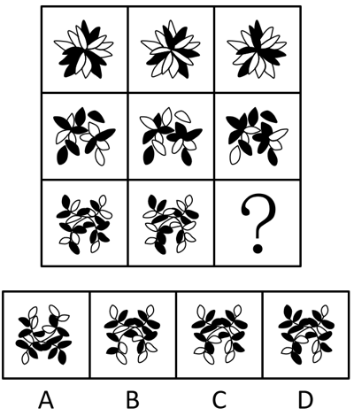

# 样式规律-黑白运算（九宫格逐位置叠加）

考点：[[20-考点/判断推理/图形推理/样式规律-黑白运算（九宫格逐位置叠加）|图形推理 / 样式规律-黑白运算（九宫格逐位置叠加）]]

**问法模型**：九宫格图形'呈现一定规律性'且各图轮廓、分割区域相同仅黑白分布不同 → 按横行做黑白叠加运算求答案

## 推理链
1. 第1步：九宫格中每行三个图形的轮廓和分割区域完全相同，只有花瓣/叶片区域的黑、白颜色分布不同，元素组成相似
2. 第2步：元素组成相似且分区相同 → 优先考虑样式规律中的黑白运算；九宫格优先横行观察
3. 第3步：第一行逐位置叠加归纳规则：黑+白=黑，白+黑=黑，黑+黑=白，白+白=白（即异色得黑、同色得白）
4. 第4步：第二行按此规则逐位置验证，运算结果与第二行第三个图形一致，规律成立
5. 第5步：第三行前两图逐位置应用'异色得黑、同色得白'规则运算出问号处图形
6. 第6步：将运算结果与四个选项对照，只有C项的黑白分布完全吻合，A、B、D均存在位置颜色不符

**最快解法**：⚡ 黑白运算法+验证排除：由第一行快速读出'异色变黑、同色变白'规则，第二行验证后，对第三行逐格叠加，先看最易分辨的几个分区排除明显不符项，锁定C

## 易错点
- ⚠ 把运算方向记反，误以为'黑+黑=黑'（同色变黑），导致选错
- ⚠ 不逐位置运算，只对比整体黑色区域数量或形状相似度，误选B或D
- ⚠ 忽略'轮廓和分割区域相同'这一黑白运算的前提特征，转去找数量、对称等其他规律而浪费考试时间

## 母题抽象
> 🧩 当九宫格（或两组）图形轮廓与分割区域完全相同、仅黑白颜色分布不同时，用黑白运算：第一行定规则、第二行验证、第三行应用，常见规则有'异色得黑同色得白''同色得黑异色得白''黑+白=白'等，须逐位置叠加验证

**同类特征**：九宫格、轮廓和分割区域相同、仅黑白颜色分布不同、元素组成相似、花瓣/叶片状分区、问号在第三行末位

## 相关题
- [[10-真题/判断推理/图形推理/10297407 样式规律-黑白运算（定义叠加）|10297407]]（四川 2025，相关度3）
- [[10-真题/判断推理/图形推理/19526251 样式规律-黑白运算（同位叠加）|19526251]]（国考 2026，相关度3）
- [[10-真题/判断推理/图形推理/10204610 样式规律-加减同异（去同存异），九宫格列规律|10204610]]（辽宁 2024，相关度2）
- [[10-真题/判断推理/图形推理/10297349 样式规律-黑白运算|10297349]]（浙江 2025，相关度2）
- [[10-真题/判断推理/图形推理/12019768 样式规律-加减同异（求同）与位置旋转的复合规律|12019768]]（浙江 2026，相关度2）

---

### 题干

请从四个选项中选出最恰当的一项填入问号处，使题干图形呈现一定的规律性。

### 选项
- A. A
- B. B
- C. C　✅
- D. D

### 官方解析
元素组成相似，优先考虑样式规律。观察发现，题干图形轮廓和分割区域相同，考虑黑白运算。九宫格优先看横行，第一行运算规律为：黑+白=黑，白+黑=黑，黑+黑=白，白+白=白；第二行经验证符合此规律；第三行应用此规律，只有C项符合。
故正确答案为C。

### 给定材料
（无）
