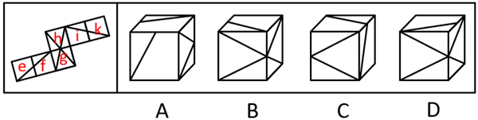
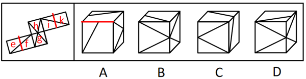
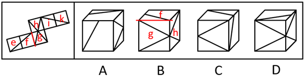

# 空间重构-六面体折叠（公共点-公共边定位法）

考点：[[20-考点/判断推理/图形推理/空间重构-六面体折叠（公共点-公共边定位法）|图形推理 / 空间重构-六面体折叠（公共点/公共边定位法）]]

**问法模型**：‘左边展开图，右边哪一项能由它折叠而成’→ 空间重构题，用相邻面公共点/公共边上的图案特征逐项验证排除

## 推理链
1. 第1步：给展开图各面编号（e、f、g、h、i、k），提取图案特征：每个面由对角线与分割线构成，图案分'直角三角形'与'直角梯形'两类；面e、f、i、k中的线条两两相交于公共边的中点
2. 第2步：所用规则——折叠后相邻面公共边、三个相邻面公共点处的图案相对位置不变，以'公共点挨着哪种图案（三角形/梯形）''线条是否交于公共边中点'为判据
3. 第3步：验证A项：正面与顶面线条来自面e/f/i/k，展开图中这些面的线条相交于公共边中点，而选项中正面线条与顶面线条不相交，排除
4. 第4步：验证B项：由面g、h组合且公共点挨着顶面线条，锁定为f+g+h；展开图中面g的直角三角形挨着面f的直角梯形，选项中却挨着面f的直角三角形，排除
5. 第5步：验证C项：由面g、i、k构成，公共点与线条的相对位置同展开图一致，当选
6. 第6步：验证D项：由面g、h组合且公共点不挨着顶面线条，锁定为g+h+i；展开图三面公共点挨着面i的直角梯形，选项中却挨着面i的直角三角形，排除

**最快解法**：⚡ 公共点法：对每个选项找出三个可见面的公共顶点，看公共点挨着的是'直角三角形'还是'直角梯形'、以及公共点是否紧邻面中线条，与展开图中对应三面公共点的特征逐一比对，不符即排除

## 易错点
- ⚠ 混淆'直角三角形'与'直角梯形'两类图案，公共点相邻图案看错（B、D项均考此点）
- ⚠ 忽略'线条相交于公共边中点'这一细节而误选A项
- ⚠ 立体图中三个可见面公共顶点的定位错误，导致选错对应展开图中的三个面

## 母题抽象
> 🧩 当六面体展开图各面为'对角线+分割线'型线条图案时，用公共点法：锁定选项三个相邻面公共点所挨的图案（三角形/梯形）及线条交点位置，与展开图比对即可秒杀

**同类特征**：六面体外表面展开图折纸盒、面内为对角线与分割线组合图案、存在直角三角形与直角梯形两类面、线条相交于公共边中点、三面公共点特征判别、问哪一项能折叠而成

## 相关题
- [[10-真题/判断推理/图形推理/2172440 空间重构-四面体展开图折叠（画边法-相邻面相对位置）|2172440]]（江苏 2018，相关度1）
- [[10-真题/判断推理/图形推理/2367942 空间重构-四面体折叠（画边法+相邻面特征）|2367942]]（江苏 2019，相关度1）
- [[10-真题/判断推理/图形推理/4678632 空间重构-六面体折纸盒（相对面排除+公共边-公共点定位）|4678632]]（选调 2020，相关度1）
- [[10-真题/判断推理/图形推理/5445923 空间重构-六面体折叠（公共点-公共边定位相邻面）|5445923]]（国考 2023，相关度1）

---

### 题干

左边给定的是六面体的外表面展开图，右边哪一项能由它折叠而成?

### 选项
- A. A
- B. B
- C. C　✅
- D. D

### 官方解析

将题干展开图标上序号，如下图所示，逐一进行分析。

A项：选项的正面和顶面来自面e、面f、面i、面k，题干展开图中面e、面f、面i、面k任意面中的线条均与另一个面中的线条相交于公共边的中点，而选项中正面中的线条与顶面中的线条不相交，选项与题干展开图不一致，排除；

B项：选项一定有面g与面h，且选项中三个面的公共点挨着顶面中的线条，故选项由面f、面g与面h构成。题干展开图中面g中的直角三角形挨着面f中的直角梯形，而选项中面g中的直角三角形挨着面f中的直角三角形，选项与题干展开图不一致，排除；

C项：选项由面g、面i与面k构成，选项与题干展开图一致，当选；

D项：选项一定有面g与面h，且选项中三个面的公共点不挨着顶面中的线条，故选项由面g、面h与面i构成。题干展开图中这三个面的公共点挨着面i中的直角梯形，而选项中这三个面的公共点挨着面i中的直角三角形，选项与题干展开图不一致，排除。

故正确答案为C。

### 给定材料
（无）
