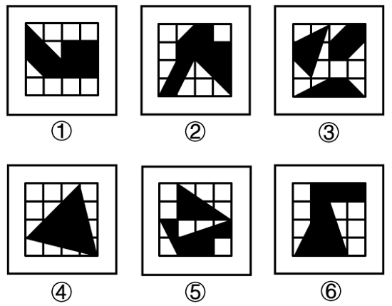

# 数量规律-黑色区域面积（宫格面积折算）

考点：[[20-考点/判断推理/图形推理/数量规律-黑色区域面积（宫格面积折算）|图形推理 / 数量规律-黑色区域面积（宫格面积折算）]]

**问法模型**：'六个图形分为两类，每类有共同特征'的分组分类问法 → 先排除属性规律，再对16宫格黑色区域按'整格记1、半格记0.5'折算面积，按数值相同分组

## 推理链
1. 第1步：六幅图均为4×4的16宫格，内部含黑色区域，元素组成不同，观察对称、曲直、开闭等属性规律均不成立
2. 第2步：属性规律失效，转向数量规律；黑色区域形状不规则且被宫格线切割，故按宫格面积折算：完整格记1，三角形占半格记0.5
3. 第3步：逐图清点黑色面积——图①左上三角+斜带+右侧黑色矩形块合计7.5格，图④大三角形折算7.5格，图⑤数块三角形合计7.5格
4. 第4步：图②'A'形黑块折算8.5格，图③三角+平行四边形+底部梯形合计8.5格，图⑥不规则黑块折算8.5格
5. 第5步：按面积数值分组：①④⑤均为7.5格一组，②③⑥均为8.5格一组，与选项D（①④⑤，②③⑥）吻合

**最快解法**：⚡ 面积折算法：以16宫格为单位，整格记1、被切出的三角形记0.5，快速累加每图黑色区域面积，7.5格的①④⑤一组、8.5格的②③⑥一组，直接锁定D

## 易错点
- ⚠ 只数黑色区域的'块数'或'位置样式'，而非折算面积，误入歧途
- ⚠ 半格三角形折算出错：把占半格的三角形记成整格，导致7.5/8.5的区分失效
- ⚠ 先入为主找对称或笔画类规律，忽略'相同宫格背景+黑色填充'提示的是面积类数量规律

## 母题抽象
> 🧩 当题干出现'统一宫格背景+不规则黑色填充区域'且属性规律无效时，用'面积折算（整格1、半格0.5）'方法，验证黑色面积数值是否可分成两组

**同类特征**：16宫格（4×4）统一背景、黑色不规则填充区域、元素组成不同、无属性规律、黑色被宫格线切割出半格、分组分类问法

## 相关题
- [[10-真题/判断推理/图形推理/10297262 数量规律-面的形状种类（封闭面种类数分组）|10297262]]（浙江 2025，相关度2）
- [[10-真题/判断推理/图形推理/12019740 数量规律-交点数（曲直交点）|12019740]]（浙江 2026，相关度2）
- [[10-真题/判断推理/图形推理/12882156 图形推理-对称性（仅轴对称 vs 既轴对称又中心对称）|12882156]]（黑龙江 2025，相关度2）
- [[10-真题/判断推理/图形推理/13504389 图形推理-笔画数（奇点数定一笔画-多笔画）|13504389]]（云南 2025，相关度2）
- [[10-真题/判断推理/图形推理/15833781 属性规律-对称性（轴对称与中心对称组合分组）|15833781]]（内蒙古 2026，相关度2）

---

### 题干

把下面六个图形分为两类，使每一类图形都有各自的共同特征或规律，分类正确的一项是：

### 选项
- A. ①②⑥，③④⑤
- B. ①③④，②⑤⑥
- C. ①③⑤，②④⑥
- D. ①④⑤，②③⑥　✅

### 官方解析
本题为分组分类题目。元素组成不同，且无属性规律，考虑数量规律。观察发现，题干每幅图形均为16宫格，且存在黑色区域。继续观察发现，图①④⑤中黑色区域的面积相同，均占7.5个格子，图②③⑥中黑色区域的面积相同，均占8.5个格子。即图①④⑤为一组，图②③⑥为一组。
故正确答案为D。

### 给定材料
（无）
