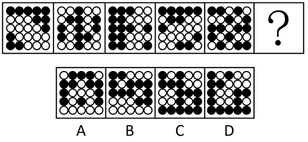

# 属性规律-对称性（黑白球分组看中心对称）

考点：[[20-考点/判断推理/图形推理/属性规律-对称性（黑白球分组看中心对称）|图形推理 / 属性规律-对称性（黑白球分组看中心对称）]]

**问法模型**：“选择最合适的一个填入问号处使之呈现规律性”→ 元素组成不同优先属性规律，整体无规律时黑白分开看，分别检验黑球/白球构成的子图形是否满足对称性

## 推理链
1. 第1步：题干5幅图均由黑球和白球填满同一网格，元素组成不同，整体黑白混合观察无明显规律
2. 第2步：所有图形均由黑球和白球两种元素构成，采用“黑白分开看”策略，将黑球、白球拆分为两个独立子图形分别找规律
3. 第3步：单独观察黑球的位置分布，旋转、移动均无明显规律，排除黑球规律
4. 第4步：单独观察白球，题干5幅图中白球连成的子图形绕中心旋转180°后均与自身重合，即白球部分均为中心对称图形
5. 第5步：逐项检验：A、B、D项白球部分旋转180°后不能与自身重合（非中心对称），C项白球部分绕中心旋转180°后完全重合
6. 第6步：只有C项满足“白球部分为中心对称图形”的规律，故选C

**最快解法**：⚡ 黑白分开看+对称性检验：整体无规律→白球单独连线观察，绕图形中心转180°看是否与自身重合；题干5幅图白球均中心对称，快速扫描选项，C项白球对角位置一一对应，A、B、D旋转后错位排除

## 易错点
- ⚠ 只做整体观察或只盯着黑球找规律，错失“黑白分开看”后白球的中心对称规律
- ⚠ 把中心对称（旋转180°重合）误判为轴对称（翻折重合），可能误选A或B等轴对称但非中心对称的选项
- ⚠ 纠结黑球数量、位置等数量规律无果后放弃分组思路而乱选

## 母题抽象
> 🧩 当题干图形由黑白球（黑白块）填满网格且整体无规律时，用“黑白分开看”方法，分别把黑球、白球连成子图形，检验其是否满足中心对称/轴对称等属性规律，再逐项对照

**同类特征**：黑白球填满网格、元素组成不同、整体观察无规律、黑白分开看、白球部分为中心对称图形、属性规律-对称性

## 相关题
- [[10-真题/判断推理/图形推理/4651586 对称性-两图形对称轴的位置关系（垂直）|4651586]]（江苏 2022，相关度2）
- [[10-真题/判断推理/图形推理/10204454 数量规律-部分数（黑白球连通区域数做和）|10204454]]（甘肃 2024，相关度1）
- [[10-真题/判断推理/图形推理/10204604 数量规律-线数量（汉字横线数）|10204604]]（辽宁 2024，相关度1）
- [[10-真题/判断推理/图形推理/10297050 数量规律-特殊计数（线条穿过小白球的数量）|10297050]]（天津 2025，相关度1）
- [[10-真题/判断推理/图形推理/10297127 图形间关系-相交图形中不相交边数量（黑白图形相交）|10297127]]（天津 2025，相关度1）

---

### 题干

从所给的四个选项中，选择最合适的一个填入问号处，使之呈现一定的规律性：

### 选项
- A. A
- B. B
- C. C　✅
- D. D

### 官方解析
元素组成不同，优先考虑属性规律。观察发现，题干图形整体无规律，所有图形均由黑球和白球构成，考虑黑白分开看。整体观察黑球没有明显规律，继续观察白球发现，题干图形中白球部分均为中心对称图形，只有C项符合。
故正确答案为C。

### 给定材料
（无）
