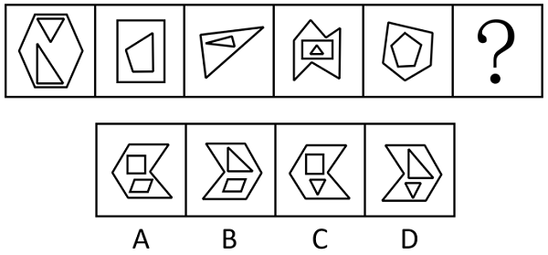

# 数量规律-线数量（内外图形直线数相等）

考点：[[20-考点/判断推理/图形推理/数量规律-线数量（内外图形直线数相等）|图形推理 / 数量规律-线数量（内外图形直线数相等）]]

**问法模型**：问号处填入最合适图形使之呈现规律性 → 元素组成不同且无属性规律时，转向数量规律，将嵌套图形内外分开数直线数

## 推理链
1. 第1步：题干五幅图元素组成不同，对称、曲直等属性规律不明显，且每幅图均为'外部多边形+内部多边形'的嵌套结构，考虑数量规律、内外分开看
2. 第2步：数外部图形直线数：图1外为六边形6条、图3外为三角形3条、图5外为五边形5条，图2外、图4外（箭头形）分别与其内部图形对应
3. 第3步：数内部图形直线数并求和：图1内两三角形3+3=6、图3内三角形3、图5内五边形5，发现每幅图内部直线数之和=外部直线数
4. 第4步：将规律用到？处并逐项对照：四个选项外部均为同一箭头形六边形（6条），A内4+4=8、B内3+4=7、C内4+3=7，均不等于6；D内三角形+三角形3+3=6，与外部6条相等，符合规律

**最快解法**：⚡ 内外分开数线法：先数外部图形直线数（四个选项外部相同，均为6条），再数各选项内部图形直线数之和，仅D项3+3=6与外部相等，直接锁定答案

## 易错点
- ⚠ 只数内部图形或只数外部图形，漏掉'内外直线数相等'这一对照关系
- ⚠ 内部含两个图形时忘记把两图直线数求和后再与外部比较
- ⚠ 误入属性规律（对称、封闭区域面数）或数交点、笔画数等其他数量维度，绕远路

## 母题抽象
> 🧩 当题干出现内外嵌套的纯直线多边形图形且属性无规律时，内外分开数直线数，找'内部直线数之和=外部直线数'（或内-外为常数）的关系验证选项。

**同类特征**：内外嵌套图形、全部由直线多边形构成、元素组成不同、无明显属性规律、数量规律-线数量、内部直线数=外部直线数

## 相关题
- [[10-真题/判断推理/图形推理/4818046 数量规律-线数量（曲线数与直线数分开数，构成双等差数列）|4818046]]（四川 2022，相关度3）
- [[10-真题/判断推理/图形推理/10204454 数量规律-部分数（黑白球连通区域数做和）|10204454]]（甘肃 2024，相关度2）
- [[10-真题/判断推理/图形推理/10297050 数量规律-特殊计数（线条穿过小白球的数量）|10297050]]（天津 2025，相关度2）
- [[10-真题/判断推理/图形推理/10297262 数量规律-面的形状种类（封闭面种类数分组）|10297262]]（浙江 2025，相关度2）
- [[10-真题/判断推理/图形推理/10297314 数量规律-交点数（曲直交点）|10297314]]（浙江 2025，相关度2）

---

### 题干

从所给的四个选项中，选择最合适的一个填入问号处，使之呈现一定的规律性：

### 选项
- A. A
- B. B
- C. C
- D. D　✅

### 官方解析
元素组成不同，且无明显属性规律，考虑数量规律。题干图形内外均由多边形构成，可考虑内外分开看。观察发现，每幅图中内部直线数=外部直线数，故？处应用此规律，只有D项符合。
故正确答案为D。

### 给定材料
（无）
