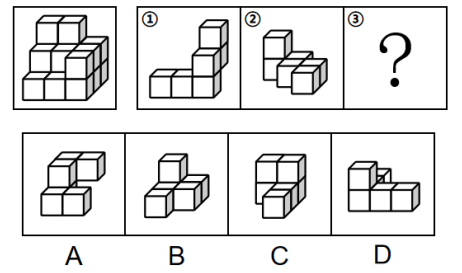
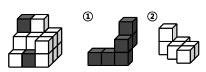

# 图形推理-立体拼合（正方体堆叠多面体组合）

考点：[[20-考点/判断推理/图形推理/图形推理-立体拼合（正方体堆叠多面体组合）|图形推理 / 图形推理-立体拼合（正方体堆叠多面体组合）]]

**问法模型**：已知目标多面体和组件①②、问第三个组件③ → 立体拼合的'占位试拼+逐层凹凸互补'模型（组件允许任意旋转，必要时打破其原有层数方向）

## 推理链
1. 第1步：题干左图多面体由相同正方体堆叠而成，自上而下可分为3层，需由①、②、③三个组件拼合而成
2. 第2步：图①是带3层立柱的L形（底部一排3块、一端向上再叠2块），先按原样保持3层试拼——直接拼在多面体左侧
3. 第3步：此拼法下图②无论怎样旋转放置都无法与剩余空缺补合成题干多面体，故排除'①直立3层'的拼法
4. 第4步：改将图①整体旋转放倒，使其由3层立柱变为上下两层的形态，拼入多面体右侧
5. 第5步：再将图②旋转后拼入多面体左侧，①②占位确定后，剩余空缺为'上下两层、每层各有3个小正方体'的形状
6. 第6步：对照选项：A项上下两层各为3个小正方体，与剩余空缺逐层吻合；B、C、D的层数或每层块数分布不符，排除

**最快解法**：⚡ 凹凸互补+旋转试拼法：先验证①保持3层拼左侧时②放不进，改令①旋转放倒成两层放右侧、②旋转放左侧，逐层清点剩余空缺为'两层各3块'，直接锁定A

## 易错点
- ⚠ 思维定势：默认图①的3层立柱必须竖直拼入，没想到可将①旋转放倒为两层形态参与拼合
- ⚠ 只对总块数不验分层结构：块数凑对但每层分布不符的B/C/D容易误选
- ⚠ 忽视组件可在空间中任意旋转（含放倒），导致①②占位判断错误、剩余空缺算错

## 母题抽象
> 🧩 当题干给出目标堆叠体和部分组件、求剩余组件时，先数总块数，再允许组件任意旋转做占位试拼（若直立方向拼不合就放倒重试），对剩余空缺逐层凹凸互补即得答案

**同类特征**：相同正方体堆叠多面体、三个多面体组合拼合、组件可旋转放置、自上而下分3层、给出①②求问号处组件③、立体拼合

## 相关题
- [[10-真题/判断推理/图形推理/4637338 图形推理-立体拼合（多正方体组合拆分·分层计数+凹凸一致）|4637338]]（国考 2022，相关度2）
- [[10-真题/判断推理/图形推理/2776149 图形推理-立体拼合（小方块计数守恒+分层形状咬合）|2776149]]（浙江 2021，相关度1）
- [[10-真题/判断推理/图形推理/10204640 立体拼合（多面体组合：数量守恒+凹凸互补+旋转）|10204640]]（河南 2024，相关度1）
- [[10-真题/判断推理/图形推理/12019797 立体拼合-由两视图及全等小块反推小立体（数小立方体+旋转试装）|12019797]]（浙江 2026，相关度1）
- [[10-真题/判断推理/图形推理/12881949 立体拼合-多块拼合正方体（凹凸互补+旋转）|12881949]]（广东 2025，相关度1）

---

### 题干

左图给定的是由相同正方体堆叠而成多面体的视图。该多面体可以由①、②和③三个多面体组合而成，以下哪项能填入问号处？

### 选项
- A. A　✅
- B. B
- C. C
- D. D

### 官方解析

本题考查立体拼合。观察题干给出的多面体可知，该多面体由上至下可分为3层。观察发现，图①也有3层，可以直接拼合在多面体的左侧，如下图所示，但此时图②无论如何放置，都无法与其拼合成题干多面体。

所以只能旋转图①，使其为上下两层的形态。将图①按照下图方向旋转，此时可以将图①放在该多面体的右侧，如下图所示：

再将图②旋转后，放在该多面体的左侧，如下图所示：

综上，图③应选择一个上下两层都有3个小正方体的图形，只有A项符合。

故正确答案为A。

### 给定材料
（无）
