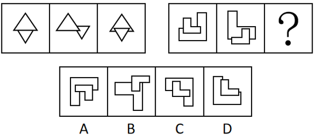
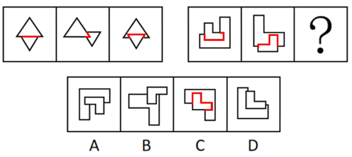

# 图形间关系-相交线（两图相交于线的线段条数呈等差递增）

考点：[[20-考点/判断推理/图形推理/图形间关系-相交线（两图相交于线的线段条数呈等差递增）|图形推理 / 图形间关系-相交线（两图相交于线的线段条数呈等差递增）]]

**问法模型**：两套图形、每组三幅、问号在第二组末位 → 先归纳第一组图形间关系规律（数相交线条数），再将该规律延续到第二组定位问号

## 推理链
1. 第1步：第一组每幅图均由两个小三角形拼合，元素组成不同但结构一致，两图均'相交于线'（有一条或多条公共边）
2. 第2步：对第一组逐幅数两图形重合（相交）的线段条数：第1幅1条、第2幅2条、第3幅3条，构成1、2、3的等差递增规律
3. 第3步：第二组每幅图同样由两个小图形（L形/多边形）拼合且相交于线，可迁移同一'数相交线'规律；前两幅相交线数依次为4、5
4. 第4步：按等差递增推算，问号处图形两小图形的相交线数应为6
5. 第5步：逐项数选项中两图形相交的线段条数并与6对照，只有C项相交线为6条，A、B、D均不足6条
6. 第6步：故问号处选C，两套图形均满足'相交线条数依次递增'的最大相似性

**最快解法**：⚡ 数线排除法：确认两组图均为'两小图形拼合、相交于线'后，直接数每幅图两图形公共边的条数——第一组1、2、3递增，第二组4、5、？→锁定？=6，快速数四个选项相交线数，唯一为6条的即C

## 易错点
- ⚠ 只关注小图形自身形状（三角形、L形）的变化，漏看'相交于线'这一图形间关系考点
- ⚠ 误把交点数或两图重合的面积当规律，数成'相交于点'而选错
- ⚠ 数相交线时漏数：一条边与对方多条边分段重合时应分别计数，或把仅接触端点（交于点）误计为一条相交线

## 母题抽象
> 🧩 当题干出现'两套图形、每幅均由两个小图形拼合且元素组成不同'时，优先考虑图形间关系，重点数'相交于线'的线段条数是否呈等差递增，再按第二组已知数值外推问号并对照选项

**同类特征**：两套图形各三幅、每幅图由两个小图形拼合、两图形相交于线（有公共边）、元素组成不同、相交线条数呈等差递增、问号位于第二组末位

## 相关题
- [[10-真题/判断推理/图形推理/10204454 数量规律-部分数（黑白球连通区域数做和）|10204454]]（甘肃 2024，相关度1）
- [[10-真题/判断推理/图形推理/10204604 数量规律-线数量（汉字横线数）|10204604]]（辽宁 2024，相关度1）
- [[10-真题/判断推理/图形推理/10297050 数量规律-特殊计数（线条穿过小白球的数量）|10297050]]（天津 2025，相关度1）
- [[10-真题/判断推理/图形推理/10297127 图形间关系-相交图形中不相交边数量（黑白图形相交）|10297127]]（天津 2025，相关度1）
- [[10-真题/判断推理/图形推理/10297148 数量规律-线的细化（端点连线穿过线条数；备选：平行线组数）|10297148]]（天津 2025，相关度1）

---

### 题干

从四个选项中选择一个替代问号，使两套图形的规律表现出最大的相似性，最适合的是（    ）。

### 选项
- A. A
- B. B
- C. C　✅
- D. D

### 官方解析

元素组成不同，且每幅图均为两个小图形拼合在一起，优先考虑图形间关系。观察发现，第一组图形中，两个小图形均相交于线，考虑相交线的数量。第一组图形相交线的数量依次为：1、2、3，第二组图形相交线的数量依次为：4、5、？，故“？”处图形相交线的数量应为6，只有C项符合。

故正确答案为C。

### 给定材料
（无）
