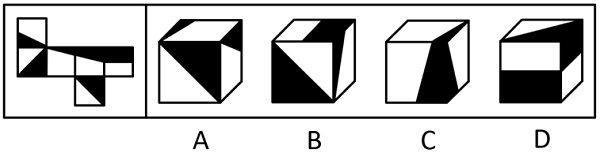
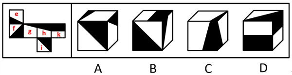
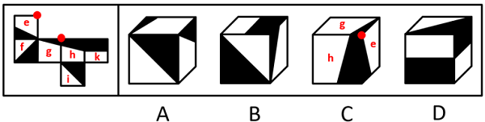

# 空间重构-六面体折叠（相对面排除+公共点法）

考点：[[20-考点/判断推理/图形推理/空间重构-六面体折叠（相对面排除+公共点法）|图形推理 / 空间重构-六面体折叠（相对面排除+公共点法）]]

**问法模型**：题干为'左边给定纸盒外表面，右边哪项能够由它折叠而成'的空间重构问法 → 先用相对面排除与元素数量排除锁面，再用公共点法比对相邻三面细节定答案

## 推理链
1. 第1步：给展开图六面编号并提取图案特征：面e含黑色三角形、面f含黑色角形（可区分黑色锐角与黑色直角两处）、面k是展开图中唯一的黑色矩形面；面e与面i为一对相对面
2. 第2步：确定方法：相对面不能在立体图中同时出现；对相邻三面采用公共点法——展开图中三面公共点紧邻的图案细节，折叠后保持不变
3. 第3步：A项右侧面为面e，因面e与面i相对不能同时出现，故A项由面f、面g、面e构成；展开图中这三面的公共点挨着面f中的黑色锐角，而A项中公共点挨着面f中的黑色直角，不一致，排除
4. 第4步：B项由面f、面k、面e构成，三面相对位置及公共点紧邻图案（面f黑色锐角一侧）与展开图完全一致，当选
5. 第5步：C项由面h、面g、面e构成；展开图中这三面的公共点没有挨着面e中的黑色三角形，而C项中公共点却挨着面e的黑色三角形，不一致，排除
6. 第6步：D项同时出现两个带黑色矩形的面，而展开图中只有一个黑色矩形面（面k），元素数量矛盾，排除
7. 第7步：综上仅B项与展开图一致，故正确答案为B

**最快解法**：⚡ 公共点排除法：先用'元素数量'秒杀D项（黑色矩形面仅面k一个）；A项面e、面i相对面排除干扰后，比对公共点挨着'黑色锐角还是黑色直角'；C项比对公共点是否挨着面e黑色三角形；三处细节均指向B

## 易错点
- ⚠ A项中黑色锐角与黑色直角形状相近，公共点挨错一侧就会误选A
- ⚠ C项忽视公共点与面e黑色三角形'挨着/不挨着'的位置关系
- ⚠ 忘记先排相对面：面e与面i是相对面不能同时出现，跳过此步会错认A项的构成面

## 母题抽象
> 🧩 当六面体展开图各面图案存在'角、三角形是否紧邻公共点'的细节差异时，用公共点法：在展开图中定位选项所涉三面的公共点，比对公共点紧邻的图案细节（锐角/直角/三角形）并结合元素数量逐一排除

**同类特征**：纸盒外表面展开图折叠、问哪项能够由它折叠而成、各面含黑色三角形、黑色矩形、黑色角形图案、相对面不能同时出现、公共点紧邻图案细节辨析、元素数量核对排除

## 相关题
- [[10-真题/判断推理/图形推理/1746880 空间重构-六面体折叠（相对面排除+画边法）|1746880]]（国考 2016，相关度2）
- [[10-真题/判断推理/图形推理/2172154 空间重构-六面体折纸盒（相对面排除＋公共点法）|2172154]]（广州市考 2018，相关度2）
- [[10-真题/判断推理/图形推理/2367990 空间重构-六面体折叠（相对面排除＋相邻面特征边验证）|2367990]]（江苏 2019，相关度2）
- [[10-真题/判断推理/图形推理/4928010 空间重构-折纸盒（相对面排除+公共边-公共点法）|4928010]]（选调 2022，相关度2）
- [[10-真题/判断推理/图形推理/5911304 空间重构-六面体折叠（公共边法＋公共点法）|5911304]]（浙江 2024，相关度2）

---

### 题干

左边给定的是纸盒的外表面，右边哪项能够由它折叠而成?

### 选项
- A. A
- B. B　✅
- C. C
- D. D

### 官方解析

对题干展开图进行编号，如下图所示，逐一分析选项。

A项：选项右侧面为面e，面e和面i是相对面，不能同时出现，故选项由面f、面g和面e构成。题干展开图中，这三个面的公共点挨着面f中的黑色锐角，而选项中，这三个面的公共点挨着面f中的黑色直角，选项与题干展开图不一致，排除；

B项：选项由面f、面k和面e构成，选项与题干展开图一致，当选；

C项：选项由面h、面g和面e构成，题干展开图中，这三个面的公共点没有挨着面e中的黑色三角形，而选项中，这三个面的公共点挨着面e中的黑色三角形，选项与题干展开图不一致，排除；

D项：选项中出现了两个有黑色矩形的面，而题干展开图中只有一个有黑色矩形的面（面k），选项与题干展开图不一致，排除。

故正确答案为B。

### 给定材料
（无）
