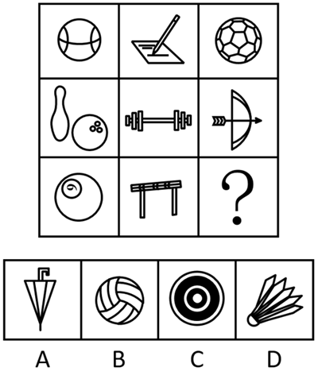

# 属性规律-曲直性（九宫格横行遍历）

考点：[[20-考点/判断推理/图形推理/属性规律-曲直性（九宫格横行遍历）|图形推理 / 属性规律-曲直性（九宫格横行遍历）]]

**问法模型**：九宫格'呈现一定的规律性'且元素组成不同 → 优先按横行看属性规律，锁定曲直性找每行遍历规律

## 推理链
1. 第1步：九宫格各图元素组成不同（篮球、钢笔、足球、保龄球、哑铃、弓箭、曲棍球、跨栏架均为不同实物），优先考虑属性规律
2. 第2步：题干同时出现全直线图形与全曲线图形，锁定曲直性考点；九宫格优先横行观察
3. 第3步：第一行：篮球为全曲线图形、钢笔写字为全直线图形、足球（圆形轮廓+多边形纹路）为有曲有直图形
4. 第4步：第二行验证：保龄球瓶与球为全曲线、哑铃为全直线、弓箭（弓弯曲+箭笔直）为有曲有直，规律成立
5. 第5步：第三行应用：曲棍球为全曲线、跨栏架为全直线，故'？'处应填有曲有直图形
6. 第6步：辨析选项：A雨伞为全直线、B排球为全曲线、C同心圆靶为全曲线、D羽毛球既有曲线球头又有直线羽毛，有曲有直，只有D符合

**最快解法**：⚡ 图形规律口诀：九宫格先横行看属性。每行依次为'全曲—全直—有曲有直'遍历，第三行缺'有曲有直'；快速扫选项：A全直、B全曲、C全曲，直接排除，D混合当选。

## 易错点
- ⚠ 实物生活化图形易误导考生去数面/线/笔画等数量规律，漏掉属性规律这一优先入口
- ⚠ 九宫格未按'先横行'顺序观察，误按列或整体九宫布局找规律
- ⚠ D羽毛球与B排球同为球类实物易混淆，须辨析D中球头（曲）与羽毛（直）并存的有曲有直特征，而B排球的弧线纹路仍属全曲线

## 母题抽象
> 🧩 当九宫格图形元素组成不同且混有生活实物图时，先横行看属性（曲直性）；若每行呈'全曲线/全直线/有曲有直'的遍历规律，问号处补该行缺失的属性类型即可。

**同类特征**：九宫格、元素组成不同、生活实物图形（球类/文具/器材）、全直线与全曲线图形并存、问法'呈现一定的规律性'

## 相关题
- [[10-真题/判断推理/图形推理/11367791 属性类-对称性（对称轴方向与条数、轴对称+中心对称）＋数量类-面数量（九宫格横行复合规律）|11367791]]（江苏 2025，相关度2）
- [[10-真题/判断推理/图形推理/11881082 属性规律-对称性（对称轴方向）|11881082]]（黑龙江 2024，相关度2）
- [[10-真题/判断推理/图形推理/14993416 数量规律-点数量（黑点个数按行求和恒值）|14993416]]（选调 2024，相关度2）
- [[10-真题/判断推理/图形推理/17097275 图形间关系-点相交（点接触 vs 线接触）|17097275]]（山西 2024，相关度2）
- [[10-真题/判断推理/图形推理/17467550 数量规律-交点数（九宫格按行等差递增）|17467550]]（湖北 2026，相关度2）

---

### 题干

从所给的四个选项中，选择最合适的一个填入问号处，使之呈现一定的规律性。

### 选项
- A. A
- B. B
- C. C
- D. D　✅

### 官方解析
元素组成不同，优先考虑属性规律。观察发现，题干出现全直线、全曲线图形，考虑曲直性。九宫格优先看横行，第一行图形分别为全曲线图形、全直线图形、有曲有直图形；经验证，第二行符合此规律；第三行应用此规律，故“？”处图形应是有曲有直图形，只有D项符合。
故正确答案为D。

### 给定材料
（无）
