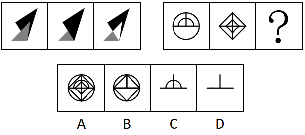

# 样式规律-求同（两图叠加保留相同部分-去异存同）

考点：[[20-考点/判断推理/图形推理/样式规律-求同（两图叠加保留相同部分-去异存同）|图形推理 / 样式规律-求同（两图叠加保留相同部分/去异存同）]]

**问法模型**：两组图对应位置比较、求'？'处图形 → 先由第一组归纳样式运算规律（叠加保留相同部分），再原样应用到第二组

## 推理链
1. 第1步：题干为两组图，第一组：图1为黑色小箭形+灰色三角形，图2为大黑色实心形+灰色三角形，图3为黑色公共轮廓形+灰色三角形，三图元素组成相似，优先考虑样式规律
2. 第2步：对比第一组发现，图3恰好是图1与图2叠加后仅保留重合部分（灰色三角形及黑色形的公共轮廓）的结果，即'去异存同'
3. 第3步：第二组应用同一规律：图1为圆（含水平直径线、上半部竖线及小半圆弧），图2为菱形（含中部竖线、内部小菱形及其水平对角线段）
4. 第4步：将两图重叠，圆弧、菱形轮廓、内部小菱形等仅单图具有的线条均被去掉，只有水平横线与上半段竖线在两图中重合
5. 第5步：共同部分组合为'横线+向上竖线'（⊥形），与选项对照：A为两图元素叠加求全，B保留圆轮廓，C保留了单图独有的半圆弧，均不符合；D恰好只剩横线与上半竖线，符合'保留相同部分'

**最快解法**：⚡ 样式规律口诀'元素相似看样式，图3变简想求同'：第一组确认'叠加保留相同部分'后，第二组直接找两图重合的线条——水平横线+上半竖线，秒选D（C的半圆弧只在圆中出现，必排除）

## 易错点
- ⚠ 把规律误判为'去同存异'（叠加相消），从而错选包含两图独有线条的A或B
- ⚠ 误以为求同需保留形状相近的轮廓，被C的半圆弧迷惑——弧线只在图1中存在，不属于'相同部分'
- ⚠ 忽略图2内部小菱形的水平对角线与图1的水平直径重合，漏掉横线后可能误排除D

## 母题抽象
> 🧩 当两组图元素组成相似且第三幅图明显比前两幅'线条更少'时，用'去异存同'：把前两图重叠，只保留两图共有的线条/元素，即为问号处图形

**同类特征**：两组图对应位置比较、元素组成相似、图3比图1、图2更简单（线条更少）、线条类图形叠加、问号位于第二组末位、选项含'部分组合'与'求全'两类干扰

## 相关题
- [[10-真题/判断推理/图形推理/10204610 样式规律-加减同异（去同存异），九宫格列规律|10204610]]（辽宁 2024，相关度1）
- [[10-真题/判断推理/图形推理/10297349 样式规律-黑白运算|10297349]]（浙江 2025，相关度1）
- [[10-真题/判断推理/图形推理/10297407 样式规律-黑白运算（定义叠加）|10297407]]（四川 2025，相关度1）
- [[10-真题/判断推理/图形推理/11226895 图形推理-样式规律（叠加求同-保留相同部分）|11226895]]（上海 2025，相关度1）
- [[10-真题/判断推理/图形推理/11226896 样式规律-加减同异（分区域：上圆内部求异+下椭圆内部求同）|11226896]]（上海 2025，相关度1）

---

### 题干

下列选项中最符合所给图形规律的是（    ）。

### 选项
- A. A
- B. B
- C. C
- D. D　✅

### 官方解析
元素组成相似，优先考虑样式规律。观察第一组图形发现，图1与图2叠加后保留相同部分得到图3，第二组图形应用此规律，故？处图形应为图1与图2叠加后保留相同部分得到的图形，只有D项符合。
故正确答案为D。

### 给定材料
（无）
