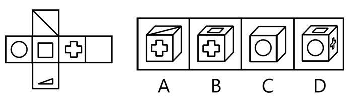
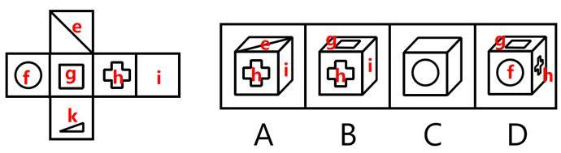

# 空间重构-六面体折纸盒（相对面排除+相邻面验证）

考点：[[20-考点/判断推理/图形推理/空间重构-六面体折纸盒（相对面排除+相邻面验证）|图形推理 / 空间重构-六面体折纸盒（相对面排除+相邻面验证）]]

**问法模型**：给出立方体展开图问'哪个可以折成'→折纸盒模型：先标三组相对面做排除，再验证相邻面组合与图案方向

## 推理链
1. 第1步：展开图为一行四面'圆、小方框、十字、空白'，其上方挂对角线面、下方挂小三角面，共六个面，其中只有一个空白面。
2. 第2步：用'一行四面隔一相对'规则定相对面：圆↔十字、小方框↔空白；上下悬挂的两面（对角线面↔小三角面）为第三组相对面；相对面在立体图中不能同时出现。
3. 第3步：B项由小方框、十字、空白三面构成，小方框与空白是相对面却同时可见，排除。
4. 第4步：C项顶面与右侧面均为空白，出现两个空白面，而展开图只有一个空白面，排除。
5. 第5步：D项由圆、小方框、十字三面构成，圆与十字是相对面却同时可见，排除。
6. 第6步：A项由对角线面、十字、空白三面构成，折叠后对角线面与一行四个面均相邻，三面两两相邻、无相对面冲突，且对角线指向经旋转验证不矛盾，当选。

**最快解法**：⚡ 相对面排除法：先在展开图标出三组相对面（圆↔十字、方框↔空白、对角线↔三角）；B中'方框+空白'同现、D中'圆+十字'同现直接排除，C数空白面数量（展开图仅一个）排除，剩余A即为答案。

## 易错点
- ⚠ 误把一行中'隔一个'的两面（圆与十字、方框与空白）当成相邻面，错杀正确项或放过错误项
- ⚠ 忽略'特征面数量'这一排除角度：展开图只有一个空白面，C项立体图却出现两个空白面
- ⚠ 只看面组合、不看对角线等特征线的指向与相邻关系，凭感觉误判A项

## 母题抽象
> 🧩 当题干给六面体展开图且各选项由三个可见面构成时，先用'隔一相对'标出三组相对面，凡选项同时出现一对相对面即排除，再用空白面等特征面数量与相邻面图案方向收尾定唯一答案。

**同类特征**：立方体外表面展开图、一行四面、上下各挂一面、问'哪个可以折成'、存在空白面、特征图案：圆/小方框/十字/对角线/小三角形、选项均为三面可见的立体图

## 相关题
- [[10-真题/判断推理/图形推理/2742184 空间重构-六面体折叠（相对面排除+公共点引线验证）|2742184]]（江苏 2021，相关度1）
- [[10-真题/判断推理/图形推理/4714994 空间重构-折纸盒（相邻面特征线与图案的相交关系）|4714994]]（福建 2018，相关度1）
- [[10-真题/判断推理/图形推理/5697923 空间重构-六面体展开图折叠（相对面判定与排除）|5697923]]（江苏 2023，相关度1）

---

### 题干

以下为立方体的外表面，下列哪个立方体可以由此折成（    ）。

### 选项
- A. A　✅
- B. B
- C. C
- D. D

### 官方解析

本题为空间重构题，对展开图进行编号，如下图所示：

A项：选项由面e、面h和面i构成，选项与展开图一致，当选；

B项：选项由面g、面h和面i构成，展开图中面g和面i为相对面，相对面不能同时出现，选项与展开图不一致，排除；

C项：选项中存在两个空白面，而展开图中只有一个空白面，选项与展开图不一致，排除；

D项：选项由面f、面g和面h构成，展开图中面f和面h为相对面，相对面不能同时出现，选项与展开图不一致，排除。

故正确答案为A。

### 给定材料
（无）
