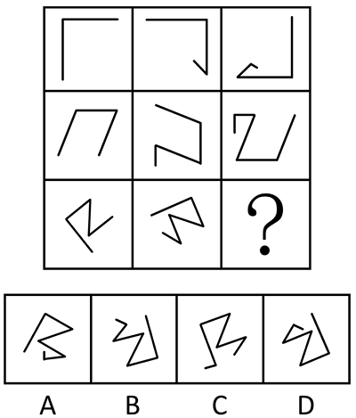

# 位置规律（旋转）+数量规律（端点加线递增）复合考点

考点：[[20-考点/判断推理/图形推理/位置规律（旋转）+数量规律（端点加线递增）复合考点|图形推理 / 位置规律（旋转）+数量规律（端点加线递增）复合考点]]

**问法模型**：九宫格问号处选最合适图形呈现规律性 → 横行相邻图对比，找'旋转+端点加线'复合规律并做加线方向二级辨析

## 推理链
1. 第1步：题干为九宫格，各行图形均为同源折线、元素组成基本相同，且从左到右线段条数逐格递增，提示规律为'位置变化+加线'叠加
2. 第2步：九宫格优先看横行，对相邻两图做'旋转+加线'拆解：第一行图1顺时针旋转且在端点处增加1条直线得到图2，图2顺时针旋转且在端点处增加1条直线得到图3
3. 第3步：验证第二行，图1到图2、图2到图3同样满足'顺时针旋转+端点加1条线'，确认该复合规律逐行可迁移
4. 第4步：应用规律于第三行——问号处图形应由第三行图2顺时针旋转且在端点处增加1条直线得到，据此排除A、C两项
5. 第5步：进行加线方向二级辨析：第一行沿端点顺时针方向加线，第二行沿端点逆时针方向加线，第三行图1到图2为顺时针方向加线，故问号处也应由图2沿顺时针方向加线
6. 第6步：对照剩余选项，仅D项满足'图2顺时针旋转+端点顺时针加1条线'，故正确答案为D

**最快解法**：⚡ 相邻图对比法+二级辨析：先锁定'顺时针旋转+端点加1条线'排除A、C，再看加线方向（第三行与第一行同为顺时针）在B、D中锁定D

## 易错点
- ⚠ 只验证旋转和加线数量、忽略加线方向（顺/逆时针）的行间差异，在B、D间误选
- ⚠ 第一行规律直接套到第二行出错，未发现各行加线方向可交替（第二行为逆时针），需逐行验证再迁移
- ⚠ 新加线段应接在折线端点处，若误认为接在中间顶点处会导致图形结构比对错误

## 母题抽象
> 🧩 当九宫格每行图形元素基本相同且线段数逐格递增时，用'相邻图对比'归纳'旋转+端点加线'复合规律，再做加线方向（顺/逆时针）二级辨析锁定唯一选项

**同类特征**：九宫格、元素组成基本相同、折线图形、线段数量从左到右递增、端点加线、整体旋转

## 相关题
- [[10-真题/判断推理/图形推理/10204610 样式规律-加减同异（去同存异），九宫格列规律|10204610]]（辽宁 2024，相关度1）
- [[10-真题/判断推理/图形推理/10297349 样式规律-黑白运算|10297349]]（浙江 2025，相关度1）
- [[10-真题/判断推理/图形推理/10297407 样式规律-黑白运算（定义叠加）|10297407]]（四川 2025，相关度1）
- [[10-真题/判断推理/图形推理/10975255 数量规律-元素个数与部分数（黑白球连通堆数）|10975255]]（江苏 2024，相关度1）
- [[10-真题/判断推理/图形推理/11226890 位置规律（端点沿外框顺时针移动+交点沿内部路径逆时针移动的双轨迹平移）|11226890]]（上海 2025，相关度1）

---

### 题干

从所给的四个选项中，选择最合适的一个填入问号处，使之呈现一定的规律性。

### 选项
- A. A
- B. B
- C. C
- D. D　✅

### 官方解析

元素组成基本相同，优先考虑位置规律。九宫格优先看横行，第一行中，图1顺时针旋转且在端点处增加1条直线得到图2，图2顺时针旋转且在端点处增加1条直线得到图3，第二行符合此规律，因此第三行中问号处图形应该由图2顺时针旋转且在端点处增加1条直线得到，据此可以排除A、C两项。继续观察发现，第一行在端点处是沿顺时针方向增加直线，第二行在端点处是沿逆时针方向增加直线，第三行图1在端点处沿顺时针方向增加直线得到图2，因此问号处图形也应该由图2在端点处沿顺时针方向增加直线得到，只有D项符合。

故正确答案为D。

### 给定材料
（无）
