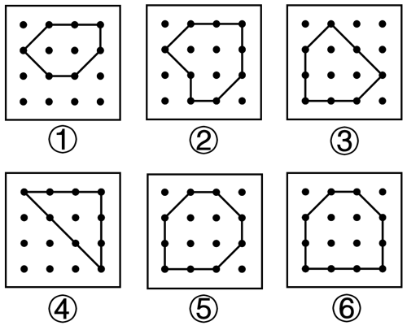

# 数量规律-素数量（封闭图形内部黑点个数的奇偶二分）

考点：[[20-考点/判断推理/图形推理/数量规律-素数量（封闭图形内部黑点个数的奇偶二分）|图形推理 / 数量规律-素数量（封闭图形内部黑点个数的奇偶二分）]]

**问法模型**：“把六个图形分为两类，使每一类都有各自的共同特征或规律”→分组分类题：属性规律无果时转向数量规律，对可数要素做奇偶/数量二分验证

## 推理链
1. 第1步：题干要求“把下面的六个图形分为两类，使每一类都有各自的共同特征”，六图均为4×4点阵上由线条围成的封闭图形，且封闭图形内外都分布小黑点。
2. 第2步：元素组成不同且无明显属性（对称、曲直、封闭性均一致），考虑数量规律；因封闭图形外部的黑点分为多个部分、计数零散，按官方提示优先数封闭图形内部的小黑点个数。
3. 第3步：逐图数内部黑点：图①为2个、图②为3个、图③为3个、图④为1个（斜线及边框上的点不计入内部）、图⑤为4个、图⑥为4个。
4. 第4步：按奇偶二分：图①⑤⑥内部黑点个数为偶数（2、4、4），图②③④内部黑点个数为奇数（3、3、1），两组各自构成“内部黑点个数的奇偶性”这一共同特征。
5. 第5步：与选项对照，只有D项“①⑤⑥，②③④”符合该分法，故正确答案为D。

**最快解法**：⚡ 奇偶二分法+内部优先：只数每个封闭图形内部的小黑点个数（①2、②3、③3、④1、⑤4、⑥4），偶数组①⑤⑥、奇数组②③④，直接锁定D。

## 易错点
- ⚠ 把封闭图形内外的全部黑点一起数：外部黑点被线条分割成多个部分、数量无统一规律，必须只数封闭区域内部的黑点
- ⚠ 把压在边线上的黑点误计入内部或漏计（如图④斜线上的点在周界上，不属于内部）
- ⚠ 属性规律（对称、开闭、直曲）走不通后未及时切换到数量规律，或误去数线条数、交点数、外部黑点堆数

## 母题抽象
> 🧩 当分组分类题干出现‘线条围成的封闭图形+封闭区域内外散布小元素’特征时，用‘内部元素计数法’：优先数封闭区域内部小元素个数，按奇偶性或数值二分验证选项。

**同类特征**：六图分组分类问法、点阵上线条围成封闭图形、封闭图形内外均有小黑点、外部黑点分散为多个部分、内部黑点个数为2/3/3/1/4/4、按奇偶性分成两类

## 相关题
- [[10-真题/判断推理/图形推理/16593204 图形推理-数量规律-笔画数（一笔画-多笔画分组）|16593204]]（青海 2024，相关度1）
- [[10-真题/判断推理/图形推理/18643877 数量规律-切点数（线圆接触关系：相切-相交-相离）|18643877]]（四川 2026，相关度1）
- [[10-真题/判断推理/图形推理/5911335 数量规律-黑球个数（分组分类）|5911335]]（浙江 2024，相关度1）

---

### 题干

把下面的六个图形分为两类，使每一类都有各自的共同特征或规律，分类正确的一项是（    ）。

### 选项
- A. ①③⑤，②④⑥
- B. ①②⑤，③④⑥
- C. ①④⑤，②③⑥
- D. ①⑤⑥，②③④　✅

### 官方解析
本题为分组分类题目。元素组成不同，且无明显属性规律，考虑数量规律。观察发现，题干均有线条围成的封闭图形，且封闭图形内外都有小黑点，考虑素数量，封闭图形内部小黑点的个数分别为2、3、3、1、4、4，其中图①⑤⑥封闭图形内部小黑点个数均为偶数，图②③④封闭图形内部的小黑点个数均为奇数，即图①⑤⑥为一组，图②③④为一组。
故正确答案为D。
注：封闭图形外部的黑点分为多个部分，故优先考虑封闭图形内部的黑点数量。

### 给定材料
（无）
