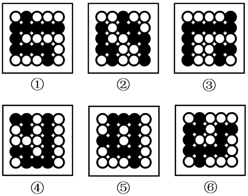

# 数量规律-部分数（黑白球连通区个数）

考点：[[20-考点/判断推理/图形推理/数量规律-部分数（黑白球连通区个数）|图形推理 / 数量规律-部分数（黑白球连通区个数）]]

**问法模型**：'六图分两类，每类各有共同特征'→元素组成相同先排除位置、属性规律，转数量规律；黑白球分堆明显时用'数部分数（连通区数）'分组

## 推理链
1. 第1步：六个图形均由黑球、白球按行列排布构成，元素组成相同，仅黑白分布位置不同
2. 第2步：按'元素组成相同→先试位置（平移/旋转）、再试属性（对称等）→再数数量'的排查顺序，位置与属性规律均不成立；题干黑白球连成明显球堆，优先数部分数
3. 第3步：逐图分别圈出相邻同色球连成的球堆：图①⑤⑥中黑球均连成1个部分，白球均分成4个部分
4. 第4步：同法数图②③④：黑球均分成2个部分，白球均分成3个部分
5. 第5步：①⑤⑥'黑1白4'为同一规律归一组，②③④'黑2白3'归另一组，对照选项仅C（①⑤⑥，②③④）符合

**最快解法**：⚡ 数部分数法（口诀：黑白球分堆明显→数部分数）：每图分别圈黑球连块与白球连块，得①⑤⑥黑1白4、②③④黑2白3，直接选C

## 易错点
- ⚠ 只数一种颜色（如只数黑球）的部分数，信息不足以锁定唯一分组，必须黑、白两色部分数组合成一组数据对比
- ⚠ 连通判定口径前后不一（斜向相触算不算连在一起），全题必须按同一口径数，否则部分数会数错
- ⚠ 见元素组成相同就死磕平移、旋转等位置规律，未及时切换到数量规律而耗时

## 母题抽象
> 🧩 当黑白球（或黑白块）按行列矩阵排布、元素组成相同但位置与属性规律均不成立时，用'数部分数（连通区数）'，以两色各自的部分数组合分组并验证选项

**同类特征**：黑白球按行列排布、元素组成相同、位置、属性规律均不成立、黑白球分堆明显、六图分两类（分组分类题）、数部分数（连通区）

## 相关题
- [[10-真题/判断推理/图形推理/2172768 位置规律（旋转-翻转）|2172768]]（海南 2021，相关度1）
- [[10-真题/判断推理/图形推理/10204458 位置规律-平移（特征交点沿内圈循环平移）|10204458]]（甘肃 2024，相关度1）
- [[10-真题/判断推理/图形推理/10204614 图形推理-位置规律（旋转+翻转交替循环）|10204614]]（黑龙江 2024，相关度1）
- [[10-真题/判断推理/图形推理/10297399 位置规律—平移（多黑块分组循环平移）|10297399]]（四川 2025，相关度1）
- [[10-真题/判断推理/图形推理/10975255 数量规律-元素个数与部分数（黑白球连通堆数）|10975255]]（江苏 2024，相关度1）

---

### 题干

把下面的六个图形分为两类，使每一类图形都有各自的共同特征或规律，分类正确的一项是：

### 选项
- A. ①③④，②⑤⑥
- B. ①②④，③⑤⑥
- C. ①⑤⑥，②③④　✅
- D. ①②⑥，③④⑤

### 官方解析
本题为分组分类题目。元素组成相同，但无位置规律和属性规律，考虑数量规律。观察发现，题干图形黑球和白球分堆明显，考虑部分数。图①⑤⑥中黑球部分数均为1，白球部分数均为4，图②③④中黑球部分数均为2，白球部分数均为3，故图①⑤⑥为一组，图②③④为一组。
故正确答案为C。

### 给定材料
（无）
