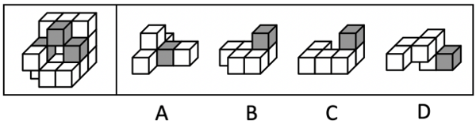
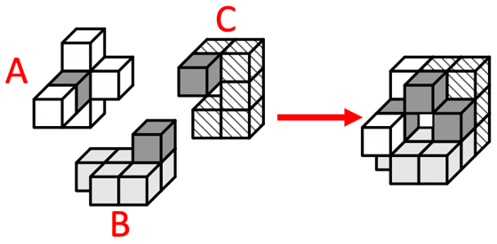

# 立体拼合-多面体组合（选非题）

考点：[[20-考点/判断推理/图形推理/立体拼合-多面体组合（选非题）|图形推理 / 立体拼合-多面体组合（选非题）]]

**问法模型**：'可以由以下4项中除哪项外的3个小多面体组合而成'→选非型立体拼合：逐项验证各小多面体经旋转后能否与题干多面体凹凸互补拼合，排除能拼出的三项，锁定拼不上的一项

## 推理链
1. 第1步：清点题干多面体由15个白色+3个灰色正方体共18块构成，3个灰色块位于多面体中部凹口区域，可作为拼合定位的'锚点'
2. 第2步：立体拼合规则——小多面体可任意旋转，所选3项须满足块数守恒（合计18块）与颜色数守恒（合计3灰）；四个选项各含1个灰色块，数量上均可能满足，故关键在空间凹凸契合
3. 第3步：按官方拼合方案验证——B项直接放入，A、C两项先旋转（官方解析明确'A、C两项中的小多面体需要先旋转'），三块凹凸互补可完整还原题干多面体，灰块恰好对应中部凹口位置
4. 第4步：A、B、C三项拼合后块数、颜色、空间结构均与题干多面体一致
5. 第5步：D项为扁平条状结构、灰色块位于一端，无论怎样旋转均无法与另两块咬合嵌入题干中部的凹空区域
6. 第6步：本题为选非题，不能拼出题干多面体的一项即为正确答案，故选D

**最快解法**：⚡ 灰块锚定+旋转试拼法：以题干3个灰色块所在的中部凹口为锚点，先放入无需旋转的B项，再旋转A、C两项试拼（解析明确A、C旋转后即可拼成），D项怎么旋转都无法嵌入凹空区域；选非问法直接锁定D

## 易错点
- ⚠ 忽略'除哪项外'的选非问法，把能拼合出题干多面体的A/B/C误当答案
- ⚠ 忽略小多面体可以旋转这一前提（A、C须先旋转），按选项原图方向硬套而误判A、C无法拼合
- ⚠ 只做块数与灰块数量的守恒清点（各选项均含1个灰块，数量信息不足以排除），不进行空间凹凸契合验证

## 母题抽象
> 🧩 当题干出现'某多面体由N白M灰正方体构成，可由除哪项外的3个小多面体组合而成'时，用'数量守恒+灰块锚定+旋转试拼'法逐项验证凹凸互补关系，选非题锁定旋转后仍无法嵌入的那一项

**同类特征**：15白3灰共18个小正方体、选非问法（除哪项外）、小多面体允许旋转、灰色块集中于中部凹口可作定位锚点、立体拼合-凹凸互补

## 相关题
- [[10-真题/判断推理/逻辑判断/2188225 论证假设-搭桥前提（翻译推理逆否等价，选非题）|2188225]]（江西 2018，相关度1）
- [[10-真题/判断推理/图形推理/10204640 立体拼合（多面体组合：数量守恒+凹凸互补+旋转）|10204640]]（河南 2024，相关度1）
- [[10-真题/判断推理/图形推理/19526428 立体拼合（多块拼合·选非题）|19526428]]（国考 2026，相关度1）
- [[10-真题/判断推理/图形推理/5893669 立体拼合（多块拼合-凹凸互补+灰色块颜色对应）|5893669]]（国考 2024，相关度1）

---

### 题干

左下图为15个白色和3个灰色正方体组合而成的多面体，其可以由以下4项中除哪项外的3个小多面体组合而成？

### 选项
- A. A
- B. B
- C. C
- D. D　✅

### 官方解析

本题考查立体拼合。题干多面体可以由A、B、C中的小多面体（A、C 两项中的小多面体需要先旋转）拼合而成，具体拼合过程如下图所示。

本题为选非题，故正确答案为D。

### 给定材料
（无）
