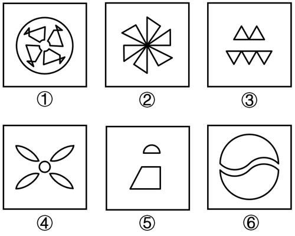

# 数量规律-元素种类数（分组分类）

考点：[[20-考点/判断推理/图形推理/数量规律-元素种类数（分组分类）|图形推理 / 数量规律-元素种类数（分组分类）]]

**问法模型**：六个图形分为两类、每类有各自共同特征 → 分组分类题，元素组成不同且属性规律不通时，转数元素种类/个数作二分标准

## 推理链
1. 第1步：题干为6个独立小图形，元素组成不同，对称、曲直、开闭等属性规律无法将六图二分
2. 第2步：六图均由多个小元素拼合而成（圆圈、三角形、叶片、梯形、半圆等），考虑元素种类或个数的数量规律
3. 第3步：逐图清点元素种类——①为小圆圈与带箭头三角形两类元素组合；②全为同一形状三角形呈扇形排布，仅1种；③全为三角形（上2个正置、下3个倒置），仅1种；④为叶片（花瓣）与中心小圆两类；⑤为梯形与半圆两类；⑥为两个相同的圆内弧线分割图形，仅1种
4. 第4步：按'元素种类数'二分——①④⑤均为2种元素，②③⑥均为1种元素
5. 第5步：与选项对照，①④⑤一组、②③⑥一组，对应A项

**最快解法**：⚡ 元素种类计数法+排除法：快速扫每图由几种小元素构成（只看'种'不看'个'），得①④⑤为2种、②③⑥为1种，直接锁定A

## 易错点
- ⚠ 误数'元素个数'而非'种类数'：①中含4个小圆和4个三角形，个数不同但种类只有2
- ⚠ 把方向/位置不同误当作种类不同：③中正置与倒置三角形方向不同，仍属同一种元素
- ⚠ 把⑤的半圆与梯形误看成一个整体图形，漏数其2种元素的特征

## 母题抽象
> 🧩 当分组分类题各图均由多个小元素拼合、且对称/曲直/开闭等属性规律二分不通时，优先清点'元素种类数'（或个数）作为分组依据

**同类特征**：六个图形分组分类、多元素组合图形、元素组成不同、无明显属性规律、小元素种类可数

## 相关题
- [[10-真题/判断推理/图形推理/4630433 数量规律-笔画数（奇点数与一笔画-多笔画）|4630433]]（新疆 2021，相关度3）
- [[10-真题/判断推理/图形推理/10204454 数量规律-部分数（黑白球连通区域数做和）|10204454]]（甘肃 2024，相关度2）
- [[10-真题/判断推理/图形推理/10297050 数量规律-特殊计数（线条穿过小白球的数量）|10297050]]（天津 2025，相关度2）
- [[10-真题/判断推理/图形推理/10297262 数量规律-面的形状种类（封闭面种类数分组）|10297262]]（浙江 2025，相关度2）
- [[10-真题/判断推理/图形推理/10297314 数量规律-交点数（曲直交点）|10297314]]（浙江 2025，相关度2）

---

### 题干

把下面的六个图形分为两类，使每一类图形都有各自的共同特征或规律，分类正确的一项是：

### 选项
- A. ①④⑤，②③⑥　✅
- B. ①②⑥，③④⑤
- C. ①④⑥，②③⑤
- D. ①②⑤，③④⑥

### 官方解析
本题为分组分类题目。元素组成不同，且无明显属性规律，考虑数量规律。题干图形均由多个小元素组成，考虑元素的种类或个数。观察发现，图①④⑤中元素种类均为2，图②③⑥中元素种类均为1，即图①④⑤为一组，图②③⑥为一组。
故正确答案为A。

### 给定材料
（无）
