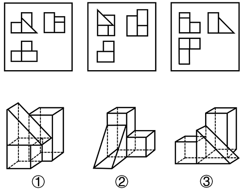

# 三视图——立体图形与主视图-左视图-俯视图的对应匹配

考点：[[20-考点/判断推理/图形推理/三视图——立体图形与主视图-左视图-俯视图的对应匹配|图形推理 / 三视图——立体图形与主视图/左视图/俯视图的对应匹配]]

**问法模型**：给出三组'主/左/俯'三视图与三个立体图形要求排序配对 → 为每个立体找最独特的视图特征（斜线位置、三角形截面、凹凸轮廓）逐一锚定，得对应顺序

## 推理链
1. 第1步：明确视图规则——每组图中左上为主视图（正面看）、右上为左视图（左面看）、左下为俯视图（上面看），立体①②③均为含斜面的棱柱组合体
2. 第2步：提取立体外形特征：①为左侧斜顶三棱柱+右侧四棱柱；②为前侧斜三棱柱+后方高四棱柱+右侧小方块；③为左侧矮四棱柱+斜面+右侧高四棱柱
3. 第3步：主视图锚定——图一左上'左矮矩形+右侧矩形内含斜线'对应③（矮块经斜面接高柱）；图二左上'斜线切割、左低右高'对应①（斜顶三棱柱在左）；图三左上'左侧高块叠放+右侧小方块'对应②（前方斜面与后高柱、右方块的投影）
4. 第4步：左视图验证——图三右上出现'高矩形+带斜边直角三角形'，恰是②从左侧看到的三棱柱三角形截面，锁定图三↔②；图一右上'高矩形+矮方块'对应③；图二右上'矩形+分格方块'对应①
5. 第5步：俯视图复核——图一俯视图呈'凸'字形（斜面矩形投影+两柱顶方块）对应③，图二俯视图为两矩形上下叠放对应①，图三俯视图呈'丁'字形对应②
6. 第6步：三组对应关系为图一↔③、图二↔①、图三↔②，顺序为③①②，对照选项为D

**最快解法**：⚡ 特征视图锚定法（排除法）：图三右上（左视图）是全部视图中唯一出现'直角三角形斜边'的，必对应从左侧看呈三角形截面的立体②；图一左上主视图'左矮块+右侧斜线'唯一对应左矮右高的立体③；剩余图二整组对应立体①；得顺序③①②，选D

## 易错点
- ⚠ 混淆主视图与左视图的观察方向，把左右位置看反而误配（如把图二组误配给②）
- ⚠ 斜面在主/左视图中的投影是'矩形加斜线'或三角形，易把斜线当成独立轮廓棱而配错立体
- ⚠ 只凭某一个视图形状相似就下结论，不用俯视图/左视图复核被遮挡的轮廓与凹凸布局

## 母题抽象
> 🧩 当题干出现'多组三视图与多个立体图形配对/排序'时，先给每个立体找出其最独特的视图（含斜线、三角形截面或凹凸轮廓的那一幅）完成一对一锚定，再用其余两个视图复核遮挡与布局，即可锁定顺序

**同类特征**：三视图与立体图形对应排序、主视图/左视图/俯视图三栏布局、组合体含斜面（斜线投影）、高低错落的棱柱拼接、选项为四个排列顺序

## 相关题
（暂无）

---

### 题干

下面三视图依次与三个几何图形对应，三个几何图形的正确顺序是：

### 选项
- A. ②①③
- B. ②③①
- C. ①③②
- D. ③①②　✅

### 官方解析
本题考查三视图。图一左上方是③的主视图，图一右上方是③的左视图，图一左下方是③的俯视图；图二左上方是①的主视图，图二右上方是①的左视图，图二左下方是①的俯视图；图三左上方是②的主视图，图三右上方是②的左视图，图三左下方是②的俯视图。
故正确答案为D。

### 给定材料
（无）
