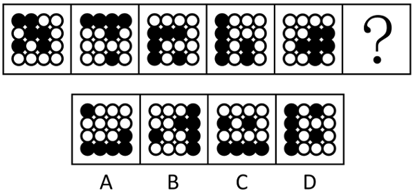

# 属性规律-对称性（黑白球分开看＋对称轴方向顺时针旋转）

考点：[[20-考点/判断推理/图形推理/属性规律-对称性（黑白球分开看＋对称轴方向顺时针旋转）|图形推理 / 属性规律-对称性（黑白球分开看＋对称轴方向顺时针旋转）]]

**问法模型**：元素组成相同但无明显位置规律的黑白球阵列 → 转属性规律：黑白球分开验证轴对称（奇数项看黑球、偶数项看白球），再递推对称轴方向的旋转

## 推理链
1. 第1步：题干5个图形均为4×4黑白球阵列，元素组成相同，但黑球、白球位置无明显平移、旋转或叠加规律，故转向属性规律分析。
2. 第2步：按官方思路将黑白球分开看：图1、图3、图5的黑球部分均为轴对称图形，图2、图4的白球部分均为轴对称图形，呈现'奇数项看黑球、偶数项看白球'的交替规律。
3. 第3步：问号处为图6（偶数项），故其白球部分应为轴对称图形，据此排除A、B两项（白球部分不构成轴对称）。
4. 第4步：继续观察题干已知图形中轴对称部分的对称轴方向，发现其依次顺时针旋转。
5. 第5步：按对称轴顺时针旋转的规律递推，图6中轴对称部分的对称轴方向应为水平。
6. 第6步：C项白球部分为轴对称图形且对称轴呈水平方向，D项虽白球对称但对称轴方向非水平，故只有C项完全符合。

**最快解法**：⚡ 黑白分开＋奇偶项交替法：先用'偶数项白球部分为轴对称'排除A、B；再用'对称轴依次顺时针旋转→问号处对称轴应为水平'对比C、D，锁定C。

## 易错点
- ⚠ 整体混看黑白球找位置或数量规律而卡壳，忽略'黑白球分开看'的分层思路
- ⚠ 忽略奇数项看黑球、偶数项看白球的交替规律，误以为五个图形同一颜色球均对称
- ⚠ 排除A、B后漏比对称轴方向的旋转规律，误选白球对称但对称轴非水平的D项

## 母题抽象
> 🧩 当图形由黑白两种元素构成且整体无位置/数量规律时，将黑白球分开看属性（如对称性），并依次验证奇偶项交替规律与对称轴方向的旋转递变，双重过滤锁定答案。

**同类特征**：黑白球构成的规则阵列、元素组成相同、无明显位置规律、黑白球分开看属性、奇数项黑球对称、偶数项白球对称、对称轴方向顺时针旋转

## 相关题
- [[10-真题/判断推理/图形推理/16069886 数量规律-黑块部分数（连通分堆数）|16069886]]（贵州 2026，相关度2）
- [[10-真题/判断推理/图形推理/19283951 属性规律-对称性（黑球整体轴对称+对称轴经过黑球个数的二级辨析）|19283951]]（国考 2025，相关度2）
- [[10-真题/判断推理/图形推理/2719404 图形推理-一笔画（黑球连线的奇点数与笔画数）|2719404]]（国考 2021，相关度2）
- [[10-真题/判断推理/图形推理/4637321 数量规律-部分数（黑白球连通部分数，两级辨析）|4637321]]（国考 2022，相关度2）
- [[10-真题/判断推理/图形推理/2172768 位置规律（旋转-翻转）|2172768]]（海南 2021，相关度1）

---

### 题干

从所给的四个选项中，选择最合适的一个填入问号处，使之呈现一定规律性。

### 选项
- A. A
- B. B
- C. C　✅
- D. D

### 官方解析

元素组成相同，但无明显位置规律，考虑属性规律。观察发现，题干所有图形均由黑球和白球构成，考虑黑白球分开看，且题干图形的黑球或白球部分较为规整，考虑对称性。图1、图3、图5的黑球部分均为轴对称图形，图2、图4的白球部分均为轴对称图形，故？处图形的白球部分应为轴对称图形，排除A、B两项；继续观察发现，题干已知图形中轴对称部分的对称轴方向依次顺时针旋转，故？处图形中轴对称部分的对称轴方向应为水平，只有C项符合。

故正确答案为C。

### 给定材料
（无）
