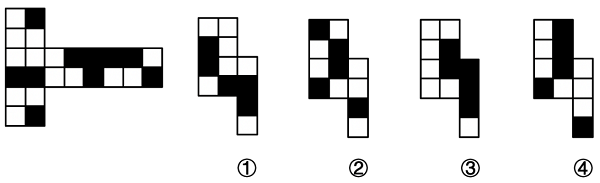
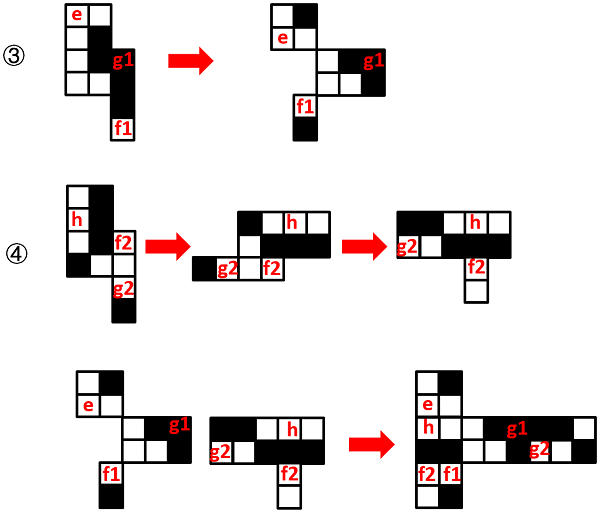

# 空间重构-展开图拆分拼合（黑白图案旋转复原）

考点：[[20-考点/判断推理/图形推理/空间重构-展开图拆分拼合（黑白图案旋转复原）|图形推理 / 空间重构-展开图拆分拼合（黑白图案旋转复原）]]

**问法模型**：'哪两个部分可组合成同样的展开图' → 采用'拆分＋旋转＋拼合复原'模型：允许各部分先旋转、再拆分（面可被切开分属两个部分），拼合后黑白格相对位置须与原图逐格一致

## 推理链
1. 第1步：提取前提——左图为正方体外表面展开图，含黑白相间的方格图案；①②③④为四个组成部分，需两两组合复原原图，且组合时允许旋转与拆分
2. 第2步：所用方法——黑白格数量守恒初筛＋拆分拼合验证：两部分的黑格总数、轮廓须与原图匹配，拼合后每个面的黑白相对位置须一致
3. 第3步：对部分③进行拆分，得到若干子块（其中含拼合面g、面f所需的子块g1、f1）
4. 第4步：将部分④先顺时针旋转，再进行拆分，得到与之互补的子块g2、f2
5. 第5步：拼合验证——g1与g2拼成原展开图中的面g，f1与f2拼成原展开图中的面f，各面黑白格位置及相邻关系与原图完全吻合
6. 第6步：对照选项——③与④可复原原展开图，对应B项；其余组合（①②、①④、②③）无论怎样旋转、拆分，黑白图案均无法与原图逐格对应，排除

**最快解法**：⚡ 拆分拼合法＋黑白格守恒：先比对各部分黑格数量与原图守恒关系锁定③④组合，再将③直接拆分、④顺时针旋转后拆分，验证g1+g2拼成面g、f1+f2拼成面f，黑白位置逐格吻合即选B

## 易错点
- ⚠ 忽略拼合前可旋转：④必须先顺时针旋转再拆分拼合，若按原方向硬拼会误排正确答案B
- ⚠ 误以为每个部分必须由完整面构成：实际上面g、面f被拆分成g1/g2、f1/f2，分属③和④两个部分
- ⚠ 只比对轮廓形状或只数黑格数量，不核对黑白格的相对位置与相邻关系，易误选①④或②③

## 母题抽象
> 🧩 当题干出现'带黑白图案的正方体展开图＋问哪两个部分可拼合复原'时，用'黑白格数量守恒初筛＋旋转拆分拼合验证'，确认拼合后每个面的黑白相对位置与原图一致

**同类特征**：正方体外表面展开图、黑白方格图案、四选二拼合复原、允许旋转与拆分、面可跨部分拼合（g1/g2、f1/f2）

## 相关题
- [[10-真题/判断推理/图形推理/10297111 空间重构-展开图拼合（碎片旋转组合）|10297111]]（天津 2025，相关度1）
- [[10-真题/判断推理/图形推理/12304871 空间重构-六面体折叠（相对面排除+共顶点相邻面）|12304871]]（江苏 2024，相关度1）
- [[10-真题/判断推理/图形推理/15419026 六面体展开图-展开图等同性判定（画边法-时针方向法）|15419026]]（湖北 2025，相关度1）
- [[10-真题/判断推理/图形推理/17097750 空间重构-相对面关系（展开图折纸盒）|17097750]]（山西 2024，相关度1）
- [[10-真题/判断推理/图形推理/19591546 空间重构-六面体折叠（相对面排除＋公共边特征-画边法）|19591546]]（选调 2024，相关度1）

---

### 题干

左图为正方体纸盒的外表面展开图，以下4个部分中，哪两个可以组合成同样正方体的外表面展开图？

### 选项
- A. ①和②
- B. ③和④　✅
- C. ①和④
- D. ②和③

### 官方解析

如下图所示，将部分③进行拆分，将部分④先顺时针旋转并拆分后，再进行拼合，即可得到题干外表面展开图，其中g1和g2拼成了原展开图中的面g，f1和f2拼成了原展开图中的面f。

故正确答案为B。

### 给定材料
（无）
