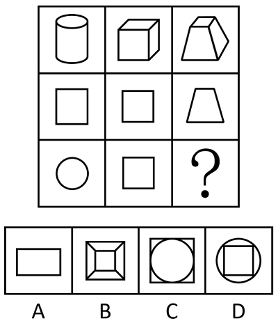

# 三视图（主视图-俯视图）——九宫格纵向列规律

考点：[[20-考点/判断推理/图形推理/三视图（主视图-俯视图）——九宫格纵向列规律|图形推理 / 三视图（主视图/俯视图）——九宫格纵向列规律]]

**问法模型**：九宫格'填入问号使之呈现一定规律性'→ 横向无规律时转纵向按列观察，验证三视图对应规律

## 推理链
1. 第1步：九宫格第三行第三列为问号，横向按行看，圆柱、正方体、四棱台与矩形、正方形、梯形之间无明显数量或位置规律
2. 第2步：改按列纵向观察。第一列图1为圆柱，图2为矩形、图3为圆，恰好分别是圆柱的主视图（正面看为矩形）和俯视图（上面看为圆）
3. 第3步：验证第二列：图1为正方体，图2、图3均为正方形，分别是正方体的主视图和俯视图，规律成立——每列图2、图3依次为图1的主视图和俯视图
4. 第4步：第三列图1为四棱台（上底小、下底大的台体），第二行图3已给出梯形，即从前向后看得到的梯形轮廓，为其主视图
5. 第5步：问号处应为四棱台的俯视图：从上往下看，外轮廓为大正方形（下底），中间为小正方形（上底），四个顶点间可见四条侧棱连线
6. 第6步：对照选项：A为单独矩形，C为正方形内切圆，D为圆内含正方形，均非台体俯视图；B为大小正方形嵌套且四角带棱线，符合四棱台俯视图，故选B

**最快解法**：⚡ 列向三视图法：横看无规律立即纵看，用第一列'圆柱→矩形+圆'锁定'图2主视图、图3俯视图'规律，直接给第三列台体找俯视图——大正方形套小正方形并带四条棱线，秒选B

## 易错点
- ⚠ 只按行横向找对称、面数量等规律，忽略'横不行则纵看'的九宫格解题惯性，误入歧途
- ⚠ 俯视图漏画可见的四条侧棱，误选仅有一个嵌套正方形而无棱线的图形
- ⚠ 混淆主视图与俯视图：把第二行已有的梯形误当俯视图答案，或把台体误当柱体导致视图判断错误

## 母题抽象
> 🧩 当九宫格横向无规律且每列图1为立体图、图2/图3为平面图时，用'三视图'规律：图2为主视图、图3为俯视图，问号处按该列立体图的俯视图验证选项

**同类特征**：九宫格、第一行为立体图形（圆柱、正方体、四棱台）、第二三行为平面图形（矩形、圆、正方形、梯形）、第三行第三列为问号、横向无规律、主视图/俯视图对应

## 相关题
- [[10-真题/判断推理/图形推理/2725452 样式规律-去同求异（黑白圆叠加，白圆被黑圆遮挡）|2725452]]（四川 2020，相关度2）
- [[10-真题/判断推理/图形推理/10204610 样式规律-加减同异（去同存异），九宫格列规律|10204610]]（辽宁 2024，相关度1）
- [[10-真题/判断推理/图形推理/10297349 样式规律-黑白运算|10297349]]（浙江 2025，相关度1）
- [[10-真题/判断推理/图形推理/10297407 样式规律-黑白运算（定义叠加）|10297407]]（四川 2025，相关度1）
- [[10-真题/判断推理/图形推理/10975255 数量规律-元素个数与部分数（黑白球连通堆数）|10975255]]（江苏 2024，相关度1）

---

### 题干

从所给的四个选项中，选择最合适的一个填入问号处，使之呈现一定的规律性：

### 选项
- A. A
- B. B　✅
- C. C
- D. D

### 官方解析
本题考查三视图。九宫格横向看无规律，考虑纵向看。观察发现，第一列的图2和图3依次是图1的主视图和俯视图；经验证，第二列满足此规律；第三列应用规律，故？处应选择图1的俯视图，只有B项符合。
故正确答案为B。

### 给定材料
（无）
