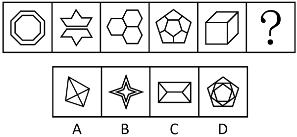

# 数量规律-多边形元素边数递减（等差数列）

考点：[[20-考点/判断推理/图形推理/数量规律-多边形元素边数递减（等差数列）|图形推理 / 数量规律-多边形元素边数递减（等差数列）]]

**问法模型**：'填入问号处使之呈现规律性'且各图元素组成不同、无属性规律 → 数每幅图中相同多边形元素的边数，验证边数构成递减等差数列

## 推理链
1. 第1步：题干五幅图均由多个形状相同的多边形元素拼合而成：图1为两个嵌套的八边形，图2为星状图形由七边形构成，图3为三个六边形，图4为五边形组合，图5为立方体造型的四边形
2. 第2步：归纳规律——每幅图相同多边形元素的边数依次为8、7、6、5、4，构成公差为-1的等差递减数列
3. 第3步：按此规律，问号处图形应由边数为3的三角形元素构成
4. 第4步：逐项对照——A项四边形被两条对角线分割，所有元素均为三角形；B项为四角星形（凹多边形，边数非3）；C项内部为矩形、梯形（四边形）；D项含五边形与六边形
5. 第5步：仅A项全部由三角形构成，与'边数递减至3'的规律吻合，故选A

**最快解法**：⚡ 数边递减法：快速数每幅图相同多边形元素的边数得8→7→6→5→4，锁定'问号处为全三角形构成'，A项外框虽为四边形但内部被对角线分割成三角形，直接排除B、C、D

## 易错点
- ⚠ 只数图形外框的边数或总线条数，漏掉'每幅图由同种多边形元素构成'这一核心特征
- ⚠ A项外框是四边形，误把A当成'四边形元素'而排除，忽略内部对角线已将其分割为三角形
- ⚠ B项星形为凹多边形，边数易数错而误认为符合递减规律

## 母题抽象
> 🧩 当题干各图均由同种多边形拼合而成且属性无规律时，数多边形元素的边数，若构成递增/递减等差数列，则问号处选符合下一项边数的多边形构成的图形

**同类特征**：每幅图由多个相同多边形构成、元素边数依次递减1、八边形-七边形-六边形-五边形-四边形、元素组成不同且无属性规律、问号处应为三角形元素

## 相关题
- [[10-真题/判断推理/图形推理/10204622 图形推理-数量规律-笔画数（一笔画判定）|10204622]]（辽宁 2024，相关度1）
- [[10-真题/判断推理/图形推理/11367773 数量规律-一笔画（奇点数）+面的形状（三角形面个数）双规律|11367773]]（江苏 2025，相关度1）
- [[10-真题/判断推理/图形推理/12019817 数量规律-面的细化（面的形状：所有面均为四边形）|12019817]]（浙江 2026，相关度1）
- [[10-真题/判断推理/图形推理/13504266 数量规律-交点数（曲直交点数量+交点形态交替规律）|13504266]]（云南 2025，相关度1）
- [[10-真题/判断推理/图形推理/16070127 数量规律-面数量+面的分级对称性（最大面-中间面-最小面的轴对称遍历）|16070127]]（河南 2026，相关度1）

---

### 题干

从所给的四个选项中，选择最合适的一个填入问号处，使之呈现一定的规律性：

### 选项
- A. A　✅
- B. B
- C. C
- D. D

### 官方解析
元素组成不同，且无明显属性规律，考虑数量规律。题干图形均由边数相同的多边形元素构成，观察发现，每幅图中这些相同的多边形元素依次仅为八边形、七边形、六边形、五边形、四边形、？，因此构成问号处图形的多边形元素应仅为三角形，只有A项符合。
故正确答案为A。

### 给定材料
（无）
