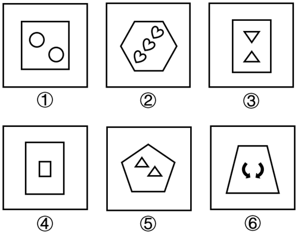

# 图形推理-数量规律（外框边数与内部元素个数作差恒定分组）

考点：[[20-考点/判断推理/图形推理/图形推理-数量规律（外框边数与内部元素个数作差恒定分组）|图形推理 / 图形推理-数量规律（外框边数与内部元素个数作差恒定分组）]]

**问法模型**：“把六个图形分为两类，使每一类都有各自共同特征”的分组分类问法 → 逐图提取可量化特征（外框边数、内部元素个数），寻找统一运算规律按常数差值分成3+3两组

## 推理链
1. 第1步：六个图形元素组成不同，对称、曲直、封闭等属性规律不明显，且每图均为'外框多边形+框内小元素'的结构（如①方框内2个圆、②六边形内3个心形），优先考虑数量规律
2. 第2步：数外框边数：①正方形4边、②六边形6边、③长方形4边、④长方形4边、⑤五边形5边、⑥梯形4边；再数内部元素个数：①2个圆、②3个心形、③2个三角形、④1个小矩形、⑤2个三角形、⑥2个弯曲箭头
3. 第3步：单看边数（4/6/4/4/5/4）或单看元素个数（2/3/2/1/2/2）都无法分成3+3两组，考虑两量之间的运算
4. 第4步：作'外框边数-内部元素数'：①4-2=2、③4-2=2、⑥4-2=2，差值恒为2，归为一组
5. 第5步：②6-3=3、④4-1=3、⑤5-2=3，差值恒为3，归为另一组
6. 第6步：即①③⑥一组、②④⑤一组，与选项C吻合

**最快解法**：⚡ 数量运算口诀法：见'多边形外框+框内小元素'结构即数边数与元素个数并作差——六图差值依次为2、3、2、3、3、2，差2的①③⑥一组、差3的②④⑤一组，锁定C

## 易错点
- ⚠ 只数外框边数或只数内部元素个数，发现单看无规律就放弃数量思路，忽略'两量作差为常数'这一分组维度
- ⚠ 图②六边形易数错边数（或受心形弧线干扰），图③两个三角形方向不同、图⑥为弯曲箭头，易被带偏去比较元素形状/方向而非数量运算
- ⚠ 把图④框内的小矩形误当作'也是矩形外框'而联想到套叠结构（面数/嵌套规律），偏离边数与元素数的差值规律

## 母题抽象
> 🧩 当分组分类题干出现'多边形外框+框内若干小元素'的统一结构且属性规律不通时，数外框边数与内部元素个数，验证'边数-元素数（或两量和、比）是否为常数'，按常数不同分成两类

**同类特征**：外框均为多边形、框内含小元素（圆/心形/三角形/箭头等）、元素组成不同且无明显属性规律、3+3分组分类问法、外框边数-内部元素个数为常数、单看一个数量无规律需两量运算

## 相关题
- [[10-真题/判断推理/图形推理/13504592 数量规律-笔画数（一笔画与多笔画）；属性规律-曲直性（双规律均可分组）|13504592]]（辽宁 2025，相关度1）
- [[10-真题/判断推理/图形推理/14403688 位置规律-旋转（分组分类）|14403688]]（山东 2025，相关度1）
- [[10-真题/判断推理/图形推理/16070043 数量规律-灰色多边形边数与白色面数量的差值运算分组|16070043]]（贵州 2026，相关度1）
- [[10-真题/判断推理/图形推理/16070177 数量规律-部分数（黑白块分堆-同色连通区域数）|16070177]]（重庆 2026，相关度1）
- [[10-真题/判断推理/图形推理/2172148 图形推理-图形间关系（两三角形线重合-点重合）|2172148]]（广州市考 2018，相关度1）

---

### 题干

把下面的六个图形分为两类，使每一类图形都有各自的共同特征或规律，分类正确的一项是：

### 选项
- A. ①⑤⑥，②③④
- B. ①②⑥，③④⑤
- C. ①③⑥，②④⑤　✅
- D. ①③④，②⑤⑥

### 官方解析
本题为分组分类题目。元素组成不同，且无明显属性规律，优先考虑数量规律。观察发现，题干图形外框均为多边形，考虑数线，外框边数分别为4、6、4、4、5、4；继续观察发现，题干图形框内均由小元素组成，考虑数素，内部元素数量分别为2、3、2、1、2、2；单看均无规律，考虑运算发现，图①③⑥中，外框边数-内部元素数=2，图②④⑤中，外框边数-内部元素数=3，即图①③⑥为一组，图②④⑤为一组。
故正确答案为C。

### 给定材料
（无）
