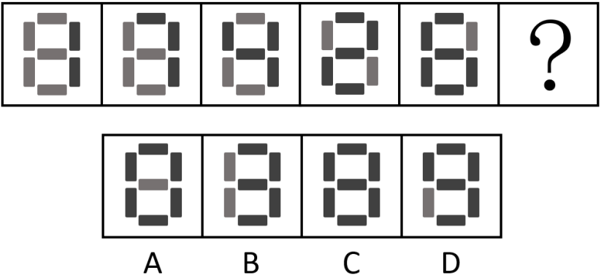

# 数量规律-元素个数（黑-灰矩形数量等差递增）

考点：[[20-考点/判断推理/图形推理/数量规律-元素个数（黑-灰矩形数量等差递增）|图形推理 / 数量规律-元素个数（黑/灰矩形数量等差递增）]]

**问法模型**：问号处填入使图形呈现规律性 → 元素组成不同且无属性规律时，按'先属性后数量'思路转数量规律，优先数元素种类与个数

## 推理链
1. 第1步：题干五幅图均由灰色矩形和黑色矩形拼成数码管'8'字轮廓，每图共7个小矩形段，元素组成相同但颜色分布不同
2. 第2步：整体轮廓一致、颜色分布杂乱，对称/封闭等属性规律不明显，按解析优先考虑数量规律中元素的种类和个数
3. 第3步：只数黑色矩形数量：图1为2个，图2为3个，图3为4个，图4为5个，图5为6个，构成公差为1的等差递增数列（对应灰色矩形5、4、3、2、1递减）
4. 第4步：依等差规律，问号处黑色矩形应为7个，即7段全部为黑色、灰色矩形0个
5. 第5步：逐项对照：A项中间横段为灰色（黑6灰1），B项左上竖段为灰色（黑6灰1），C项7段全黑（黑7灰0），D项左下竖段为灰色（黑6灰1）
6. 第6步：只有C项黑色矩形数量为7，符合规律，故选C

**最快解法**：⚡ 元素计数法+排除法：只需数每图黑块个数2→3→4→5→6，锁定问号处需7个黑块；快速扫选项，凡含灰色块的A、B、D一并排除，直接选C

## 易错点
- ⚠ 被五图相同的'8'字轮廓误导，误往位置规律（旋转/平移）或样式规律（黑白叠加）方向思考
- ⚠ 混淆数黑色与灰色：灰色数量5、4、3、2、1递减同样成立，需确认递减延续到0也能对应同一选项，避免犹豫
- ⚠ A、B、D三个干扰项均只含1个灰色块且位置各异（中/上/下），若不逐项精查易误选外形最接近的干扰项

## 母题抽象
> 🧩 当多幅图由两类（如黑/灰）小元素拼成相同轮廓时，分别数两类元素的个数，若呈等差递增/递减，问号处选延续该数列的选项

**同类特征**：黑灰两色矩形拼成数码管'8'轮廓、每图7个小矩形段、元素组成不同、无属性规律、黑色矩形数量2/3/4/5/6等差递增、灰色矩形数量同步递减、问号处求延续规律项

## 相关题
- [[10-真题/判断推理/图形推理/12561867 数量规律-相同元素的位置关系（对角相对-边邻相邻）分组分类|12561867]]（浙江 2024，相关度1）
- [[10-真题/判断推理/图形推理/15419022 数量规律-图形间关系（面相贴-被完全隔开，内部线条部分数）|15419022]]（湖北 2025，相关度1）
- [[10-真题/判断推理/图形推理/16069776 数量规律-面数量（总面数恒定+全直线面数量递减二级规律）|16069776]]（广西 2026，相关度1）
- [[10-真题/判断推理/图形推理/1789602 数量规律-波峰波谷个数差+位置规律（最高波峰与竖轴左右关系）|1789602]]（江苏 2016，相关度1）
- [[10-真题/判断推理/图形推理/18643877 数量规律-切点数（线圆接触关系：相切-相交-相离）|18643877]]（四川 2026，相关度1）

---

### 题干

从所给四个选项中，选择最合适的一个填入问号处，使之呈现一定规律性（    ）。

### 选项
- A. A
- B. B
- C. C　✅
- D. D

### 官方解析
元素组成不同，且无明显属性规律，考虑数量规律。观察发现，题干图形均由灰色矩形和黑色矩形构成，优先考虑元素的种类和个数。题干图形中黑色矩形的数量依次为2、3、4、5、6，故“？”处图形黑色矩形的数量应为7，只有C项符合。
故正确答案为C。

### 给定材料
（无）
